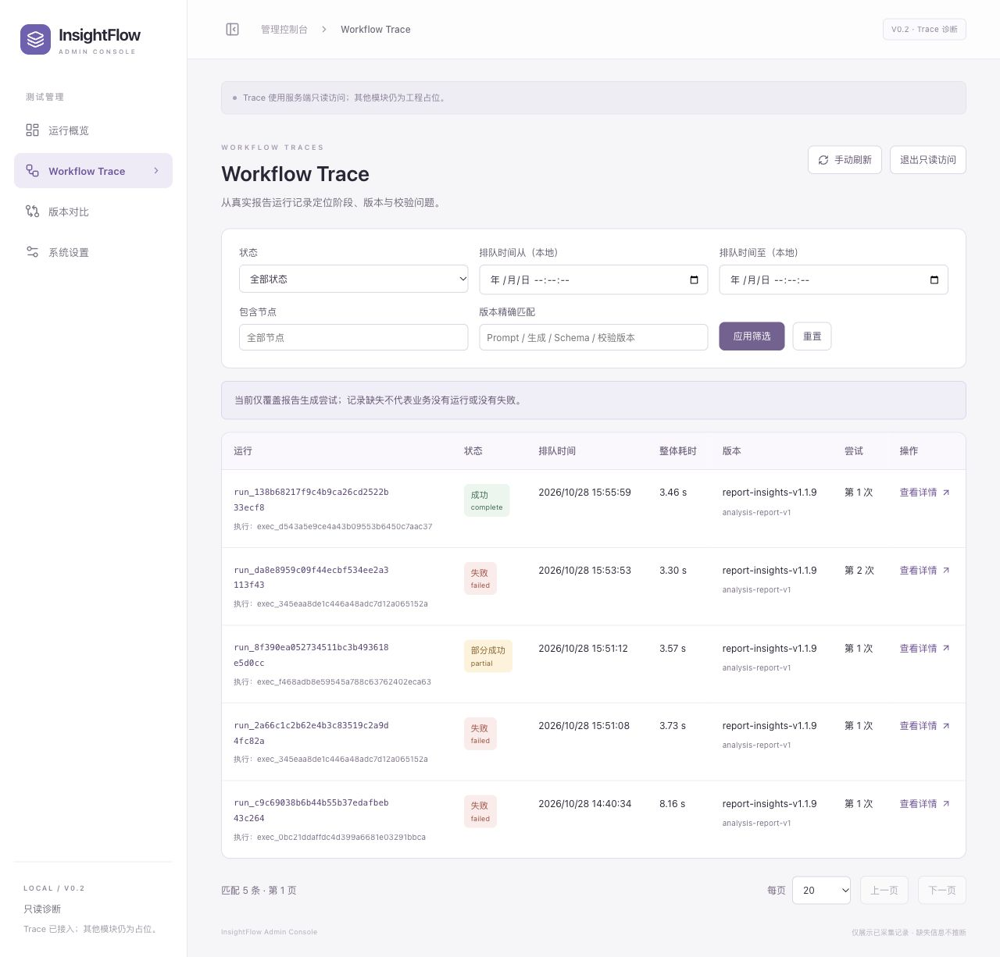
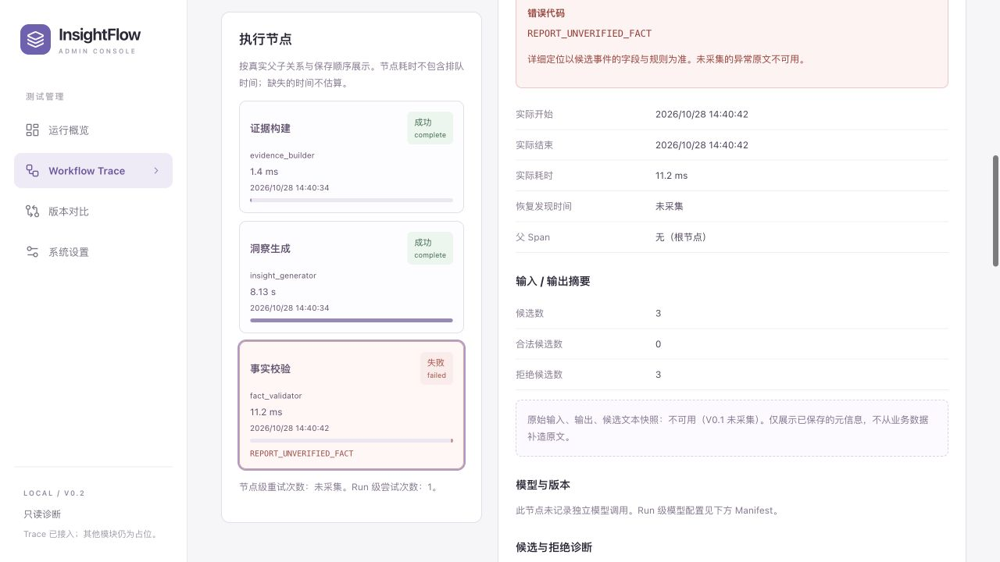

# InsightFlow Admin Trace V0.2

需求 REQ-0045。本轮把 V0.1 追踪记录接入管理前端，未新增 Run 表、数据库或分析节点，未修改业务决策规则。

## 入口与使用

访问 http://127.0.0.1:5174/traces。点击运行进入 `/traces/:runId`，点击节点查看 Inspector。

列表支持状态、排队时间起止、实际 Span 名称及版本精确匹配；版本匹配 Prompt、生成策略、报告 Schema、Validator、Registry 中任一版本。筛选由后端执行，匹配总数和分页在同一数据库读快照内返回。筛选与页码保存在 URL，节点选择使用 `?span=...`，刷新后重新加载。

时间输入为浏览器本地时间，提交转换为含时区 ISO 时间；后端要求时区且拒绝倒置范围。时间边界均包含，依据 Run 的 queued_at，不冒充节点开始时间筛选。分页、加载、真实空结果、无权限、请求失败与 404 分别展示；没有演示数据或失败兜底记录。支持手动刷新，没有轮询或自动修复。

详情展示 Run 状态、时间、实际耗时、错误、版本和重试链接。Span 按已保存父子关系展示；缺失父节点或循环关系显示提示。只有同时有已采集起点与耗时才画相对时间条，不补估缺失时间。

Inspector 展示当前 Span 的受控摘要、事件分页、候选 index、证据 ID、字段位置、规则 ID 和解释，以及关联 Manifest。事实校验会默认优先选中失败节点。规则说明只解释命中类别，不声称每次拒绝都经过人工语义确认。

## 权限与环境

复用服务端 `INSIGHTFLOW_ADMIN_READ_TOKEN` 与现有 `X-Admin-Token`。原 API 调用方式完全兼容。新增：

- `POST /api/v1/admin/access`：管理员输入现有只读凭证，以请求头交换 8 小时签名 Cookie；不把原始凭证写入 Cookie。
- `DELETE /api/v1/admin/access`：清除 Cookie，要求 `X-Admin-Request: 1`，防止普通跨站表单触发。
- `/admin/access` 为同一实现的别名。以上仅处理访问凭证，不修改 Trace 或业务数据。

Cookie 为 HttpOnly、SameSite=Strict，HTTPS 时 Secure。原始凭证只在输入期间短暂驻留内存，验证后清空；不写入 URL、localStorage、sessionStorage、VITE_ 环境变量、构建包或日志。服务端未配置为 503，无权限为 403。Cookie 篡改、到期或服务端凭证轮换均拒绝访问。退出清除本浏览器 Cookie；这不是多账户会话撤销系统。

Admin 默认 `/api/v1/admin`，通过 Vite 同源代理到 `http://127.0.0.1:8000`。正式使用时两者需要指向**同一个数据目录的服务**；没有把其他数据库的 Trace 自动合并或复制。跨域部署应使用同源反向代理，当前 Cookie 方案不提供跨站凭证共享。

```sh
cd /Users/lainey/Desktop/vibe-coding/insightflow/admin
npm ci
npm run dev
```

后端沿用原启动方式，提前把本地环境变量导入服务进程。Admin 页面输入服务端配置的管理员只读凭证。应用不会自动读取后端 `.env`，不要把模型 API Key 当作 Admin 凭证。

当前为方便测试，本地 8000 验收后端连接 `var/workflow-trace-v01-verification-02`，5174 页面展示该库的真实报告运行记录；数据是明确标注的合成验收数据，非用户生产业务数据。验收进程使用独立临时只读凭证，未修改用户 `.env`。本浏览器已经完成只读访问；进程退出后，按正式配置启动自己的数据目录与凭证。

## 实际修改文件

| 文件 | 内容 |
| --- | --- |
| `backend/app/api/admin.py` | 可选筛选参数、签名 Cookie 访问交换、只读接口禁缓存 |
| `backend/app/storage/trace_repository.py` | 数据库端组合筛选及分页快照；原调用兼容 |
| `backend/tests/test_trace_explorer.py` | 8 项后端筛选与权限测试（含参数化） |
| `backend/scripts/verify_trace_explorer.py` | 合成数据经真实 ReportWorkflow 的显式验收工具；不直接插入 Trace |
| `admin/src/types/traces.ts`、`api/traces.ts` | 复用 V0.1 契约与受控请求、基础响应检查 |
| `admin/src/pages/TracesPage.tsx`、`TraceDetailPage.tsx` | Run Explorer、详情、URL 恢复和请求取消 |
| `admin/src/features/traces/*` | 权限输入、状态/版本展示、Span 层级、Node Inspector、事件与候选诊断 |
| `admin/src/app/routes.tsx`、`layouts/AdminLayout.tsx`、`auth/AccessBoundary.tsx` | 详情路由、导航和只读访问提示；前端壳不冒充服务端授权 |
| `admin/src/pages/SettingsPage.tsx`、`styles.css` | V0.2 说明与页面样式 |
| `admin/src/api/client.ts` | 更新实际权限传输说明，保留统一错误处理 |
| `admin/src/tests/routes.test.tsx`、`traces.test.tsx`、`trace-service.test.ts` | 路由、页面、服务与安全边界验证 |
| `admin/package.json`、`package-lock.json`、`README.md` | 版本 0.2.0、当前使用说明，无依赖升级 |
| 根 README、本文及验收/版本记录 | 追加导航、审计与证据 |

TraceRun、TraceSpan、TraceEvent、RunManifest 模型及观测写入实现未改。Planner、Validator、HITL、Engine、Report 业务源码和原 frontend 源码均未改。旧档案和数据库记录保留。

## 真实运行验收

没有为展示成功/失败而 seed、复制或修改 Trace 行。沿用 V0.1 原失败 Run，新增记录均经实际批准、确定性 Engine、ReportWorkflow、真实 qwen3.8-flash 调用与原 Fact Validator 后生成。上游 Intent/Planner 使用明确标注的受控验收输入；这些案例不冒称全链路真实 LLM 质量评测。

| Run | 结果 | 说明 |
| --- | --- | --- |
| `run_c9c69038b6b44b55b37edafbeb43c264` | failed | V0.1 留存销售样本，3 候选全部拒绝，可定位 implication 及规则 |
| `run_2a66c1c2b62e4b3c83519c2a9d4fc82a` | failed | 新增销售记录数案例，模型返回后被现有校验拒绝 |
| `run_da8e8959c09f44ecbf534ee2a3113f43` | failed | 对上一案例显式重试一次，attempt=2，retry_of 指向原 Run，失败仍保留 |
| `run_8f390ea052734511bc3b493618e5d0cc` | partial | 主任务真实计算记录数为 6；辅助任务缺字段被 Validator 阻断并由 Engine 跳过；报告明确部分成功 |
| `run_138b68217f9c4b9ca26cd2522b33ecf8` | complete | 独立的单列记录编号 CSV，记录数真实为 6，五个报告阶段均完成 |

共展示 5 个 Run：1 complete、1 partial、3 failed；其中本轮新增真实报告模型调用 4 次。没有根据这些不同输入计算模型成功率，也没有为了成功案例修改 Prompt、删掉失败候选或放宽校验。

通过只读 API 与 SQLite 逐项核对：5 个 Run、19 个 Span、60 个 Span Event 完全一致，未授权接口为 403。见 [核对结果](audits/workflow-trace-v0.2/database-api-check.json)。API 只返回当前配置库，不把验证库自动并入默认 var 数据库。

## 自动化与浏览器结果

- backend 全量：**704 项通过**（原 696 + 新增 8），1 条原有 Starlette 弃用警告。
- Admin：**31 项通过**，TypeScript 与构建通过；无新增依赖。
- 原 frontend：构建通过，源码未变。
- 新增覆盖：数据库组合筛选与分页、时区和无效范围、Cookie 交换/篡改/过期/退出/轮换/HTTPS、partial、失败定位、URL 恢复、缺失 Manifest、孤儿/循环 Span、事件翻页、未知敏感字段不渲染、请求取消和响应错误。

浏览器实际验证：登录前拒绝、合法只读访问、刷新保持访问；成功 Run 五阶段、失败默认选中 Fact Validator、部分成功独立标识；重试链接、分页、版本空结果、退出后拒绝。状态/节点/版本/时间组合过滤通过 URL 直接访问及刷新核对，返回原 V0.1 的一条匹配记录。浏览器工具不支持原生日期输入的 fill 操作，日期表单转换与倒置范围由组件测试补充，不伪称已通过工具点击完成该日期操作。

最终浏览器 warn/error 日志为空。早期测试失败日志也保留：Secure Cookie 断言误要求结尾分号、组件测试模拟函数未清理，以及原生选择器定位问题均已修正，没有修改业务或权限条件来通过测试。





## 未采集信息与剩余问题

1. 原始输入/输出、候选正文与受控内容快照未采集，页面明确不可用。仅有字节数、ID、计数、规则和字段位置，无法复原具体原句。
2. 节点级重试次数、模型服务请求 ID、token usage、未显式配置的采样参数不可用；Run 尝试与重试关系可查。
3. 当前仅 ReportWorkflow 有内部 Span。上游部分失败明细尚未纳入 Trace；不能因为报告阶段成功就认定业务全部成功。
4. 追踪是 best-effort；整个 Run 未写入时不能从空列表判断无业务运行。页面披露 incomplete/collector_degraded，保留 V0.1 故障边界。
5. 版本筛选只支持明确列出的版本键，节点按真实名称精确筛选；没有版本评测、Prompt 编辑、自动修复或多用户权限管理。
6. 事件按需分页、仅手动刷新。后台与观测恢复仍为既有单进程部署边界，未声称支持分布式恢复。

历史版本未删除：需求 REQ-0045 与 V0.2 源码快照/清单追加到档案；V0.1 需求、源码和失败记录继续保留。
