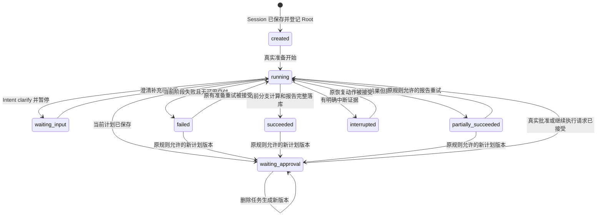

# InsightFlow Lifecycle V1.0：状态机与节点契约（待评审）

任务书 REQ-0059；本次档案 REQ-0063。只读设计，不是已经上线的数据契约。实际行为与证据见 [审计](REQ-0059-lifecycle-audit.md)。

## 1. 分开三种状态

| 层 | 来源 | 允许表达 | 禁止替代 |
|---|---|---|---|
| 业务 lifecycle | 一致版本的 Session、计划/审批、Execution、ReportGeneration、AnalysisReport | created/running/waiting_input/waiting_approval/succeeded/partially_succeeded/failed/interrupted；资料不足时结果不可判定 | 不直接等于 Session.status；不由 Span 是否全绿决定业务成功 |
| 观测 collection | 真实 Run/Span/Event/Call、capture_scope、缺口及采集错误 | collected/incomplete/not_collected/unavailable，另附投影是否过期 | Trace 写失败不把真实计算标为 failed；observed 不代表完整生命周期已覆盖 |
| UI display | 前两层、流程定义、所选分支与 Attempt | pending/running/succeeded/partial/failed/skipped/interrupted/waiting_input/waiting_approval/not_collected/unavailable | 未采集不等于 pending；下游成功不能反推所有上游节点成功 |

资料不足的 null/unknown 是查询/展示结果，不新增一个虚构的业务终态，也不默认 failed。现有业务枚举不改。

语义映射复用 TraceRun.status：created→queued，succeeded→complete，partially_succeeded→partial，其余同名。Root 仓储当前禁止 complete/partial，阶段 1 需评审后增量放开及约束；不是本轮直接修改。

## 2. 节点契约 A：真实触发、输入与业务结果

下列 success_condition 描述调用完成，不能单独推导完整目标完成。输入沿用现有类型，不新建相似模型。

| node_id | trigger | input | success_condition | business_outcome | failure_condition |
|---|---|---|---|---|---|
| data_profiler | prepare_real 到 PROFILING 并调用 DataProfilerNode.run | ProfileInput(FileInfo,ProfileOptions) / NodeInput | 真文件解析、画像验证和保存完成 | DatasetProfile，质量提示保留 | 文件/表头/格式/版本/保存异常 |
| intent_parser | PARSING_INTENT 调用 IntentParserNode.run | IntentInput(user_query,profile,clarification_answers) | IntentArtifact 结构和后置规则通过；允许 input_guard | proceed 或 clarify；无输入可 clarify 且 0 Call | 调用、超时、协议/JSON/Schema/grounding 等错误 |
| analysis_planner | 意图 proceed 且实际调用 Planner | PlannerV1Input(IntentArtifact,DatasetProfile)，Registry | 草案解析并经真实 Validator 返回 | ValidatedAnalysisPlan；可含 F0/partial/blocked | 调用/JSON/Schema/输入等错误；不把 F0 当运行失败 |
| plan_validator | 每个真实校验调用点，显式 role | 原 AnalysisPlan/DatasetProfile/Registry | 确定性校验返回 | F0/F1/F2、覆盖和不可满足要求 | 执行抛异常；普通 INVALID_SCHEMA/F0 返回仍为正常校验结果 |
| hitl_approval | 用户实际修订/审批请求、事务结束 | RevisionRequest / ApprovalRequest、保存的 PlanVersion | 操作提交完成；等待本身没有计算 Span | revised/accepted/rejected/conflict/replayed；仅 accepted 有真实 Approval | 非预期处理/存储异常；业务拒绝单独记录，不染红计算节点 |
| analysis_engine | 新执行 request 成功 claim，而非 replay | ExecutionRequest、服务端批准快照、指定版本文件 | 任务结果/ExecutionResult 已保存 | success/partial_success/failed；skipped 依真实资格/中断原因 | 任务失败在 ExecutedTask；全失败或编排/持久化异常另记录；前置拒绝不是已执行 |
| evidence_builder | Report 服务实际调用 build | 真完整 ExecutionResult、profile、descriptions | 返回经过绑定的证据集合（可为空） | 有证据/无证据 | 输入不一致或证据构建执行异常 |
| chart_builder | 实际调用 VisualizationBuilder.build | execution/descriptions/evidence/tasks/intent | ChartSpec 列表返回，表格回退合法 | charts_available/empty | 真实图表构建异常 |
| insight_generator | 有证据且实际请求 Provider；或真实无证据分支 | 受控证据、动态 Schema、批准范围、原目标 | 模型返回且 Draft 解析通过；不包含 Fact 验收 | candidates_returned；无证据分支 skipped | 调用/超时/协议/JSON/Schema 错误 |
| fact_validator | 实际调用 materialize_candidates；或无证据分支 | Draft、已选择 Evidence、真实结果表、tasks | 核心任务都有合法候选；允许非核心/重复等候选被拒 | all_accepted/partially_accepted；真实无证据 skipped | 全部拒绝、缺核心任务合法洞察或执行异常会抛错 |
| report_assembler | 实际组装 AnalysisReport | 合法证据/洞察、图表、失败任务、质量限制 | 组装模型通过公开 Schema | complete/partial/unavailable 与独立 goal_coverage | 模型构造/组装异常 |
| report_persistence | ReportWorkflow 调用 reports.finish | AnalysisReport + audit + execution_id/attempt | 事务确实提交且保存的是本 attempt | saved；若 stale no-op 应标未提交，不能宣称新报告保存成功 | 保存/事务异常；不能根据 report 对象已在内存中就 complete |

report_persistence 当前 stale attempt 会静默 no-op（ReportRepository.finish），后续仅通过返回“是否实际提交”的最小兼容观测结果核对，不改变其幂等规则。pending 永远不创建 Span。

## 3. 节点契约 B：重试、恢复、边界与关联

| node_id | retry_policy | resume_policy | trace_boundary（现状→设计） | related_records |
|---|---|---|---|---|
| data_profiler | 准备失败且 retryable 时走原检查点规则 | 无画像才重做 | 已有 observed_node，保留 | Session、NodeRun、DatasetProfile、Root |
| intent_parser | 原有限内部结构重试；人工重试/澄清另建 Span | 从保存画像和澄清答复重跑；旧 Artifact 保留 | 已有主 Span；Call 为所属 Span 的尝试 | IntentHistory、parse_id、Call、RequestSnapshot |
| analysis_planner | 原有限输出重试，不引入 Validator 自动修复 | 已有 proceed 意图可从 PLANNING 恢复 | 已有主 Span，内部重试共用 | planner_result、operation_id、Call retry 链 |
| plan_validator | 不自行重试；随真实调用重做 | 初始保存失败可利用 planner_result 检查点 | 已有两处→补齐审阅/修订/审批/执行/报告 role；独立接口不造 Root | PlanVersion、validation_version、role、实际父 Span |
| hitl_approval | 原 approval_request_id 幂等；不新增“用户拒绝”API | 跨请求取原 Root，等待/重启不自动批准 | 事务前后短 action 边界/Events；无长期 waiting Span | plan_id/version、真实 approval_id、Session revision、限制确认 |
| analysis_engine | 同 request_id 原结果重放，不新建执行 Span；不自动重跑失败任务 | 原恢复保存已完成任务、未完成 skipped；不改变执行算法 | 缺失→claim 后主 Span；实际 preflight/loader/Validator 做单独诊断，Runner/保存子记录 | Execution/approval_id、Task/Step 日志、完整结果引用 |
| evidence_builder | 只随原报告 failed attempt 重试 | 读取同 Execution/批准快照，不重新计算 Engine | 已有 Report Run Span，保留 | Evidence ID/data_ref/结果字段、Report Run |
| chart_builder | 随报告允许的重试 | 同已保存执行数据 | 缺失→紧包现有 build，不移动顺序 | ChartSpec、result_id、Report attempt |
| insight_generator | 现有单次调用；失败随报告新 attempt | 新 Report Run/新 Call，旧失败保留 | 保留现有 Span/无证据 skipped；不加模型节点 | 模板/最终请求、Evidence ID、Call/operation |
| fact_validator | 不增加 LLM 修订循环 | 每次报告实际调用独立记录 | 保留；拒绝统计与规则 ID 不变 | candidates、accepted/rejected、rule_ids |
| report_assembler | 随已有报告重试 | 以本次合法输出重组装 | 保留 | AnalysisReport 草案、report_status/goal_coverage |
| report_persistence | 保持旧 attempt CAS 与唯一报告 ID | 只保存当前尝试，旧报告不覆盖 | 保留并核对实际提交；失配写诊断 | ReportGeneration(execution_id,attempt)、analysis_reports |

节点耗时只来自实际执行边界；HITL wait_started/wait_ended 单独计算业务等待。Engine 业务记录中的恢复墙钟耗时不冒充 Trace 实测 duration。崩溃只知道 recovered_at 时，Trace finished_at/duration=null；明确捕获取消则可记录实际观测结束。

## 4. Workflow 聚合输入与版本选择

定义纯只读聚合器，输入为同一 Session 的数据库快照，不调用 Node、Validator、Planner 或 Report；不触发审批/清洗/计算。

1. 读取 Session revision、workflow_kind 和当前 dataset_ref/current PlanVersion。独立导入/旧 Mock 不能升级成真实 Workflow。
2. 以当前 plan_id+plan_version+dataset_version 及真实 Approval 选择分支；修改计划后的旧执行/旧报告只能显示在历史，不能“完成”新计划。
3. 当前执行依据服务端已接受的 claim、Session.engine_execution_ids 顺序与保存的 approval/plan/version 绑定。结果记录不足或绑定冲突时返回 unknown/inconsistent；不靠相似目标或最大时间戳猜测。
4. 报告依据当前 execution_id 的最新 **已接受** attempt，不取“最近一次成功”掩盖后续失败。历史 attempt 单独展示。其报告须核对 execution/plan/dataset 对应。
5. Trace 只补充实际活动/中断观测和完整性，不能生成缺失业务结果或推翻已提交结果。三库不是同一事务，输出各自来源 revision/时间与 inconsistent 标记。
6. 无法读取业务快照时保留未知，不用陈旧 Root.status 冒充实时；API 网络失败也不推导业务 failed。

阶段 1 提议 Root 状态为该聚合结果的可重建缓存；Session/Approval/Execution/Report 仍是唯一业务事实。缓存失效或写入失败时，Admin 只读查询可以返回业务投影和 collection=incomplete，不回填 Span。

## 5. 状态判定表（按当前分支、活动工作优先）

| 已验证事实/条件 | workflow lifecycle | 附加信息 |
|---|---|---|
| Session 新建且尚未进入实际处理 | created | queued 不等于已执行 Profiler |
| 正在真实准备/已批准待执行/执行 running/Report queued 或 generating | running | activity 指明阶段；历史失败仍保留，不以旧失败压住真实恢复 |
| 当前 Intent clarify，流程确实暂停且没有该分支活动下游 | waiting_input | Intent Span 可 complete，不产生 Planner |
| 当前计划待审核，无活动执行 | waiting_approval | approval_eligibility=ready/blocked；F0、未确认条件作为阻断原因，不自动 failed |
| Engine success + 最新报告 completed + Report complete + goal_coverage complete，版本绑定正确 | succeeded | 落库后才进入成功，不等于单个 Span 绿灯 |
| Engine partial_success + 最新报告 completed 且可用 | partially_succeeded | 保留失败/跳过任务；报告成功不修饰 Engine 全成功 |
| Engine success/partial_success + 最新报告内容 partial 或 goal_coverage partial/blocked | partially_succeeded | 内容覆盖与系统错误分别展示 |
| Engine 有已保存成功任务 + 报告 failed | partially_succeeded | execution 可用、report failed、可按原规则重试；不能说用户报告目标全部完成 |
| 报告 unavailable（无证据），Engine 有合法已完成结果（含合法空结果） | partially_succeeded | 报告不可生成；空结果不是 Engine 失败；不补洞察 |
| 准备真实失败；或 Engine 全失败且无成功任务 | failed | 即使无证据报告组装正常，也不能把全失败改成功 |
| 明确服务恢复/取消中断当前工作，没有后续已接受恢复，且没有已验证全交付 | interrupted | 已保留计算结果/任务仍展示；中断原因独立，不伪装普通 timeout |
| Engine 结束但未找到 ReportGeneration，且业务记录可完整读取 | running，activity=report_not_queued | 显示“结果已保存，报告尚未启动”，needs_attention；不凭 Session.COMPLETED 判成功，不自动补队列 |
| claim 前审批/加载请求被拒绝，没有新执行记录 | 保持现有等待/approved_not_started，附 action_outcome | 呈现实际拒绝或错误及需处理原因，不造 Engine 计算失败/成功 |
| 真实计算 Span 已异常结束，但 executions 仍 running 且没有终态结果 | lifecycle=null，consistency=inconsistent | 显示节点失败与“业务记录待恢复”，保留已保存任务；不能只因数据库 running 就继续显示正在计算 |
| 当前资料不足或跨版本关联冲突 | lifecycle=null（查询 unknown/inconsistent） | 不造业务终态；Trace 缺失单独 collection，不推断未执行 |

优先级：确认当前分支后，已接受的新活动工作优先；其次真实暂停；再当前中断；再完整终态/部分结果/失败。旧任务的迟到回调不影响当前分支。Engine 中断恢复保留 partial_success 时，没有后续报告/新动作则先显示 interrupted + results_available；若其后真实恢复报告且可用，重新聚合为部分成功。只有 Trace 因漏 finish 显示 interrupted、业务已完成时，以业务完成为准并提示观测缺口。

单进程 BackgroundTasks 没有持久队列/工作进程心跳，进程静默退出通常要等下次启动恢复才有明确中断证据。不能仅因运行较久自动推断 interrupted；无法判断时提示陈旧/未知与等待恢复，不通过固定时间阈值造失败事件。

Report.retry queued/generating 时，Root 可从 failed/partially_succeeded/interrupted 回到 running；已有 Engine 结果仍可查，旧报告失败仍在历史。completed/unavailable 不可重试的现有规则不改。

## 6. Root 转移规则

图中只描述合法业务动作对应的投影，**不为动作授予新权限**。APPROVED 后尚未 POST 执行也归 running，但 activity=approved_not_started，不说 Engine 正在计算。拒绝/冲突不转移 Root，不产生成功 Approval。可观察根状态已 failed 但业务有可用结果的重建应按表修正缓存，注明 reconciliation，不能假造节点事件。

Root 身份终身稳定；终态表示“当前已接受分支/尝试的结果”，允许后续合法动作重新打开。Root.finished_at 是最近结算点，可在 reopen 时清空；之前结算事件只追加，失败 Span 永久保留，不覆盖。不能修改旧 Manifest。

## 7. UI 主进度与 Attempt

- 主行按 Session/Root 去重，展示当前业务分支。11 个主逻辑节点沿用任务书，report_persistence 和前置校验作为详情子节点；Root 必须等实际持久化才可完成。
- Node complete→UI succeeded；partial→黄色/部分结果标签；failed/interrupted 同红色但文本/图标不同；skipped/pending 同灰色但必须区分。
- F0 附到 plan_validator 的业务结果与审核阻断，不把“校验正常返回”伪装成任务可执行。
- HITL 为真实等待 Event/业务状态，黄色；成功审批依真实 Approval，冲突显示动作诊断，不替换已存在成功/等待事实。
- pending 仅为流程定义+已验证当前分支尚未进入的展示推导，标 state_source=derived_pending、span_id=null。采集有缺口、历史从未采集或用途不明时显示 not_collected/unknown，不能灰色冒充 pending。
- 节点历史包含所有实际 Span，不用列表顺序配对；使用 node identity、role、父 Span/Report Run、node_attempt。内部 Call retry 属同一 Span；人工重执行不同 Span。报告重试是在子 Report Run 的新 attempt，Root 不变。
- ReportGeneration.completed 但 AnalysisReport.partial 的组合必须能看到“生成完成/内容部分可用”两个维度；Fact Validator 拒绝数不直接触发整个 Workflow failed。

以上均待设计评审，阶段 0 不实现 UI 或轮询。API/关联模型见 [Trace 数据契约](REQ-0059-trace-data-contract.md)。
