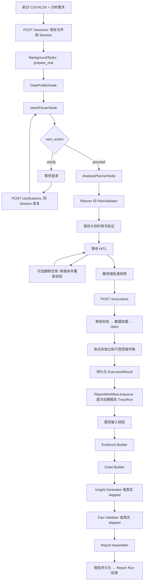

# Runtime 节点清单与 Trace 状态映射表

**InsightFlow · 2026-10-30 · 只读代码审计 · REQ-0058**

审计范围：当前前台 `real_workflow=true` 主链路、服务与包装节点、状态写入、异常处理、Run/Span/Event 与 LLM 调用记录关联。未修改代码、Prompt、配置或数据库记录；本轮没有发起模型请求。本文中的“节点”指逻辑执行边界，并不表示它们都已接入统一 Agent Runtime。

## 1. 审计结论

1. 真实流程由 FastAPI 接口、BackgroundTasks 和代码状态机控制；没有独立的通用 Agent Runtime 调度器。
2. 画像、Intent、Planner 走 `Node.run → Orchestrator.record`；Engine、Report 主入口直接调用服务，现存 V1 Node 包装器没有接入当前主入口。
3. **全流程没有统一根 Trace Run。**目前 Run.kind 只允许 `report_generation`，报告排队时才创建 Run；上传、理解、规划、HITL 和 Engine 无对应 Span/Event。
4. 实际接入的 Span 名称共 **5 个**：`evidence_builder`、`insight_generator`、`fact_validator`、`report_assembler`、`report_persistence`。源码共有 7 处字面量调用，其中 Insight/Fact 各有正常与跳过分支。
5. 业务阶段、节点终态、可执行性、批准状态、模型协议状态、Trace 状态是不同契约，不能统一用“成功”解释。
6. 本轮只读数据库快照：3 个历史 Session；7 条 LLM Call；Run/Span/Event 均为 0。详细计数另存 `read-only-runtime-counts.json`，不冒充本轮新测试。

## 2. 当前实际调用顺序

画像与 Intent 在当前主流程中**顺序执行**，Intent 使用已保存画像。DataProfilerNode 使用工作线程不代表这两个节点在主流程中已经并发。

Planner 的第一次确定性校验发生在 `AnalysisPlannerService.plan()` 返回前，此时 Session 仍为 `PLANNING`；之后 Session 才进入 `VALIDATING`，由审核服务重新校验并保存计划。不能用一个阶段标签代替每次 Validator 调用。报告输入 `reporting.contracts.prepare()` 还会在 Evidence Builder 之前再次调用 PlanValidator；它也没有独立 Span。

## 3. Runtime 节点清单：Understanding、Planning、HITL

下表“无 Trace”表示没有对应 Run/Span/Event 埋点，不表示业务没有实际执行。U/P/H/E/R/C 编号仅用于本清单导航，不是系统新增的 node_id。

| 编号 / 执行边界 | 真实入口与调用者 | 状态来源及记录时机 | 异常处理与后续行为 | Trace 关联 |
|---|---|---|---|---|
| U01 文件接收、解析选项与会话创建 | 前台 `api.create()` → `routes.create_session()` → `FileStore.save()` / `SessionRepository.create()` | 文件和 Session 保存后有 `CREATED`；返回 201 后后台开始准备 | 文件/参数异常由 HTTP 错误处理返回；创建 Session 失败会清理刚保存文件；可能尚无 Session 记录 | 无 Run、Span、Event |
| U02 Data Profiler | `prepare_real()` → `DataProfilerNode.run/process()` → `DataProfilerService.profile()` | 调用前 Session=`PROFILING`；返回后追加 NodeRun(success/error)，成功保存真实 DatasetProfile 后进入 `PARSING_INTENT` | AppError 转 NodeOutput.error；未知 Exception 转 NODE_FAILED；外层记录 NodeRun 后把 Session 标 FAILED | 无 Trace；NodeRun 只有终态和 finished_at |
| U03 Intent Parser | `prepare_real()` → `IntentParserNode.run/process()` → `IntentParserService.parse()` | Session=`PARSING_INTENT`；真实请求单独写 CallRecord；返回后保存 IntentArtifact、intent_history 和 NodeRun | Schema/grounding 等错误有限重试；超时/耗尽后 Session FAILED；合法 `clarify` 是正常返回，不是节点错误 | 无 Span；Call.run_id/span_id 未传，通常 null |
| U04 澄清暂停与恢复 | `next_action=clarify` → `begin_real_clarification()`；前台 POST `/sessions/{id}/clarifications` | Session=`WAITING_FOR_CLARIFICATION`；答案与消息落库后，同 Session 进入 `PARSING_INTENT`；新 parse_id | 非等待态/版本冲突返回 AppError；正常澄清不会调用 Planner；没有独立“等待节点”的通用 NodeRun | 无 pause/resume Trace Event |
| P01 Analysis Planner | `prepare_real()` → `AnalysisPlannerNode.run/process()` → `AnalysisPlannerService.plan()` | Session=`PLANNING`；CallRecord 记录每次请求；返回 ValidatedAnalysisPlan 后追加 Planner NodeRun | 非 proceed 意图拒绝；JSON/结构错误有限重试；超时、失败耗尽由外层标 Session FAILED | 无 Span；Call.run_id/span_id 为 null |
| P02 Plan Validator：候选校验 | `AnalysisPlannerService.plan()` → `self.validator.validate()` | 返回 F0/F1/F2、executable、coverage_status；不是独立运行状态；此时 Session 仍是 PLANNING | Schema 不合法可抛 PLAN_SCHEMA_INVALID；缺字段/不支持能力等通常返回 F0 结果，而非异常 | 无 Span/Event；没有独立 Validator NodeRun |
| P03 Plan Validator：保存初始计划 | `prepare_real()` → `save_generated_plan()` → `review.validate_v1()` | Session 先 VALIDATING；在审核事务中重验、保存不可变 PlanVersion，再 AWAITING_APPROVAL；review_status=awaiting_review | 失败回滚保存事务，再由 prepare_real.fail_real 记录 Session FAILED；不写虚假计划 | 无 Span/Event；业务版本记录存在 |
| H01 HITL 展示、等待、删除重验 | GET review；POST plan-revisions → `PlanReviewService.revise_v1()` | 展示是只读；删除成功创建新 plan_version，review_status=awaiting_approval，清除旧批准 | 版本错误、非法删除、未实现的自然语言修订返回 AppError；事务回滚，保留原计划；不自动批准 | 无 Span/Event；删除和版本事实在 plan_versions |
| H02 HITL 批准 | POST approvals → `PlanReviewService.approve_v1()` | 重验版本、约束和覆盖；批准快照与审批记录同事务保存；Session=APPROVED、review_status=approved | defer/clarify、未验证约束、无可执行任务等拒绝；事务回滚，通常保留待审核状态，并不把所有审批拒绝都标 Session FAILED | 无 Span/Event；approval_id 供下游绑定 |
| C01 准备阶段人工重试 | POST retry-preparation → `begin_real_retry()` → BackgroundTasks.prepare_real() | 同 Session 按检查点进入 PROFILING/PARSING_INTENT/PLANNING/VALIDATING；保留原 NodeRun | 不允许重试已审批/执行的准备流程；不自动批准；新服务调用可生成新的 parse_id/operation_id | 无统一节点 Attempt 或根 Run 重试关联 |

**特别注意 H01：**`review_status=validating` 在同一审核事务内临时设置，结束前被改成 awaiting_approval。它不是已经独立落库、可供 Admin 持续观测的“校验中”事件。

## 4. Runtime 节点清单：Execution

| 编号 / 执行边界 | 真实入口与调用者 | 状态来源及记录时机 | 异常处理与后续行为 | Trace 关联 |
|---|---|---|---|---|
| E01 执行幂等与审批预检 | POST `/api/v1/executions` → `AnalysisEngineService.execute()` → replay/check_approval | 先查 execution_request_id 重放，再校验批准计划/数据版本/Validator/未决约束；此时可能尚未 claim | 不满足条件返回 AppError，不能换版本执行；重放返回原结果，不制造新执行 | 无 Span/Event；execution_request_id 与批准快照是真实关联 |
| E02 数据加载与结构核验 | `DatasetLoader.load(dataset_id, dataset_version)` | 读取指定版本实际文件并核对 hash、解析选项和结构；在 claim 之前 | 缺文件/版本/结构异常拒绝；此时可能没有 execution_id，不能声称 Engine Run 已开始 | 无 Span/Event |
| E03 执行认领 | `ExecutionRepository.claim()`，事务内再次校验批准与 revision | executions.status=running，写服务端批准快照；Session=RUNNING、review_status=executing | 重复/冲突/审批变化拒绝；同请求不重复启动 | 无 Engine Span；有业务执行记录 |
| E04 任务与操作链 | `AnalysisEngineService.execute()` 循环 → `TaskRunner.run()` → Registry handler | 任务从独立数据副本开始；步骤按序；filter/group_aggregate/aggregate/sort/top_n/derive 产生真实行数与结果 | 单任务异常转换为 failed 任务并继续其他独立任务；F0 任务 skipped；空表可以 success | 无任务/步骤 Span；步骤日志先存内存，任务返回后 save_task 落库 |
| E05 任务结果保存与整体完成 | `ExecutionRepository.save_task()` / `finish()` | 任务 success/failed/skipped；整体 ExecutionResult=success/partial_success/failed；物理行状态从 running 改 finished | save_task/finish 的存储异常不是 TaskRunner 内错误；可能留 running 业务记录，需后续恢复，不能承诺所有基础设施错误都已有终态 | 无 Span/Event；完整结果与预览分开持久化 |

Engine 完成时，Session 对 success 和 partial_success 都可进入 `COMPLETED`；整体是否部分成功必须看 `ExecutionResult.execution_status`。这时报告可能尚未开始或随后失败。

运行中的 GET execution 当前返回 `EXECUTION_IN_PROGRESS`（409），不是提供逐步骤进度流的接口。任务级 progress 虽落在 SQLite，尚未转为 Admin 实时节点事件。

## 5. Runtime 节点清单：Reporting

以下 Span 只在 `ReportWorkflow.generate()` 传入有持久化 Run 的 TraceContext 时实际写入；独立调用 Report 服务并不会自动生成这些持久化记录。

| 编号 / 执行边界 | 真实入口与调用者 | 业务状态 / Trace 状态来源 | 异常处理 | Run / Span / Event |
|---|---|---|---|---|
| R01 报告排队 | Engine 接口完成后 `ReportWorkflow.enqueue()` → `reports.queue()` / `traces.queue()` | ReportGeneration=queued；新鲜尝试生成报告 Run(status=queued)，同 execution+attempt 幂等 | 数据源/Session 不符拒绝；业务排队与 Trace 写入不是一个事务；观测失败允许缺口 | **Run 在这里才创建**；当前没有 run.queued 事件 |
| R02 报告开始、输入/批准核验 | BackgroundTasks → `ReportWorkflow.generate()` → reports.start / traces.start / service.prepare | ReportGeneration=generating；Run=running；核对批准快照、执行结果、画像；输入指纹观察 | 进入 generate 的 try 后，AppError 导致报告失败、Run failed；reports.start 在 try 之前，若其存储异常则无该局部终态兜底；失败可能没有对应 failed Span | run.started、inputs.verified；**无独立输入核验 Span** |
| R03 Evidence Builder | `AnalysisReportService.generate()` → `EvidenceBuilder.build()` | Span running → complete/failed；保存 evidence_count 和受控证据投影 | 异常由 span 包装捕获并向 ReportWorkflow 传播；0 证据仍可正常完成构建 | Span=`evidence_builder`；span.started/finished；Evidence 快照 |
| R04 Chart Builder | `VisualizationBuilder.build()` | ChartSpec 后续进入报告；没有独立状态字段或 NodeRun | 异常向外传播；无法通过独立 Chart Span 定位 | **无 Span/Event**，位于 Evidence 与 Insight 之间 |
| R05 Insight Generator | `provider.generate()`，传真实模板 binding 与当前 trace | Span running → complete/failed/interrupted；LLM Call 独立协议状态；候选 JSON 契约通过后才结束正常分支 | 超时、模型失败、非法 JSON/候选结构抛明确错误；不以模板伪造成功 | Span=`insight_generator`；span.started、llm.started、llm.returned、span.finished；Call/Request/Template ID 精确关联 |
| R06 Fact Validator | `materialize_candidates()`，observer=trace.candidate | Span 有 rejected_count 则 partial；无拒绝正常 complete；抛错 failed；记录合法/拒绝数 | 部分合法候选可保留；核心覆盖/事实不满足可拒绝或限制报告，不等于模型协议失败 | Span=`fact_validator`；candidate.validated / candidates.summarized；span.started/finished |
| R07 Report Assembler | 构造 `AnalysisReport` | 构造过程 Span 通常 complete；报告内容另有 complete/partial/unavailable；goal_coverage 另有 complete/partial/blocked | 构造或契约异常导致 Span failed 与报告失败；不能把构造完成等同目标完成 | Span=`report_assembler`；span.started/finished；报告计数/状态属性 |
| R08 报告保存与结束 | `ReportRepository.finish()` → trace.snapshot(report) → trace.finish(report_status) | 持久化 Span complete/failed；ReportGeneration=completed 或 unavailable；Run 取报告内容的 complete/partial/unavailable | 保存失败会走报告错误处理；不会篡改已成功 Engine 结果 | Span=`report_persistence`；span.started/finished；run.finished；受控报告投影 |

无证据时，R05 与 R06 走真实 `skip=True` 分支：发 `span.skipped`，结束为 `skipped`，不调用模型；报告通常为 unavailable。不能因模板 Manifest 存在就推断发生了 LLM 调用。

`inputs.verified` 事件包含 `inputs_match`。事件名本身不代表所有业务校验已经通过；这个方法是观察指纹核对，不是替代批准校验的业务授权门禁。

## 6. 状态契约及准确映射

| 状态来源 | 当前真实取值 | 代表什么 | 不能据此推出什么 |
|---|---|---|---|
| Session.status | CREATED、PROFILING、PARSING_INTENT、PLANNING、VALIDATING、WAITING_FOR_CLARIFICATION、AWAITING_APPROVAL、APPROVED、RUNNING、COMPLETED、FAILED；PREPARING 为旧分支所用 | 整体业务检查点 | 不能推出每个节点已开始/完成；COMPLETED 不代表报告已成功 |
| WorkflowEvent | 保存每次真实 Session 状态变化与 recorded_at | 业务阶段历史 | 不是 TraceEvent，没有 run/span 关联；同状态内操作未必产生新条目 |
| NodeOutput / NodeRun.status | success、error | 包装节点正常返回或抛错后的终态 | 没有 pending/running/skipped/partial；没有节点开始记录；success 不保证可执行或无需澄清 |
| review_status | awaiting_review、validating、awaiting_approval、approved、executing、completed、execution_failed | 计划审核与执行流程辅助状态 | approved 不是计算成功；事务中 validating 未必对外可见 |
| ValidationResult.feasibility | F0、F1、F2 | 静态执行可行性 | 不是运行中/运行完成状态；F2 不代表已经执行 |
| ValidatedAnalysisPlan.coverage_status | complete、partial、blocked | 计划覆盖核心目标的程度 | 不代表任务运行成功 |
| executions.status（物理表） | running、finished | 执行记录是否结束 | finished 本身不表示计算成功 |
| ExecutionResult.execution_status | success、partial_success、failed | 各独立任务结果汇总 | success 不等于报告成功，也不等于全链路已被 Trace 记录 |
| ExecutedTask.status | success、failed、skipped | 单任务终态 | 没有任务 running 持久事件；skipped 不是实际执行失败 |
| StepExecutionLog.status | success、failed | 步骤实际操作结果与耗时/行数 | 没有独立逐步 start/end 事件；日志不是实时推送 |
| ReportGeneration.status | queued、generating、completed、failed、unavailable | 当前报告尝试的生成/保存进度 | completed 也可能对应 AnalysisReport.partial |
| AnalysisReport.report_status | complete、partial、unavailable | 报告内容生成完整程度 | 不等同 goal_coverage；不反推上游节点状态 |
| TraceRun.status | queued、running、complete、partial、unavailable、failed、interrupted | **报告生成尝试**的观测状态 | 当前不是完整 Workflow 根状态；缺 Run 不等于未执行 |
| TraceSpan.status | running、complete、partial、failed、skipped、interrupted | 该执行范围的开始/终止情况 | complete 不能替代报告内容完整性或业务目标覆盖 |
| LLMCallRecord.status | running、succeeded、failed、cancelled、interrupted | Provider 协议层结果；outcome_scope=provider_protocol | succeeded 不代表 JSON/语义/事实校验通过 |

当前不存在对所有节点统一落库的 `pending`、`waiting`、`retrying` 状态；不能在 Admin 中凭流程顺序或计时器补画这些状态。重试主要由 operation_id/call_sequence/retry_index 或报告 attempt 表达。

## 7. Trace Event 与终态的真实对应

| 实际动作 | 写入的观测数据 | 边界说明 |
|---|---|---|
| 创建报告尝试 | TraceRun(queued) | 无 run.queued 事件 |
| 开始报告尝试 | Run 改 running + run.started | Run 与 Event 分开持久化 |
| 进入普通 Span | Span(running) + span.started | 正常执行边界，非前端推测 |
| 进入跳过分支 | 临时 Span(running) + span.skipped，随后结束为 skipped | 不会同时发 span.started |
| Span 正常结束 | span.finished + Span complete/partial/skipped | 当前 partial 由 rejected_count 触发，不是通用结果语义推断 |
| Span 异常结束 | span.finished(error_code) + Span failed/interrupted | **当前没有单独名为 span.failed 的事件** |
| 模型返回 | llm.returned + call_id/request_snapshot_id/template_snapshot_id | 表示收到 Provider 响应，不代表 Fact Validator 已通过 |
| 校验候选 | candidate.validated、candidates.summarized | 白名单诊断与计数；不保留完整候选正文 |
| 报告结束 | run.finished + Run 对应终态 | complete/partial/unavailable 来自报告内容；异常为 failed/interrupted |
| 进程重启恢复 | 更新 Run/Span interrupted、recovered_at、integrity=incomplete | 不追加统一恢复 Event；不伪造缺失结束时刻与耗时 |

当前报告代码生成的五个 Span 通常为同一 Run 下的平级节点；通用类虽支持 parent_span_id，但并未生成 Understanding/Planning/Execution/Reporting 四阶段完整父子树。

## 8. ID、重试、存储与异常恢复

### 8.1 关联键

- `session_id`：业务全流程关联；澄清、检查点重试、计划版本和执行继续使用它。
- `NodeInput.run_id` / `NodeRun.run_id`：每次包装节点调用默认新 UUID；不是 TraceRun ID，也没有稳定父子关系。
- `IntentArtifact.parse_id`：与 Intent 的 LLM Call.operation_id 对应，可精确追到该次模型尝试。
- Planner 的 operation_id 在方法内生成；成功返回未持久化同名 parse_id/call_id；错误 details 可保留 parse_id，成功路径缺少稳定调用引用。
- `approval_id`、dataset/plan/version：不可变批准与执行的业务绑定。存在这些 ID 不代表各自有 Span。
- 报告 Run 在 enqueue 时绑定 execution、approval、dataset、plan，并关联实际 Insight 模板；执行前不存在可复用的完整根 Run。
- Intent/Planner 的 Call binding 不传 trace，因此 run_id/span_id 为 null；Report binding 接入当前 insight_generator Span。
- 内部 LLM 重试有独立 CallRecord、call_sequence、retry_index 与 retry_of_call_id；前台检查点重试会重新生成 operation_id，缺少跨调用的统一根节点 Attempt 链。
- 报告重试是新 ReportGeneration.attempt 和新报告 Run；retry_of_run_id 指向上一已采集报告尝试。不是一个 LLM 调用内的自动多轮修复。

业务名称与实际标识也不完全相同：

| 业务边界 | 当前 NodeRun.node_name | Prompt Registry node_id | 已接入 Span.name |
|---|---|---|---|
| Data Profiler | data_profiler | 无 LLM | 无 |
| Intent Parser | intent_parser | intent_parser | 无 |
| Analysis Planner | analysis_planner_v1 | analysis_planner | 无 |
| Engine | 主入口不生成对应 NodeRun；备用包装器名 analysis_engine_v1 | 无 LLM | 无 |
| Report / Insight | 主入口不经 report_module_v1 包装器 | insight_generator | 五个报告子节点，含 insight_generator |

这些已有标识不能仅按相同显示名称合并，关联必须使用真实上下文与绑定。

### 8.2 存储与读取

- `var/insightflow.sqlite3`：Session、画像引用、计划版本、批准、ExecutionResult、报告与当前 ReportGeneration。
- `var/observability/trace.sqlite3`：Run、Span、Event、受控投影。
- `var/prompt_registry/registry.sqlite3`：不可变模板、实际请求快照和调用生命周期。
- `report_generations` 按 execution_id 保存最新尝试，重试替换当前行；失败尝试的长期历史主要依赖独立 TraceRun 等记录。观测缺失时不能承诺恢复全部尝试历史。
- Trace 快照是脱敏投影/哈希，不是完整原始输入输出；CallRecord 的响应哈希不能还原模型正文。
- Admin 读取 Run/Span/Event，无 SSE/自动轮询；当前主要依赖手动刷新。前台业务页面每秒查询 Session，两者不是同一个进度数据源。

### 8.3 异常恢复与不能保证的记录

- 准备阶段：单进程启动时把活动 Session 标为 PROCESS_INTERRUPTED，保留检查点；没有自动造成功 NodeRun。
- 通用 Node.run 与 prepare_real 主要捕获 Exception，取消/进程退出等 BaseException 不保证生成结束 NodeRun；可能保留活动 Session 到启动恢复。real_output 对 Mock 来源的拒绝也发生在 record 之前，不能承诺每次门禁拒绝都已有 NodeRun。
- ReportWorkflow 的 start 在其 try 之前；排队/开始/错误结果再次写库的存储异常不保证被同一方法保存为 failed。捕获 BaseException 时可把 Trace 标 interrupted 并重新抛出，ReportGeneration 仍可能保留 generating 到重启恢复。
- cancelled 的模型请求不一定是用户主动取消，也可能是服务层总超时取消底层请求；2026-10-29 实测即为业务 LLM_TIMEOUT 与 Call.cancelled 并存。
- Engine：保留已保存任务，对未完成任务产生 EXECUTION_INTERRUPTED 的 skipped 结果；按任务重新汇总 success/partial_success/failed，并附中断信息。没有独立的 ExecutionResult.interrupted 状态。恢复时计算的 elapsed 包含中断间隔，不是可据以断言的纯计算耗时。
- ReportGeneration：重启时 queued/generating 变 failed，错误 REPORT_PROCESS_INTERRUPTED；原始 Engine 结果保留。
- Trace：原 queued/running 变 interrupted，恢复发现时间为 recovered_at，duration_ms 留空，避免估算丢失的真实耗时。
- LLM Call：原 running 标 interrupted，错误 LLM_CALL_INTERRUPTED，不伪造返回。
- Trace 写入 fail-open，故障不改变业务判断；事件/快照有大小和数量上限。Span/Event/Run 非同一次事务，最终写失败也可能留 running，不能承诺每次失败均完整落库。
- 请求快照写入 fail-closed：保存失败不发送模型，终态保存失败也不会假装成功。这与 Trace 的观测降级策略不同。

## 9. 已有包装器与独立入口：不能误判成主链路

| 文件 / 入口 | 当前实际用途 | 审计判断 |
|---|---|---|
| nodes/data_profiler.py、intent_parser.py、planner_v1.py | 真实主流程明确实例化并调用 | 主链路包装节点 |
| nodes/engine_v1.py 的 AnalysisEngineNode | 可调用真实 Engine 的适配器；主要在测试使用 | 当前 `/executions` 主入口未通过此包装器，因此不会自动有对应 NodeRun |
| nodes/report_v1.py 的 ReportModuleNode | 独立调用报告服务的适配器；主要在测试使用 | 当前 ReportWorkflow 未通过此包装器；不能因为文件存在就认定主流程已统一节点化 |
| nodes/analysis_planner.py、analysis_engine.py、report_module.py | legacy Mock 分支 | 真实 real_v1 分支不走 Mock 计算/报告；保留历史代码不等于当前主流程使用 Mock |
| POST /intents/parse、/plans/generate、/plans/validate | 独立模块 API | 前台主流程同进程调用服务，未逐个调用这些 HTTP API；它们不自动建立 Session 根 Trace |
| POST /reports | 明确导入结果的独立报告 API | 拒绝外部传入的 engine source；没有 ReportWorkflow 所传持久化 TraceContext |
| GET presentation / download | 读取已保存报告，格式化展示或 HTML 导出 | 不发起重新统计/模型分析，不作为新增分析节点 |
| Prompt 启动登记、Registry 查询 | 模板来源和调用追溯基础设施 | 已登记模板不等于节点实际执行；本身不创建模型 Call 或业务 Run |

## 10. 只读复核结果与后续状态设计边界

本次没有新增运行测试或修改实现。复核 2026-10-29 已归档的真实前台案例：两 Session、7 次实际模型请求、3 次 Planner 约 30 秒超时；业务错误与 NodeRun 留存，Run/Span/Event 为零。它们证明上游追踪缺口；本次不能声称 HITL、Engine、Reporting 已通过新的真实端到端测试。

目前最需要统一的是：每次实际节点调用的稳定身份、开始/终态事件、暂停/恢复与重试关联，以及完整根 Run。不能直接把所有 `success/complete/completed/approved/F2` 统一成“节点成功”，也不能通过补画历史或调整显示文案代替真实埋点。

本轮未创建新的 Runtime、状态机、Span 或 UI。192 个相关源码文件前后哈希验证，审计与版本资料之外没有应用源码变更；没有读取或归档真实 .env/API Key。

## 11. 关键源码定位

- [上传入口](/Users/lainey/Desktop/vibe-coding/insightflow/backend/app/api/routes.py:49)：`create_router.create_session`。
- [真实主流程](/Users/lainey/Desktop/vibe-coding/insightflow/backend/app/workflow/orchestrator.py:191)：`WorkflowOrchestrator.prepare_real`。
- [NodeRun 保存](/Users/lainey/Desktop/vibe-coding/insightflow/backend/app/workflow/orchestrator.py:40)：`WorkflowOrchestrator.record`。
- [通用包装器异常边界](/Users/lainey/Desktop/vibe-coding/insightflow/backend/app/nodes/base.py:20)：`Node.run`。
- [重新验证](/Users/lainey/Desktop/vibe-coding/insightflow/backend/app/services/plan_review.py:113)：`PlanReviewService.validate_v1`。
- [删除任务与版本](/Users/lainey/Desktop/vibe-coding/insightflow/backend/app/services/plan_review.py:162)：`PlanReviewService.revise_v1`。
- [真实批准](/Users/lainey/Desktop/vibe-coding/insightflow/backend/app/services/plan_review.py:266)：`PlanReviewService.approve_v1`。
- [真实执行入口](/Users/lainey/Desktop/vibe-coding/insightflow/backend/app/api/executions.py:20)：`create_execution_router.execute`。
- [Engine 编排](/Users/lainey/Desktop/vibe-coding/insightflow/backend/app/services/analysis_engine.py:94)：`AnalysisEngineService.execute`。
- [任务与步骤](/Users/lainey/Desktop/vibe-coding/insightflow/backend/app/execution/task_runner.py:87)：`TaskRunner.run`。
- [报告排队](/Users/lainey/Desktop/vibe-coding/insightflow/backend/app/workflow/reporting.py:13)：`ReportWorkflow.enqueue`。
- [报告生成](/Users/lainey/Desktop/vibe-coding/insightflow/backend/app/workflow/reporting.py:28)：`ReportWorkflow.generate`。
- [报告子节点](/Users/lainey/Desktop/vibe-coding/insightflow/backend/app/services/analysis_report.py:39)：`AnalysisReportService.generate`。
- [报告状态写入](/Users/lainey/Desktop/vibe-coding/insightflow/backend/app/storage/report_repository.py:65)：`ReportRepository.finish`。
- [Span 状态处理](/Users/lainey/Desktop/vibe-coding/insightflow/backend/app/observability/recorder.py:54)：`SpanHandle.finish`。
- [Run 状态处理](/Users/lainey/Desktop/vibe-coding/insightflow/backend/app/observability/recorder.py:123)：`TraceContext.finish`。
- [Run 契约](/Users/lainey/Desktop/vibe-coding/insightflow/backend/app/domain/tracing.py:20)：`TraceRun`。
- [Span 契约](/Users/lainey/Desktop/vibe-coding/insightflow/backend/app/domain/tracing.py:39)：`TraceSpan`。
- [调用开始捕获](/Users/lainey/Desktop/vibe-coding/insightflow/backend/app/llm/capture.py:21)：`CallRecorder.begin`。
- [调用终态捕获](/Users/lainey/Desktop/vibe-coding/insightflow/backend/app/llm/capture.py:55)：`CallRecorder.finish`。

既有真实触发审计：[2026-10-29 实测记录](/Users/lainey/Desktop/vibe-coding/insightflow/docs/audits/workflow-trace-real-integration-2026-10-29/live-verification-authorized/final-audit.md)。
