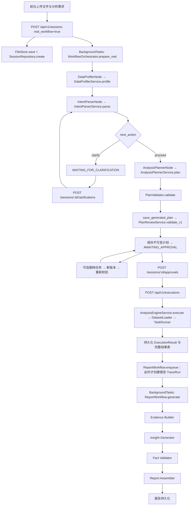

# InsightFlow Trace V0.3 真实工作流接入审计（静态阶段）

关联需求：REQ-0056。日期：2026-10-29。本文件是静态代码结论，不把自动化测试或历史报告当成本次真实前台执行证据。

## 核心结论

当前 Trace V0.3 是**真实 Reporting 子流程的追踪**，尚不是从上传开始的完整 Workflow Trace。当前代码能从上传的真实文件执行 Intent、Planner、Validator、HITL、Engine 和 Report；但运行事实分散在业务 SQLite、Prompt Registry 和报告 Trace 中，没有贯穿四阶段的根 Run ID。

没有发现 Admin 为未埋点的 Understanding、Planning、Execution 节点生成成功状态的代码。Admin 目前明确展示“报告生成尝试”和已有 Span。**不能因为报告成功，就说上游节点已在 Trace 中被观测。**

## 1. 前台到后端实际链路

关键证据：frontend/src/api/client.ts 的 create 显式提交 real_workflow=true；frontend/src/App.tsx 的 confirm 先调用 approveReal 再 executeReal。真实分支不是 Orchestrator 中保留的 legacy_mock 分支。不能仅看到导入 MockAnalysisPlanner/MockAnalysisEngine 就认定真实入口在用 Mock。

- 文件上传、Session 创建失败在 prepare_real 前，当前无 TraceRun。
- Profiler 完成后才调用 Intent，当前实现是顺序执行，并非并行。
- Planner 服务返回前执行一次 PlanValidator；Orchestrator 保存初始计划时由审核服务重新校验；审批与 Engine 执行前还会验证。不同验证动作没有独立 Trace 身份。
- Engine 同步执行，保存结果后才为报告排队。报告失败不会把已成功的 Engine 改成失败。
- /api/v1/intents/parse、/plans/generate、/plans/validate 是独立模块 API，前台主链路不是通过这些 HTTP 端点互调，而是同进程调用服务。

## 2. 四阶段各节点覆盖表

“业务持久化”不等于“Admin Trace 已埋点”。未采集的开始/结束不能从阶段状态时间差反推。

| 阶段 / 节点 | 实际入口 | 已保存的业务事实 | Admin Span / Event | 开始、结束、失败与缺口 |
|---|---|---|---|---|
| Understanding / 文件接收 | routes.create_session → FileStore.save | 上传文件元数据、本地文件、Session | 无 | 上传失败可能尚无 Session；无 Trace 开始/终止 |
| Understanding / Data Profiler | prepare_real → DataProfilerNode.run | DatasetProfile、版本、Session.profile、NodeRun | 无 | WorkflowEvent 有 PROFILING 状态；NodeRun 仅终态与 finished_at，无开始与耗时 |
| Understanding / Intent Parser | IntentParserService.parse | IntentArtifact、intent_history、parse_id、澄清问题；CallRecord | 无 | 业务 PARSING_INTENT 与错误可存；LLM 调用独立存储，未绑定 Run/Span |
| Understanding / 澄清与恢复 | begin_real_clarification → prepare_real | clarification_answers、消息、workflow_events、同 session_id | 无 | 暂停与继续是业务事实，但无持久化 Trace pause/resume 事件 |
| Planning / Analysis Planner | AnalysisPlannerService.plan | ValidatedAnalysisPlan、计划、模型信息；CallRecord | 无 | PLANNING 可见；成功返回没有 parse_id/call_id，难直接关联调用 |
| Planning / Plan Validator | planner.validator.validate / review.validate_v1 | validation_version、F0/F1/F2、约束审计与计划版本 | 无 | VALIDATING 是业务检查点，不是全部校验动作的开始结束轨迹 |
| Planning / HITL 审核 | PlanReviewService.revise_v1 / approve_v1 | 不可变 plan_versions、plan_approvals、批准快照、约束审计 | 无 | 无审批/删除/重新校验 Span；相同状态下的操作也不一定新增 WorkflowEvent |
| Execution / 批准与加载检查 | AnalysisEngineService.execute/check_approval、DatasetLoader | 版本批准快照；claim 后 execution running | 无 | 部分拒绝/加载失败发生在 claim 前，没有执行记录或 Trace |
| Execution / 任务及六类操作 | TaskRunner.run | TaskExecutionMetadata、步骤状态/耗时/行数/错误、完整结果 | 无 | 步骤日志在内存积累，任务结束才 save_task；无逐步实时开始/终止事件 |
| Execution / 结果持久化 | ExecutionRepository.finish | ExecutionResult、session COMPLETED/FAILED | 无 | 数据真实且可查，但不能显示为已观测 Engine Span |
| Reporting / 报告排队 | ReportWorkflow.enqueue → TraceRecorder.queue | ReportGeneration attempt；独立 report TraceRun | 有 Run；无排队 Event | 第一个统一观测点在 Engine 结束之后 |
| Reporting / 输入核验 | ReportWorkflow.generate → verify_inputs | 输入哈希核对事件 | inputs.verified；无独立 Span | 实际批准校验/prepare 失败可能发生在首个子 Span 前 |
| Reporting / Evidence Builder | AnalysisReportService.generate | 确定性 Evidence + 受控投影 | evidence_builder + started/finished | 已接入真实上下文，记录证据数；失败记录错误码 |
| Reporting / Chart Builder | VisualizationBuilder.build | 保存至 AnalysisReport.charts | 无独立 Span | 图表生成在其他 Span 之外，失败无法定位为 Chart 节点 |
| Reporting / Insight Generator | provider.generate | 独立实际请求快照、调用状态、响应哈希 | insight_generator；llm.started/returned | 含实际模型调用引用；无证据时真实 skipped |
| Reporting / Fact Validator | materialize_candidates | 合法/拒绝数、规则 ID、候选序号 | fact_validator；candidate.validated/summarized | 已采集真实校验诊断；拒绝数影响 partial |
| Reporting / Report Assembler | 构造 AnalysisReport | report_status、goal_coverage、图表及洞察 | report_assembler | return/异常与真实完成状态绑定，不以报告反推其他节点 |
| Reporting / 持久化 | ReportRepository.finish | analysis_reports、report_generations | report_persistence | 真实写入动作有 Span；失败不会被记作该节点成功 |

## 3. 当前 ID 关联

1. **session_id**：目前贯穿业务全链路的最可靠关联键。澄清、计划删除、新版本审批与执行均归属原 Session。
2. **NodeInput.run_id / Session.node_runs.run_id**：每次调用节点默认新 UUID，是终态节点记录 ID，不是 TraceRun.run_id，没有父子树；不能拿来冒充根 Run。
3. **Intent parse_id**：每次 parse 创建；与该次 CallRecord.operation_id 相同。成功 IntentArtifact 保留它，可以按这个精确键追到调用，但当前 Admin 没有自动串接这条链；澄清后新 parse_id，需要通过同 Session 的 intent_history 串接。
4. **Planner parse_id**：内部生成并用作 CallRecord.operation_id；成功返回只在 provenance.notice 写 attempts，不保存 parse_id 或 call_id。不能通过输入内容相似强行认领到某个 Session。
5. **plan_id + plan_version + validation_version / approval_id**：不可变审批绑定存在，旧审批不会自动用于新计划；没有 Trace 根关联。
6. **execution_id / execution_request_id**：执行、重放、结果及批准快照之间有关联。RunManifest 保存 execution_id/approval_id/dataset/plan 引用，但这是报告执行后绑定。
7. **report TraceRun.run_id**：仅在报告排队时创建；kind 目前只允许 report_generation，execution_id 必填，无法直接用于尚未执行的上传与 HITL 等待。每次报告重试新 Run，retry_of_run_id 指向前一次已采集报告尝试。
8. **LLMCallRecord.call_id**：各实际 HTTP 调用独立记录；request_snapshot_id、template_snapshot_id、operation_id、sequence、retry_of_call_id 均存在。Intent/Planner 不传 trace，run_id/span_id 为 null；Report 传当前 insight_generator Span，可精确跳转。

**结论：目前没有统一根 Run ID。现有报告 Run 是子流程尝试，不应重新解释为整个分析任务。**

## 4. LLM Attempt 与 Prompt Registry

- Intent/Planner 有有限重试：每次请求独立 CallRecord 与 RequestSnapshot，call_sequence 从 1 开始、retry_index 从 0 开始、retry_of_call_id 指向同 operation_id 的前次调用。
- CallRecord.status=succeeded 仅表示 Provider 协议成功。JSON、Schema、grounding 或 Planner 校验可能随后失败；不能据此显示 Intent/Planner 业务节点成功。
- 后置校验错误会在后续 retry_reason 中记录，或最终作为业务错误保存；首个调用自身没有独立 consumer_validation 状态。Planner 成功操作 ID 缺失也会影响追溯。
- Report 没有节点内部自动重试循环；用户重试报告是新的 ReportGeneration.attempt + 新 TraceRun。与一次 LLM API 调用的序号不是同一个层级。
- Report RunManifest.prompt_template_snapshots 绑定实际 insight_generator 模板；llm.returned 事件包含 call_id/request_snapshot_id/template_snapshot_id；Prompt Registry 的调用列表再核对 run/span 实际存在性。
- Report 无证据跳过模型时，Manifest 中有模板引用不等于真实调用。没有 llm.returned/CallRecord 时不应展示“已调用”。
- 模板启动登记只说明加载并保存，不代表模型执行成功；历史未知不得用现有模板或当前配置填充。

## 5. 实时、异常与历史缺口

### 实时

- 业务 Session 的 workflow_events 是真实服务端状态变化；前台 App 每秒查询 Session，用服务端状态显示进度，不应抹成“没有任何持久化进度”。
- Admin Trace Explorer、Detail、Inspector 为首次加载 + 手动刷新，没有轮询、SSE 或 WebSocket。接口能返回运行中已存的报告 Span，但页面不会自动持续更新。
- 上游尚未生成报告时，Admin /runs 可为空，即使 Intent 或 Planner 正在真实执行。
- Step 日志、候选诊断和 LLM 指标的保存时机不同；不能根据最终结果补画开始事件。
- Run、Span、Event 分开提交，Run Detail 与 Span API 并行读取，没有共同 as_of/cursor，可能看到短暂不同读时点。

### 异常

- 单进程启动恢复会把准备阶段标为 PROCESS_INTERRUPTED，Engine 对 running 记录做恢复，ReportGeneration 标为 REPORT_PROCESS_INTERRUPTED，Trace 另标 interrupted、integrity=incomplete；已完成历史不改成新运行。
- TraceRepository.recover 不伪造中断时刻和耗时：recovered_at 是发现时间，duration_ms=null。它只改记录，不追加统一的恢复 Event。
- 无心跳或租约；进程还活着但卡住，Run 可长期 running。多进程或横向扩展不适用现有“启动时恢复所有活动记录”逻辑。
- Trace 写入是 best-effort，失败不改变业务判断；256 Events/Run、8192 字节事件白名单、256KB 投影等限额会造成可见缺口。最后一次持久化失败甚至可能无法把 incomplete 或终态落库，不能说所有错误都被记录。
- Prompt 请求快照保存则是 fail-closed：保存失败不发送模型请求。这与观测 fail-open 是不同边界，不能混淆。

### 历史

- 业务 SQLite：var/insightflow.sqlite3；Trace：var/observability/trace.sqlite3；Prompt 模板/调用：var/prompt_registry/registry.sqlite3。
- 原始请求受单独快照存储保护；当前本机免登录模式按用户要求启用，属于本人电脑测试配置。
- Report Trace 保存 Evidence/LLM 输出/报告的受控投影与哈希，文本被哈希化；CallRecord 只保存响应哈希，没有完整模型响应正文。不能把投影说成完整候选历史。
- 上游没有 Span 的历史任务不能从报告或状态反推补造；只能展示当时已有业务事实，并明确标注来源与采集层级。
- Git unknown 是实情；没有完整历史版本快照的 Run 不可冒认当前模板。

## 6. 最小改造建议（未实施）

### P0：同一套 Trace 扩展根关联，而非第二套运行事实

- 在真实 POST /sessions 接收任务时创建根观察 Run；复用既有 TraceRepository。支持后续 session/dataset/plan/approval/execution 绑定事件，不更改业务授权契约。
- 现有 Run.kind=report_generation 且 execution_id/session_id 必填，生命周期也没有等待态；需要显式向后兼容扩展，不可填虚构 execution_id 或把等待当 completed。
- 建议增加 workflow_analysis kind、root_run_id/parent_run_id（可空）、根 Run 在创建业务 Session 前允许 session_id/execution_id 未知，后续通过 append-only 绑定事件关联；旧报告 Manifest 和记录不可原位补写。
- 根 Run 支持 waiting_for_clarification / awaiting_approval / blocked 等语义，独立记录暂停与恢复。根 Manifest 保留创建时已知的版本与配置；后续实际计划/执行使用不可变子尝试 Manifest 或绑定事件，不修改根 Manifest 来假装创建时已知。

### P0：真实服务边界接入同一 Context

- 对文件解析、画像、Intent、Planner、每次 Validator、HITL 提交/删除/批准、Engine 加载/任务/步骤与 Reporting 接入实际开始、结束、异常；仅保存真实执行事件，不补画历史。
- 明确稳定 node_key、node_attempt、业务版本与 action 类型。跨 HTTP 的 Context 以服务端持久关联取回，不信任客户端自报批准或任意 Run ID。
- Intent/Planner 的 binding 应带 run/span；保留 operation_id 与消费者校验结果关联。Call 的 Provider 状态和节点业务状态分开显示。
- 继续复用现有 Plan Validator、HITL、Engine；埋点仅围绕服务调用，不放宽批准、约束审计或事实校验。

### P1：恢复、完整性与读取

- 复用已有幂等键；执行/报告重试保留旧 Attempt 与 root_run_id。澄清和人工等待保留根关联，不能在报告出现时才创建新的全流程根。
- 持久化状态变化与对应 Event 尽量同一次观测事务；观测缺失标 incomplete/unknown，不让缺失节点继承成功。
- 增加有界的活跃状态刷新或事件 cursor。SSE/轮询是后续展示层选择；本轮不开发 UI。
- 单进程先明确支持边界；以后多 Worker 必须有 owner/lease/心跳和恢复事件，不能简单扫描并中断其他进程的 Run。
- 在原只读 API 上增加 root/session 过滤及子尝试查询；历史 report_generation 原样兼容，不使用当前配置回填。

## 7. 测试计划（后续改造验收）

| 场景 | 必须验证的真实证据 |
|---|---|
| 正常 CSV/XLSX 从上传到报告 | 四阶段同 root；各节点 start/end 落库；结果与独立 Pandas 一致 |
| 需要澄清 → 用户补充 | 同 session/root，新增 Intent attempt，Planner 在澄清前无调用 |
| 等待 HITL → 刷新/重启 → 批准 | 等待不算成功；根关联和批准版本保留 |
| 删除任务 → 重验 → 旧审批 | 版本事件准确，旧批准不执行新计划，未执行步骤无成功事件 |
| F0 / F1 / 部分任务失败 | blocked/partial 如实，实际派生步骤可核对，保留失败任务 |
| LLM 协议成功但语义失败 | Call succeeded 与节点 failed 分离；重试关联准确 |
| 报告失败后重试 | Engine 结果不变；新报告 Run 继承根、引用前 Attempt |
| 无证据 | Insight 与 Fact 为 skipped，无模型 Call，无虚构洞察 |
| 并发两个会话 | run/span/call/evidence 不串，跨会话伪造关联拒绝 |
| 追踪写失败/事件超限 | 业务不变，缺口可见，不伪造成功；快照故障仍拒绝模型发送 |
| 异常退出恢复 | 标 interrupted/recovered_at，不能编造丢失的结束时间 |
| 运行中刷新与历史查询 | 页面显示持久化事实；读取一致性边界明确；旧 Run 不回填 |
| 权限与脱敏 | 本机模式边界不变；标准模式分开授权；不泄漏密钥和原始数据 |

## 8. 本阶段验证边界

本次前台已打开真实 5173 页面，选择用户提供的销售 CSV 并填写待澄清需求；点击发送被自动审批审查拒绝（潜在向外部模型发送派生数据）。没有绕过该拒绝；正在等待用户对具体文件、阿里云模型服务和执行范围的确认。

当前真实数据库审计基线：业务 Session 1 条，TraceRun 0 条，LLMCallRecord 0 条。上述静态结论不表示已经通过本轮“真实前台任务触发”的验收。后续真实验证单独保存，不覆盖该记录。

本轮仅新增审计和验证资料，未修改业务源码、Prompt、UI 或 Trace 契约。
