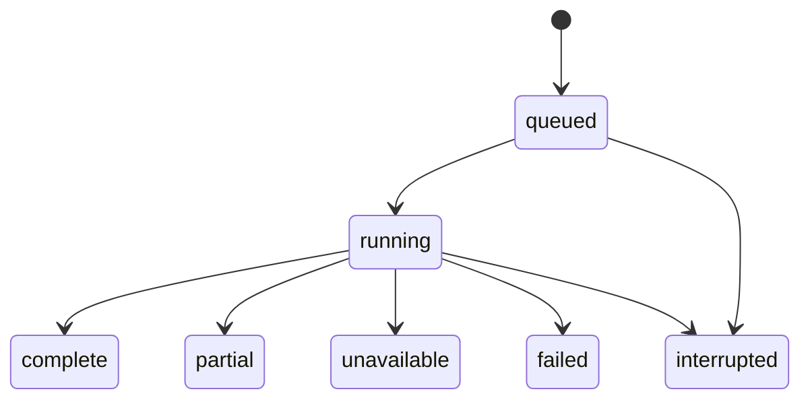

# Workflow Trace V0.1：实施前审计与数据契约

2026-10-28。需求 REQ-0043；REQ-0044 指示继续。本文在业务源码修改前保存。

## 现有事实来源

| 现有实现 | 可复用信息 | 缺口 |
| --- | --- | --- |
| `domain/models.py`、`workflow/transitions.py` | Session ID、状态事件、NodeRun | NodeRun.run_id 是每次节点调用标识，只有结束时间，没有父子关系、开始时间或耗时 |
| `storage/execution_repository.py` | execution_id、请求幂等键、批准快照、计划和数据版本、完整结果与步骤日志 | 已有 Engine 事实无需复制；其 running/finished 是存储状态，业务结果另有 success/partial_success/failed |
| `storage/report_repository.py` | 每个 execution 的 ReportGeneration、attempt、queued/started/finished、错误；不可变 AnalysisReport | generation 按 execution 覆盖最新尝试，旧 attempt 历史未独立保存；completed 不等于报告内容 complete |
| `workflow/reporting.py` | 真实执行/批准/画像检查、后台生成、失败重试 | 只保存最终报告或最终错误；没有报告内部节点时间线 |
| `services/analysis_report.py` | Evidence、筛选后的模型输入、模型返回、候选校验、报告组装 | 生产环境没有原始模型候选持久化；报告失败时局部变量不可查询 |
| `reporting/fact_validation.py`、`claims.py` | 引用、组合、数值和文本规则；拒绝候选、rule、triggered_rules | 部分诊断只有最终报告成功时保存；核心覆盖错误可在合法候选已存在时抛出，不能把合法数推断为 0 |
| `services/intent_parser.py`、`analysis_planner.py` | parse_id、attempt、Prompt、错误码的 Python logger extra | 未配置统一持久化日志收集；不能把控制台日志当 Trace 数据库 |
| `llm/compatible_provider.py` | provider/model、is_mock、结构化请求、超时、错误码 | 没有调用 ID、usage/token 或服务端请求 ID 返回契约；未知信息应为 null，不能补造 |
| `scripts/evaluate_report_insights.py` | 离线 Recorder 保存输入、原始返回、耗时、报告和 Presentation | 属于评测文件，不是生产 Report Workflow 埋点；不能冒充历史生产 Trace |

当前 Prompt=`report-insights-v1.1.9`，生成策略=`evidence-composition-v1.1.1`，公开报告 Schema=`analysis-report-v1`。数据版本是 64 位十六进制字符串，不是递增数字。Validator 版本、Registry 版本和批准 ID 均可从原有快照读取。

只读检查默认 `var/insightflow.sqlite3`：11 张业务表，1 条 session，0 条 execution/report/generation。现存 `var/workflow-v1-e2e/` 验证库有 2 条 completed generation 与 2 份 complete 报告；V1.1.1 验证库有 5 complete、12 partial、2 unavailable 报告，但无 report_generation。不同库不能拼成一个生产总体，也不能替缺失数据补 Trace。未读取或归档密钥。源码审计未发现统一 Trace 表。

报告相关 6 个现有测试文件在修改前运行：141 项通过，1 条现有 Starlette 弃用警告。

## ID 与事实来源边界

V0.1 一个 Run 表示**一次 ReportWorkflow 生成尝试**，不是宣称已经监控整条分析工作流。

- `run_id`：服务端 UUID；唯一键 `(kind=report_generation, execution_id, attempt)` 复用现有业务尝试。
- `session_id`：跨模块关联根。`execution_id`、`approval_id`、dataset/plan/validation/registry 版本引用原始记录。
- `retry_of_run_id`：前一个可观测尝试；若旧尝试没有 Trace，保留 null 和 attempt，不伪造父记录。
- `span_id`：单次阶段调用；`parent_span_id` 支持后续嵌套，均必须属于同 Run。旧 NodeRun ID 将来可作为 span binding，不覆盖它。
- `event_id`：唯一事件；序号在 Run 内分配，重复写入同事件幂等。候选用 `candidate_index`，关联同一次调用的证据 ID，不复制事实数值。
- 业务状态始终由 ExecutionRepository / ReportRepository 决定。Trace outcome 是观测结果；查询时另附当前业务来源状态。Trace 故障不改业务状态。

## 最小模型

| 模型 | 必需内容 |
| --- | --- |
| Run | ID、kind、session/execution、attempt/retry_of、owner_instance、status、queued/start/finish 时间、duration_ms、report_id、error_code、integrity、manifest |
| Span | ID、run/parent、name、status、start/finish/duration、error_code、受控 attributes |
| Event | ID、run/span、sequence、type、时间、受控 payload |
| RunManifest | trace schema、业务引用与版本、Prompt/Schema/生成策略、实现源码 SHA-256、model/provider/timeout/enable_thinking、原业务记录引用 |

Manifest 在开始时冻结；输出 report_id 留在 Run。没有 Git 时使用实现文件哈希，不虚构提交号。模型 temperature/top_p/usage 未显式提供时保持未知。配置只选白名单字段，不序列化 Settings、Provider 或 HTTP headers。

## 生命周期

- complete/partial/unavailable 直接对应保存报告的 report_status；goal_coverage 独立保留，不能混淆。
- failed：业务报告生成或持久化失败；原成功 ExecutionResult 不变。
- interrupted：服务进程中断后观测记录未正常结束；不补造实际完成时间或计算耗时。
- Span：running → complete/partial/failed/skipped/interrupted。无证据时 Insight 与 Fact Validation 为 skipped，LLM 调用次数为 0，Run 为 unavailable。
- LLM JSON 返回合法不代表 Fact Validator 成功；合法候选数非零也不代表核心覆盖成立。

埋点顺序服从原代码：加载/校验输入 → Evidence Builder → 现有图表逻辑 → Insight Generator（一次 LLM 调用及 JSON 解析）→ Fact Validator → Report Assembler → 原 Repository 保存。保存也需被观测，不能在内存组装成功时提前宣称 Run 成功。

## 存储、失败隔离与并发

使用现有 SQLite 技术，在 `var/observability/trace.sqlite3` 建立 Run/Span/Event 表，manifest 是 Run 内不可变 JSON。不在业务 SQLite 的关键事务中写观测，避免 Trace 锁竞争拖垮业务；不复制业务输入表或结果表。跨库引用通过现有 Repository 校验和读取，不能宣称有跨库外键原子性。

记录器只接收受控元信息，独立短事务、短 busy timeout，不在业务路径无限重试。初始化或写入失败使用有限、脱敏日志，返回空记录器继续原业务；恢复写入时标记 gap/incomplete。全部写入失败时可能整条 Run 缺失，API 必须声明列表不保证覆盖全部业务尝试，不能伪装为“没有失败”。Trace 不承担审计级零丢失保证。

上下文通过显式参数传递，不向共享 Provider 写当前 run，不用进程全局可变当前 span。唯一业务尝试键抑制重复 Run；不同 Run 的事件、候选和错误隔离。业务重试仍只由原 queue(expected_attempt) 决定，Trace 不触发重试。

重启恢复与原业务恢复配合，关闭遗留活跃 Span/Run，记录恢复发现时间；实际中断时间和跨进程 monotonic 耗时为未知。现有业务恢复明确面向单进程本地部署；本轮验证单服务内并发，不冒称多 worker 分布式恢复安全。

## 候选诊断与数据边界

Insight 记录调用开始/返回/失败、purpose、Prompt、模型配置、输入/输出字节数、总候选数；Fact Validator 记录每个候选 accepted/rejected、primary/evidence_refs、error_code、rule ID 以及阶段统计。无法解析 JSON 时 candidate_count=null，不把未知写成 0。

默认不保存用户原话、字段样本、分组类别、结果行、自由文本候选、HTTP 响应或异常 repr。原始计算结果、批准快照和已保存报告使用已有 ID 作为受控引用，仍由原接口权限检查。拒绝文本原文不在 V0.1 Admin API 返回；现有离线评测原文保留于既有权限环境，不被静态站点发布。快照引用没有内容时明确为 null，不能声称可以还原从未保存的原文。

事件 payload 使用白名单结构、长度与总量限制。诊断中 scope/fragment/original_text 等自由文本不直接复制。规则类别允许结构化 ID，例如 SAME_METRIC_COMPOSITION、FREE_TEXT_GUARD、ENDPOINT_NOT_INTERVAL_STABILITY、UNBOUND_POPULATION_SCOPE、NUMERIC；不改变这些规则本身。

## 只读 API 与权限

实现用户要求的 `/admin/runs`、`/admin/runs/{run_id}`、`/admin/runs/{run_id}/spans`、`/admin/spans/{span_id}/events`。统一 router 另挂 `/api/v1/admin`，匹配已有 Admin Base URL；使用完全相同权限与处理函数，不建立第二套数据来源。

通过独立 `INSIGHTFLOW_ADMIN_READ_TOKEN` 服务端配置和 `X-Admin-Token` 访问；未配置默认关闭（503），缺失/错误凭证拒绝（403），先验证凭证再查询，授权后不存在资源为 404。普通 session token 不升级为管理员。凭证不进入 VITE_ 变量、Trace 或客户端源码。本轮不制作登录页或自动把凭证写入浏览器。

列表采用有界分页；详情附 manifest、业务引用与 trace_integrity。事件 API 不返回原始内容或本地文件路径。本轮所有 Admin 接口只读。

## 保留策略

默认不自动删除历史元信息、需求档案、评测或业务数据。原始内容默认不采集；事件大小及每 Run 事件数量有上限，超过时记录 incomplete。提供只读保留策略说明与存量统计，后续清理必须明确启用并限定观测数据，本轮不自动 purge。容量风险必须披露，不能无限扩张单事件载荷。

## 拟修改文件与实施顺序

新增：`domain/tracing.py`、`storage/trace_repository.py`、`observability/recorder.py`（含安全降级与白名单）、`api/admin.py`、Trace 单元与集成测试、交付文档。

最小调整：`core/config.py`（Trace/只读凭证配置）、`main.py`（装配/恢复/路由）、`workflow/reporting.py`（业务尝试关联与最终保存观测）、`services/analysis_report.py`（四阶段边界）、`reporting/fact_validation.py`（候选诊断回调）。不修改任何业务判断、Prompt 或公开 AnalysisReport Schema；不改 Planner/HITL/Engine。

顺序：冻结源码 → 契约与存储 → 安全记录器与 API → Report 埋点 → 故障/并发/重试/恢复/权限测试 → 真实 ReportWorkflow 验证与响应留档。

新增测试覆盖 complete、partial、failed、unavailable/零 LLM、全部候选拒绝、核心覆盖失败、候选规则计数、同请求幂等、不同 Run 并发、重试关联、重启恢复/查询、Trace DB 故障不破坏业务、权限与脱敏边界。原测试应继续通过。真实模型验证另行标注，不以测试 Provider 冒充真实 LLM。
