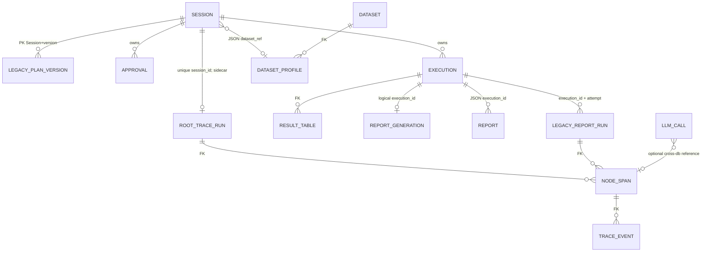
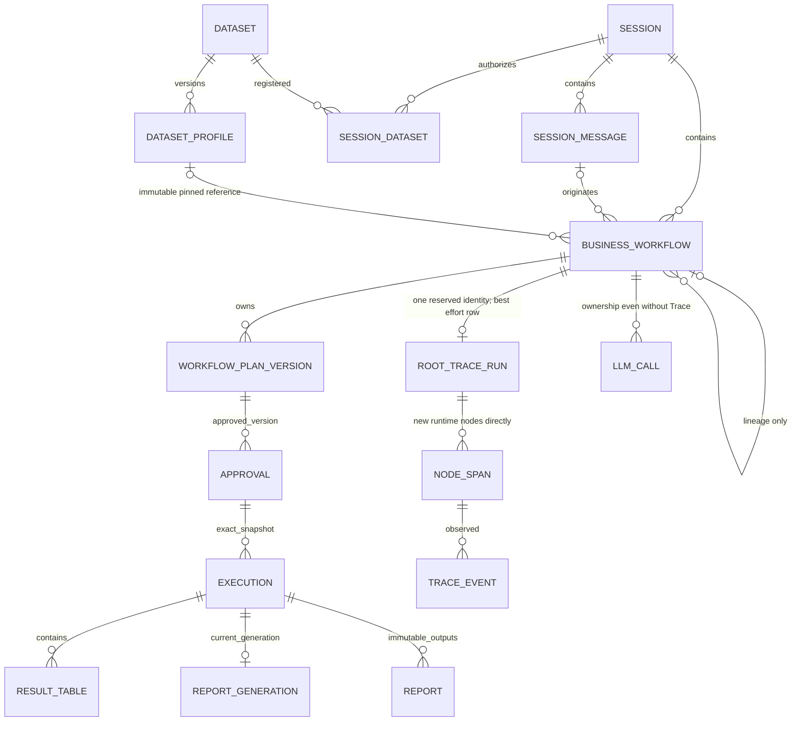

# InsightFlow Phase 02：Business Workflow 数据契约设计评审稿

日期：2026-10-30。需求：REQ-0076。状态：**待架构评审，未实施**。

本轮只读取源码及三个实际 SQLite 库，保存需求、Schema 取证和设计文档。未导入应用启动模块、未执行迁移、未运行测试、未发送模型请求，不修改业务源码、Schema、测试或业务记录。已有测试通过记录不作为本设计已实现的证据。

阅读顺序：本文（事实、ER、契约、API、测试与决策）→ [迁移与回滚方案](migration.md) → [实际数据库取证](database-inventory.json)。`business-schema.sql`、`trace-schema.sql`、`registry-schema.sql` 是只读导出的既有建表定义，不是待执行的迁移脚本。

## 1. 结论及事实/风险/建议的区分

**事实 F1：**当前没有独立 Business Workflow 表。Session 同时承载对话和分析状态，Root 有独立 run_id，但按 session_id 唯一。依据：[SessionState](/Users/lainey/Desktop/vibe-coding/insightflow/backend/app/domain/models.py:137)、[Root 唯一索引](/Users/lainey/Desktop/vibe-coding/insightflow/backend/app/storage/trace_migrations.py:26)、[register_root](/Users/lainey/Desktop/vibe-coding/insightflow/backend/app/observability/workflow.py:11)。

**风险 R1：**只增加 workflow_id 或只删除 Root 唯一索引，无法解决计划 v1 主键冲突、单一当前批准、回调串线及旧 API 歧义。此判断来自 F1 与下文实际表约束，不表示系统现在已支持多个 Workflow。

**建议 D1：**增加独立 Business Workflow 业务记录，Session 退回持续对话空间。审批/执行继续使用既有不可变快照和实际计算结果，不让 Trace 成为业务存储或授权来源。Workflow 控制状态从 Session 迁移，不另建一套竞争的业务状态机。

**建议 D2：**目标新运行只使用一个 Workflow Root 和直接归属于它的 Node Span；历史独立 Report Run 保留为兼容记录。报告重试使用新的 Node Span、现有 report attempt 和并发令牌，不创建 Attempt 实体或第三层 Trace。

**重要约束解释 D3：**“每个 Workflow 对应一个 Root”定义为唯一且预留的 Root 身份，正常采集时物理行恰好一条；Trace 故障时物理行允许暂时或历史性缺失。若要求物理 Trace 行必须与业务创建同步成功，会违背 Trace 失败不得阻断业务。推荐在 Workflow 创建事务中预留 root_run_id，但不对侧库建立强 FK，不伪造缺失 Span 或过去成功事件。此解释需要产品/架构确认。

## 2. 当前实际库存与 Schema 审计

实际读取 `var/insightflow.sqlite3`、`var/observability/trace.sqlite3`、`var/prompt_registry/registry.sqlite3`，均采用 mode=ro、query_only 和只读事务。跨库不是同一时刻原子快照。完整 PK、FK、索引、触发器、行数和哈希见 database-inventory.json；以下数量只代表读取时点：

- 6 个 Session：5 个 real_v1、1 个 legacy_mock；5 个有 dataset_ref，2 个有 review_plan。
- 5 个 Dataset、5 个 DatasetProfile；2 个持久化 PlanVersion、1 个 Approval、1 个 Execution、1 个 Report、1 个 ReportGeneration。
- 3 个 Workflow Root、1 个历史 Report Run、18 个 Span、55 个 Event；3 个 Session 没有 Root，不能据此推断它们未开展业务。
- 21 个 LLMCallRecord，9 个有 Run/Span，12 个无 Run。其中 4 个无 Run 调用有唯一已保存 IntentArtifact.parse_id 的直接关联候选；其余 8 个缺少这一直接证据，不能按时间或相似输入强行归属。
- 三库 PRAGMA foreign_key_check 均无已声明 FK 的违例；这不证明 JSON 内全部业务引用正确。

来源：[取证库存](database-inventory.json)、[关联证据](association-evidence.json)；parse_id 契约在 [IntentArtifact](/Users/lainey/Desktop/vibe-coding/insightflow/backend/app/domain/intent.py:117)。

### 2.1 当前实体、约束与读写路径（事实）

| 实体 | 当前主键、外键和唯一约束 | 状态/归属与读写入口 |
|---|---|---|
| Session | sessions.id PK；state 是 JSON；session_access.session_id PK/FK | get/mutate；mutate 用 BEGIN IMMEDIATE、Session revision。消息、目标、当前计划、批准、错误、阶段均在 state |
| Dataset | datasets.id PK；file_info JSON | FileStore 保存上传文件，DatasetRepository.save 登记元信息；路径由 file_id+extension 服务端构造 |
| DatasetProfile | PK(dataset_id,dataset_version)，FK dataset_id→datasets | profile/save；版本基于内容 SHA、格式、解析契约和 options；同版本不同画像拒绝覆盖 |
| Manifest | 无独立 Manifest 表；RunManifest 在 TraceRun.record 内 | 捕获模板、模型、版本和输入指纹；update_run 强制不可变。不能当作数据集权威档案 |
| PlanVersion | PK(session_id,plan_version)，FK session_id→sessions；plan_id 不在 PK 中 | PlanReviewRepository 追加；current_guard 选择该 Session 最新版本；UPDATE/DELETE 触发器禁止 |
| Approval | approval_id PK；UNIQUE(session_id,request_id)；FK session_id；约束审计另 FK approval_id | 保存不可变 request、record、审批快照；当前有效批准来自 Session.engine_approval；不是数据库 FK 到具体 PlanVersion |
| Execution | id PK；request_id 全局 UNIQUE；FK session_id→sessions | claim/save_task/finish；批准快照、请求、结果 JSON；execution_results.id PK、FK execution_id；不是数据库 FK 到批准版本 |
| ExecutionResult | 在 executions.result，不是另一个独立执行实体表 | 含 execution_id、plan_id/version、dataset/version、approval_id、真实状态及结果引用 |
| ReportGeneration | execution_id PK，但当前 DDL 没有声明 FK；session_id/record | 每个执行只保留当前 attempt 的 generation；queue/start/finish；同时镜像写入 Session |
| Report | analysis_reports.id PK；report/audit JSON，无 SQL FK 到 Execution | 不可变保存 ID；真实归属由 report.execution_id 及 audit 的 Session/Plan/Approval 核对；导入报告不一定有 Engine 行 |
| TraceRun | id PK；UNIQUE(execution_id,attempt)；另有 Session 唯一 Root 索引 | workflow/report_generation 两种 kind；跨库没有 FK 到 Session/Execution；Manifest 不可变；observation_revision 原子 CAS |
| TraceSpan | id PK；FK run_id→TraceRun；parent_span_id 的同 Run 合法性由仓储检查 | reserve_workflow_span 事务分配 node_attempt；终态 Span 不能覆盖 |
| TraceEvent | id PK；FK run_id、span_id；UNIQUE(run_id,sequence) | 事件追加，仓储校验 Span 同 Run；不是按最后事件决定业务成功 |
| LLMCallRecord | id PK；UNIQUE(operation_id,sequence)；request_id UNIQUE/FK 请求快照 | run_id/span_id 是跨库软引用；终态禁止更新；只保存响应 hash，不保证保存完整模型响应 |

真实路径：

- [Database](/Users/lainey/Desktop/vibe-coding/insightflow/backend/app/storage/database.py:9)、[SessionRepository.mutate](/Users/lainey/Desktop/vibe-coding/insightflow/backend/app/storage/session_repository.py:33)。
- [DatasetRepository](/Users/lainey/Desktop/vibe-coding/insightflow/backend/app/storage/dataset_repository.py:13)、[dataset_version](/Users/lainey/Desktop/vibe-coding/insightflow/backend/app/profiling/versioning.py:8)、[FileStore.read](/Users/lainey/Desktop/vibe-coding/insightflow/backend/app/storage/file_store.py:43)。
- [PlanReviewRepository DDL/不可变触发器](/Users/lainey/Desktop/vibe-coding/insightflow/backend/app/storage/plan_review_repository.py:8)、[PlanVersion/ReviewApproval](/Users/lainey/Desktop/vibe-coding/insightflow/backend/app/domain/plan_review.py:11)。
- [ExecutionRepository](/Users/lainey/Desktop/vibe-coding/insightflow/backend/app/storage/execution_repository.py:13)、[ExecutionRequest](/Users/lainey/Desktop/vibe-coding/insightflow/backend/app/domain/execution.py:107)、[ExecutionResult](/Users/lainey/Desktop/vibe-coding/insightflow/backend/app/domain/execution.py:145)。
- [ReportRepository](/Users/lainey/Desktop/vibe-coding/insightflow/backend/app/storage/report_repository.py:9)、[AnalysisReport](/Users/lainey/Desktop/vibe-coding/insightflow/backend/app/domain/analysis_report.py:77)。
- [Trace 表](/Users/lainey/Desktop/vibe-coding/insightflow/backend/app/storage/trace_repository.py:15)、[Trace 类型及 RunManifest](/Users/lainey/Desktop/vibe-coding/insightflow/backend/app/domain/tracing.py:8)、[Registry DDL](/Users/lainey/Desktop/vibe-coding/insightflow/backend/app/storage/migrations/prompt_registry_001.sql:2)、[CallRecorder](/Users/lainey/Desktop/vibe-coding/insightflow/backend/app/llm/capture.py:38)。

### 2.2 当前 ER（逻辑关系不等于数据库声明的 FK）

### 2.3 只在 Session 内的当前业务控制信息（事实）

`status/revision/error`、`user_goal/analysis_mode`、`profile_options/dataset_ref/profile`、`intent/intent_history/clarification_answers`、`planner_result`、`current_plan_version/review_plan/review_status`、`approved_plan_version/engine_approval`、`engine_execution_ids/report_generations`、`node_runs/workflow_events`。计划、批准、执行和报告有独立历史事实，但这些“当前指针”和准备阶段检查点没有独立 Workflow 作用域。依据：[SessionState:137](/Users/lainey/Desktop/vibe-coding/insightflow/backend/app/domain/models.py:137)、[真实准备流程](/Users/lainey/Desktop/vibe-coding/insightflow/backend/app/workflow/orchestrator.py:249)。

消息也嵌在 Session JSON 中，Message 有稳定 ID，但没有独立消息表或数据库级 origin_message FK；创建入口把初始 goal 保存为用户消息。依据：[Message:72](/Users/lainey/Desktop/vibe-coding/insightflow/backend/app/domain/models.py:72)、[create_session:68](/Users/lainey/Desktop/vibe-coding/insightflow/backend/app/api/routes.py:68)。

## 3. 目标 ER 与所有权（建议，尚未存在）

图中 Approval/Execution/Report 的 Workflow 所有权通过同库强约束绑定表建立，既有不可变 payload 和原主键保留；不意味着本轮把旧表重建。具体物理方案见 migration.md。历史 Report Run 不放到 Root 下形成第三层，只作为可跳转的历史顶层记录保留并登记同一 Business Workflow 的归属。

### 3.1 Session 的新职责

持久化对话 ID、标题、会话元信息、会话 revision、消息和数据集授权目录。Workflow 列表由归属查询产生；`selected_workflow_id` 只是客户端选择偏好，不是服务端当前事实。Session 不再有全局分析 `status/current_plan/engine_approval/error` 的新写入权威字段。

Session revision 保护聊天元信息/消息追加；Workflow revision 保护分析。A 的状态变化不能使 B 的合法请求因 Session revision 无关增长而失败。会话“最近更新”仅用于排序，不用于选择有效工作流。

### 3.2 Business Workflow 最小字段表

| 字段 | 持久化与类型 | 规则 |
|---|---|---|
| workflow_id | 必须；服务端不透明唯一 ID，PK | 与 session_id、run_id、plan_id 区分；创建后不变 |
| session_id | 必须；FK sessions.id | 一个 Session 多 Workflow；同时提供 UNIQUE(workflow_id,session_id) 供组合引用 |
| origin_message_id | 新运行必需；历史允许 null | 与 session_id 组合 FK 指向本 Session 消息；不能引用别的 Session；无证据不补造消息 |
| parent_workflow_id | 可空 FK BusinessWorkflow | 仅表示新需求/重跑来源，不是跨任务执行依赖；同 Session、已存在、不可修改，禁止自引用与环 |
| goal_text / goal_sha256 | 必须；不可变原始目标及 hash | 结构化 Intent 不替代原话；澄清追加上下文，真正改变分析目标新建 Workflow |
| input_file_id | 新运行必须；数据集元信息引用 | 上传先登记文件元信息；画像尚未产生时不伪造 dataset_version；历史缺失允许仅归档不可执行 |
| dataset_id + dataset_version | 等价快照引用；画像完成前可空 | 复用现有复合版本键，无须新增 dataset_version_id；二者同时为空或同时有值；绑定后不可换版本 |
| dataset_content_sha256 / profile_hash | 已绑定时保存或可验证引用 | 核验文件、画像与解析选项；不把 RunManifest 当数据事实来源 |
| current_plan_version_id | 可空；FK WorkflowPlanVersion | 指向同 Workflow，不能仅凭数字选计划 |
| current_plan_version | API 返回值，建议从版本行派生 | 避免与 ID 双写不一致；若为性能缓存必须同事务校验并更新，不再是独立权威 |
| current_approval_id | 可空；同 Workflow 的批准引用 | 修订后清空当前引用，旧批准历史不删除 |
| current_execution_id | 可空；同 Workflow 执行引用 | 原子 claim 时设置，旧执行仍可保存历史；不得按成功时间推断 |
| control_status | 必须；迁移现有 SessionStatus 语义 | 只作为现有命令准入/准备检查点的唯一状态源；COMPLETED 仍表示计算结束，不承诺报告完整交付 |
| control_context | 必须；版本化 JSON | 移入原 Intent 历史、澄清、画像引用、planner_result、可重试错误及必要节点运行引用；原 review_status 仅作兼容投影，不另立状态权威 |
| revision | 必须；非负整数 | 同库写事务或条件更新保护；回调必须匹配当前 Workflow |
| active_execution_key | 可空；执行尝试隔离标识 | 接受异步调度/恢复时生成新值；仅是 Workflow 的标量，不是 Attempt 实体；旧 worker 不能自行刷新后重放 |
| root_run_id | 必须；唯一且不可变预留 ID | 业务创建时保存；不对 Trace 侧库建 FK；旧 Root 可复用已有 ID；缺失时只预留身份不制造历史事件 |
| creation_request_id / payload_hash | 新创建必须 | UNIQUE(session_id,creation_request_id)；同 key 不同目标/数据/消息拒绝 |
| created_at / updated_at | 必须；UTC | 新记录为业务接受时间；回填须区分历史业务开始时间和现在的登记时间 |
| origin / materialized_at / provenance | 必须的迁移元数据 | native / legacy_default / legacy_archive；保存回填时间、源 hash 与归属证据，不能冒充过去实际部署记录 |
| lifecycle_status / current_phase | **只读派生，不另建持久权威状态** | 由 control_status、有效计划/审批、指定执行、ReportGeneration/Report、覆盖状态聚合 |
| collection / consistency | **只读派生** | Trace 缺失、跨库读取变化、历史不明确分别返回 controlled unknown/inconsistent |

现有状态与检查点依据 [SessionState:137](/Users/lainey/Desktop/vibe-coding/insightflow/backend/app/domain/models.py:137)；并发检查从 [preparation_mutate:220](/Users/lainey/Desktop/vibe-coding/insightflow/backend/app/workflow/orchestrator.py:220) 的 Session revision 平移到 Workflow，不能继续以整个会话 revision 隔离不同分析。

### 3.3 计划、审批、执行与报告契约

| 对象 | 精确引用与约束（目标） |
|---|---|
| WorkflowPlanVersion | plan_version_id PK；UNIQUE(workflow_id,plan_version)；同 Workflow 内从 1 递增；plan_id、dataset/version、validation_version 固定；LLM AnalysisPlan 输出 Schema 无须新增 workflow_id，归属由服务端附加 |
| Approval | 原 approval_id 不变；显式绑定 workflow_id + plan_version_id + validation_version + dataset/version + intent/plan snapshot hash；批准引用的快照必须与对应版本一致 |
| Execution | 原 execution_id 不变；明确 workflow_id、approval_id、plan_version_id、数据快照、dispatch key；请求只定位服务端批准快照，不接收任意计划或路径 |
| ExecutionResult | 完整结果与预览分开，既有计算结构不变；v2 归属封装包含 workflow_id，来源结果仍绑定原 execution_id/approval_id |
| ReportGeneration | 沿用 execution_id 唯一当前 generation、单调 report attempt；workflow 由唯一 Execution 所有权确定，不再以 Session.current 字段决定；新增 FK/绑定校验不能假设历史全完整 |
| Report | 原 report_id 不变；明确 execution_id + workflow_id，验证 report.execution_id、保存审计及 Execution 绑定一致；engine 来源强校验，imported/旧 Mock 不能伪装成真实 Engine |
| Message | message_id + session_id 稳定，新增 workflow_id 可空；目标创建消息和后续澄清须明确所属 Workflow；会话级消息可无 Workflow |

审批与执行现有强校验继续保留，作用域从 Session.current 改为 Workflow.current：[check_approval:20](/Users/lainey/Desktop/vibe-coding/insightflow/backend/app/services/analysis_engine.py:20)、[PlanReview.current_guard:158](/Users/lainey/Desktop/vibe-coding/insightflow/backend/app/services/plan_review.py:158)。

### 3.4 数据版本隔离

一次 Workflow 只绑定一个解析数据快照；相同文件不同 header_row/sheet/options 会产生不同 dataset_version。绑定前可以失败/补充上传信息；一旦开始基于版本生成 Intent/Plan，不允许原位切换。用户要求在新版本上重分析，创建新 Workflow、可设置 parent_workflow_id，重新规划和审批，不继承批准。

多个 Workflow 可以只读共享同 Session 已授权的同一个 DatasetProfile。使用真实复合键和内容 SHA，不能用文件名、Session 当前默认文件或版本时间判断相同。[版本计算](/Users/lainey/Desktop/vibe-coding/insightflow/backend/app/profiling/versioning.py:8)、[不可变画像保存](/Users/lainey/Desktop/vibe-coding/insightflow/backend/app/storage/dataset_repository.py:20)。

### 3.5 Trace、Manifest、调用与失败语义

- **业务身份不依赖采集成功。**Workflow 的 root_run_id 在业务库预留；侧库登记用同一 ID 幂等。侧库不可用时返回 not_collected/incomplete，业务继续。历史缺 Root 不补 Span；如果之后恢复登记，只标实际采集时间与缺口，不反推过去成功。
- **Root 与 Node Span 两层。**新 Reporting 的 Evidence、Chart、Insight、Fact Validator、Assembler、Persistence 等直接挂该 Root，不新增 Report Run 子层或报告 Attempt 节点。重试创建实际重跑节点的新 Span，携带 execution_id/report attempt/dispatch key；稳定 node_key 不能混入动态 attempt。
- **历史 Report Run 单独兼容。**已有 Run/Span/Event/Manifest 不改写；建立明确归属链接，Admin 可跳转历史记录。旧 Report Run 不重新挂成 Span，不把不同 Run 的 Event 序号合并，也不伪造新根的历史节点。
- **当前 CAS 保留。**observation_revision 不复用为 Workflow revision；Root 接受状态事件时携带明确 Workflow 版本和执行隔离标识，仍使用原子 CAS。当前实现见 [update_run:60](/Users/lainey/Desktop/vibe-coding/insightflow/backend/app/storage/trace_repository.py:60)。
- **Root 状态是投影。**后续完整 Root complete/partial 只能来自已提交、当前 Workflow 分支匹配的业务结果；不能决定审批资格或反向覆盖 Workflow。现有 preparation-only Root 不能直接解释为完整生命周期；扩展迁移矩阵需另行评审，不在本轮实施。
- **Manifest 不可变。**新 Root 初建时画像可能未完成，Manifest 只保存当时已知文件/目标和待绑定标记；数据版本确定后记录真实绑定事件/输入快照，不修改初始 Manifest。历史 Manifest 缺 workflow_id 时用证据链接，不改写成“过去已采集”。
- **LLM 独立归属。**即使 run_id/span_id 缺失，未来调用也应通过 CallBinding 的业务元信息关联 workflow_id；保持 operation_id/sequence/retry_index，不增 Attempt 表。历史无证据调用保持 unavailable。Prompt 请求快照原文、哈希和旧版本不回填改写。
- **区分两种故障政策。**Trace 仍 fail-open；现有 Prompt Registry 请求快照强制校验失败的错误政策不因此放宽。组合代码变化可能需要登记新的 composition 版本，即使 Prompt 文本不变，也不能覆盖旧快照。[模板来源校验](/Users/lainey/Desktop/vibe-coding/insightflow/backend/app/llm/templates.py:111)、[调用捕获](/Users/lainey/Desktop/vibe-coding/insightflow/backend/app/llm/capture.py:18)。
- **报告提交保护保留。**finish 的 accepted=True 提交成功才允许 persistence/报告 Trace 成功，False 只记录旧回调忽略；此规则同样适用于新的 Root 下 Report Span。[finish:65](/Users/lainey/Desktop/vibe-coding/insightflow/backend/app/storage/report_repository.py:65)、[ReportWorkflow:52](/Users/lainey/Desktop/vibe-coding/insightflow/backend/app/workflow/reporting.py:52)。

## 4. API、查询和前端迁移（设计，不是已新增接口）

建议将新契约放在显式 v2 路径，避免把现有 `/admin/workflows/{session_id}` 静默改成另一种参数含义。

| 新目标接口 | 业务作用域 |
|---|---|
| POST /api/v2/sessions；GET /api/v2/sessions/{session_id} | 创建/读取持续对话与消息摘要，不返回唯一分析状态 |
| GET/POST /api/v2/sessions/{session_id}/messages | 消息与稳定序号；分析相关消息必须指定 Workflow 或明确创建新 Workflow |
| GET/POST /api/v2/sessions/{session_id}/workflows | 列表/创建；创建携带 origin_message_id、目标、数据引用、creation_request_id，可选 parent |
| GET /api/v2/workflows/{workflow_id} | 明确工作流当前控制快照和 revision |
| POST .../clarifications、.../retry-preparation | 使用 expected_workflow_revision 和隔离标识；不接受 Session revision 代替 |
| GET .../plans、.../plans/{version}、.../review | 在 Workflow 内解析版本，v1 可以各自独立存在 |
| POST .../plan-revisions、.../approvals | 精确 plan_version_id/validation_version；返回不可变审批引用 |
| POST .../executions | 批准引用、幂等 key、期望 Workflow revision；生成明确执行 ID |
| GET .../executions/{execution_id}、.../executions/{execution_id}/report | 必须核对 URL Workflow 与对象归属；不匹配拒绝 |
| POST .../executions/{execution_id}/report | 精确 expected_attempt；report dispatch key 不得覆盖另一个执行 |
| GET .../reports/{report_id}；原 report_id 预览/下载路径保留 | 对象 ID 与 Workflow 双校验；显式 Report ID 的历史访问不按 Session 最新替换 |
| GET /admin/v2/workflows/{workflow_id}/lifecycle、.../trace | 按业务 Workflow 聚合和查 Root；Trace 缺失单独返回 |
| GET /admin/runs?workflow_id=... | 用归属链接筛选 Root 及明确标为 legacy 的 Report Run；既有 Run/Span 查询继续兼容 |

### 4.1 旧入口的明确兼容行为

1. `GET /api/v1/sessions/{id}`、`/plan`、`/profile`、`/review`、Session 范围的澄清/修订/审批/旧执行及 Admin Session Lifecycle，由新版兼容适配器处理。仅当该 Session 恰有一个可确定的 Workflow，才解析并投影旧 DTO；零个有效归属返回明确 unavailable，多个返回 `409 WORKFLOW_SCOPE_REQUIRED`。**不能因为有 legacy_default 就在多 Workflow 下静默选它，也不能自动取最近成功项。**
2. 旧 `/plans`、`/plans/{version}`、`/approvals`、`/constraint-audits` 同样需要作用域：多 Workflow 时旧数字版本不唯一，不混成一个列表。新 Session 会话 DTO 使用 v2，旧 DTO 不通过随意缺字段伪造兼容。
3. 旧 `/sessions/{id}/report*` 是旧 Report 契约，真实报告入口是 execution/report_id。legacy_mock 的旧报告仍用旧 renderer，不能把 AnalysisReport 强塞旧 Report Schema。多 Workflow 时不得由 Session.COMPLETED 选报告。[旧入口](/Users/lainey/Desktop/vibe-coding/insightflow/backend/app/api/routes.py:166)。
4. 旧 `/executions/{execution_id}`、`/reports/{report_id}`、`/admin/runs/{run_id}` 有显式 ID，可继续精确读历史；旧 POST /executions 没 workflow_id，只有唯一已验证的计划/批准映射时才允许新版适配器执行，否则拒绝。旧 Run Detail 查询不能把 Session 当前 Workflow 冒充此 Run 的冻结状态。
5. 权限仍先验证对象属于请求者可访问的 Session，再检查 Workflow/对象一致性；知道 workflow_id 不代表授权。当前是 Session capability token，不宣称账户/租户系统已完成。[session_guard](/Users/lainey/Desktop/vibe-coding/insightflow/backend/app/api/session_access.py:20)。

6. 判断歧义时不能排除 failed、已完成或归档 Workflow 后选一个“可执行的”；多条已存在 Workflow 就需要显式选择。旧 GET /sessions 的 SessionSummary.status 也无法表达多分析状态：全部可访问会话均为单流程时保留旧列表投影；存在多流程会话时，应返回明确 CLIENT_UPGRADE_REQUIRED，或经显式协商使用新列表契约，不能悄悄隐藏该会话或选一个状态。原单 legacy_mock 会话可保留原样只读展示，不授权真实执行。

现有选择点证据：[Session 当前计划/审核](/Users/lainey/Desktop/vibe-coding/insightflow/backend/app/api/routes.py:100)、[Session 画像](/Users/lainey/Desktop/vibe-coding/insightflow/backend/app/api/datasets.py:41)、[旧 Admin workflows 路径](/Users/lainey/Desktop/vibe-coding/insightflow/backend/app/api/admin.py:118)、[Lifecycle 当前执行选择](/Users/lainey/Desktop/vibe-coding/insightflow/backend/app/services/lifecycle.py:128)。

### 4.2 前端与 Admin

新工作台定位 `(session_id, workflow_id)`，建议路由 `/sessions/{session_id}/workflows/{workflow_id}`。Session 消息流中保留各 Workflow 的目标/方案/结果卡片标识，用户能明确选中某次分析。刷新先恢复 Session，再验证所选 Workflow 归属，不只按 Session 的最后执行 ID 选结果。

Workflow 查询、轮询、请求取消和旧响应过滤统一按 `workflow_id + revision + dispatch key`，A 的迟到响应不能覆盖 B。聊天刷新与分析轮询分开。幂等缓存改为 Workflow + plan_version_id/approval_id/execution_id 的稳定命令键；旧缓存只在单流程明确映射时迁移，否则保留但不使用。

当前事实：[App 单 Session 状态与恢复](/Users/lainey/Desktop/vibe-coding/insightflow/frontend/src/App.tsx:14)、[前端路由](/Users/lainey/Desktop/vibe-coding/insightflow/frontend/src/main.tsx:7)、[当前报告 at(-1) 规则](/Users/lainey/Desktop/vibe-coding/insightflow/frontend/src/workflow/presentation.ts:6)、[审批/执行缓存键](/Users/lainey/Desktop/vibe-coding/insightflow/frontend/src/api/client.ts:74)、[消息结果展示](/Users/lainey/Desktop/vibe-coding/insightflow/frontend/src/components/MessageList.tsx:25)。

Admin Trace Detail 以所选 Run 的明确 Workflow 归属请求 Lifecycle；历史无归属显示 unavailable，而不是退回 Session 最新结果。保留 Root/历史 Report Run 跳转和显式“历史运行”提示。来源：[Lifecycle API 客户端](/Users/lainey/Desktop/vibe-coding/insightflow/admin/src/api/lifecycle.ts:33)、[LifecyclePanel](/Users/lainey/Desktop/vibe-coding/insightflow/admin/src/features/traces/LifecyclePanel.tsx:65)。

提交锁定的产品体验不在本设计中擅自改变：后端必须支持 Workflow 隔离，但前端“任一运行时是否禁发新消息”保留现有规则，待产品确认是否改为仅锁当前 Workflow。

## 5. 受影响源码清单（未来实施范围）

| 范围 | 需评审的现有文件与位置 | 预期最小调整 |
|---|---|---|
| 模型 | domain/models.py:125/137；domain/plan_review.py:11；domain/execution.py:107；domain/lifecycle.py:30；domain/tracing.py:20；domain/prompt_registry.py | 对话/Workflow DTO 分离；现有计算 payload 以归属封装复用 |
| 业务存储 | storage/database.py:9；session_repository.py:33；dataset_repository.py:13；plan_review_repository.py:8；execution_repository.py:40；report_repository.py:65/84 | 新 Workflow/消息/归属索引；命令事务以 Workflow 而非 Session 当前槽为准 |
| 生命周期 | storage/lifecycle_reader.py:45；services/lifecycle.py:12/128/271 | 按 Workflow 读取并核对；保留旧分支排除、unknown、一致性检测 |
| 编排/审核 | workflow/orchestrator.py:220/227/321/350/361；services/plan_review.py:107/158；services/analysis_engine.py:20 | 当前版本选择和旧回调 guard 改为 Workflow 作用域，算法不重写 |
| Reporting/Trace | workflow/reporting.py:13/28/52；observability/workflow.py:11/40；observability/recorder.py:180；storage/trace_repository.py:48/60；trace_migrations.py:26 | 新 Report 节点直接归 Root；历史独立 Run 兼容；Root 索引切换且保留 CAS/提交确认 |
| LLM 日志 | llm/base.py；llm/capture.py:18；llm/templates.py:111；storage/prompt_registry.py；storage/migrations/prompt_registry_001.sql | 业务归属元数据与受控链接，历史 payload/哈希不改 |
| API | api/routes.py:85/100/140/166；api/datasets.py:41；api/executions.py:19；api/reports.py:36；api/admin.py:118 | 新作用域及旧 API 唯一解析适配器；显式对象 ID 路径保留 |
| 用户端 | frontend/src/main.tsx:7；App.tsx:14/49/76；api/client.ts:74/85；types/contracts.ts；workflow/presentation.ts:6；MessageList.tsx:25；PlanReviewCard/ReportGenerationCard | 当前选择、轮询、缓存、方案/结果卡片按 Workflow 绑定 |
| Admin | admin/src/api/lifecycle.ts:33；features/traces/LifecyclePanel.tsx:65；pages/TraceDetailPage.tsx；types/traces.ts | 按明确业务归属取生命周期，保留历史 Run 和缺失状态 |

表中列出的新契约文件/迁移文件将在架构通过后另行创建，本轮没有创建生产模块或改测试。

建议的新增文件位置：`backend/app/domain/business_workflow.py`、`storage/workflow_repository.py`、`storage/workflow_bindings.py`、`api/workflows.py`，以及分阶段的独立迁移文件。它们承接归属、事务和 DTO，不重复实现 Profiler、Planner、Validator 或 Pandas 内核。拟新增测试按第 6 节拆为 Workflow 作用域、迁移、API 兼容和 Trace 安全回归文件；本轮不创建这些文件。

## 6. 测试矩阵（仅设计，未编写或执行）

| 编号 | 场景 | 必须断言 |
|---|---|---|
| T01 | 同 Session 创建 A、B | 两个独立 Workflow ID、不同目标/Root 身份，同一对话；重复创建 key 幂等 |
| T02 | A/B 各有 plan v1 | 无 PK 冲突，plan_version_id 独立；只凭数字不能跨 Workflow 解析 |
| T03 | 独立审批及错误归属 | A 的批准不能引用 B 的版本；伪造 Session/Workflow/数据组合拒绝 |
| T04 | 同时执行 A/B | 各自 snapshot、execution_id、dispatch key；无 Session revision 无关冲突 |
| T05 | 独立报告 | 各自执行、报告和证据；图表/报告 ID 不串线，提交成功才有成功 Trace |
| T06 | A 失败、B 成功 | B 状态、批准、执行、报告与 revision 不被 A 失败改变 |
| T07 | A 删任务修订 | 仅 A 版本递增与审批失效，B 原批准继续有效 |
| T08 | 同 Workflow 合法恢复 | 同 Workflow/Root、新 execution key/Node Span，旧 worker 成功或错误均被拒绝 |
| T09 | 跨 Workflow 旧回调 | 即使数值 revision 相同，A 令牌不能作用于 B；迟到前端响应也不能覆盖 B |
| T10 | Trace 故障/缺 Root | Workflow、计划、批准和结果可正常保存；collection not_collected/incomplete，不伪造 Span |
| T11 | 历史回填 | 原 PK、ID、JSON/hash 不变；legacy locator 唯一、可重跑、关联证据可复核 |
| T12 | 歧义/缺数据历史 | unknown/quarantined；不按时间、名称或相似原话强行分配，不授权执行 |
| T13 | 旧 API 单流程兼容 | 原调用经过适配器定位唯一 Workflow；原幂等重放不重复审批或执行 |
| T14 | 旧 API 多流程 | 409 WORKFLOW_SCOPE_REQUIRED，不默认 default/最近成功 Workflow |
| T15 | Root CAS | 并发旧写不能覆盖；同业务 revision 陈旧 observation_revision 失败；历史默认 0 可读 |
| T16 | Report stale callback | 部分恢复及完整恢复、迟到成功与失败四组；旧提交 False 不 complete，新提交成功可 complete |
| T17 | 数据版本隔离 | A 使用 D1、B 使用 D2；新解析选项不改变 A；旧审批不授权 D2 |
| T18 | 消息与权限 | origin 属于同 Session；别的 Session token 不能访问；Session 共享权限不误称单 Workflow 隔离 |
| T19 | 幂等作用域 | A/B 同客户端短 key 可独立使用；同 Workflow 同 key 不同 body 冲突；双击只产生一个对象 |
| T20 | 归属强约束 | 组合 FK/事务拒绝跨 Workflow Approval、Execution、Report，验证 JSON 快照与索引一致 |
| T21 | 双库部分恢复 | Trace/Registry 写失败不导致伪造关联；业务错误与采集缺口分开 |
| T22 | 历史 Report Run | Run/Span/Event/Manifest 和序号原样保留；新 Reporting 无第三层 Run/Attempt 节点 |
| T23 | 迁移中断/重跑 | Session 原子单元，唯一 alias 防重复；checkpoint/hash 冲突停止，后续增量不丢 |
| T24 | 旧 Worker/旧二进制 | 切换后被路由/数据库保护拒绝写旧 Session 分析槽；不能绕过新归属索引 |
| T25 | 回滚演练 | 单流程 shadow 可退；1:N 写入后只能退回支持 Workflow 的版本，不能静默退旧 Session-only 代码 |
| T26 | 模板与 LLＭ 记录 | 新调用业务归属可在 Trace 缺失时保存；历史请求及模板 hash 不变，无证据调用仍 unavailable |
| T27 | Lifecycle 完成度 | Engine partial 或 Report failed 不变 succeeded；历史分支不覆盖当前分支；不同 Workflow 独立聚合 |
| T28 | 快照读取竞争 | Workflow revision 读前后变化返回重试/不一致；单纯聊天消息更新不污染分析一致性 |

T15/T16 应继承而不是替换 [现有 11 项安全用例](/Users/lainey/Desktop/vibe-coding/insightflow/backend/tests/test_trace_write_safety.py:35)；模型语义评测不是本次契约迁移测试的替代品。

## 7. 待确认决策与推荐

| 决策 | 推荐 | 未确认的影响 |
|---|---|---|
| Root 必须物理存在，还是唯一预留身份+可缺采集？ | 预留唯一 ID，采集物理行 0..1；禁止缺失反推成功 | 与 Trace fail-open 能否同时成立 |
| 新 Reporting 是否继续建独立 Run？ | 新运行只挂业务 Root 的 Node Span；旧 Report Run 归档兼容 | 决定是否真正保持两层架构 |
| 新目标与澄清如何区分？ | 用户明确新建分析或针对某 Workflow 补充；暂不靠新增 LLM 节点自动分流 | 避免错误覆盖原目标 |
| 更换数据版本如何处理？ | 新 Workflow，可引用 parent；不继承审批 | 审批与统计口径可信度 |
| 任一 Workflow 运行时能否继续发消息？ | 本轮保留现有锁定体验，实施前单独确认是否按 Workflow 放开 | 不能借架构迁移擅自改变既有 UI 约束 |
| 历史 Mock/歧义数据是否可执行？ | 可见、明确 legacy_archive/unknown，只读；重新提出需求开启真实 Workflow | 不能用历史归档外观伪造真实结果 |
| v1 多 Workflow 请求选默认还是拒绝？ | 拒绝歧义，显式选择 Workflow | 老客户端体验与正确性权衡 |
| 历史计划主键如何保留？ | 原表冻结保留，统一 WorkflowPlanVersion 版本仓通过 legacy locator 读取旧行 | 直接改 PK/重编号会破坏历史引用 |
| 何时允许真正 1:N？ | 每 Session backfill/validate 完成、新旧写入隔离及回滚演练后再开 gate | 提前开放不可安全回退 |

报告完成后停止。没有实施推荐项；后续需架构评审通过，再形成独立开发任务。
