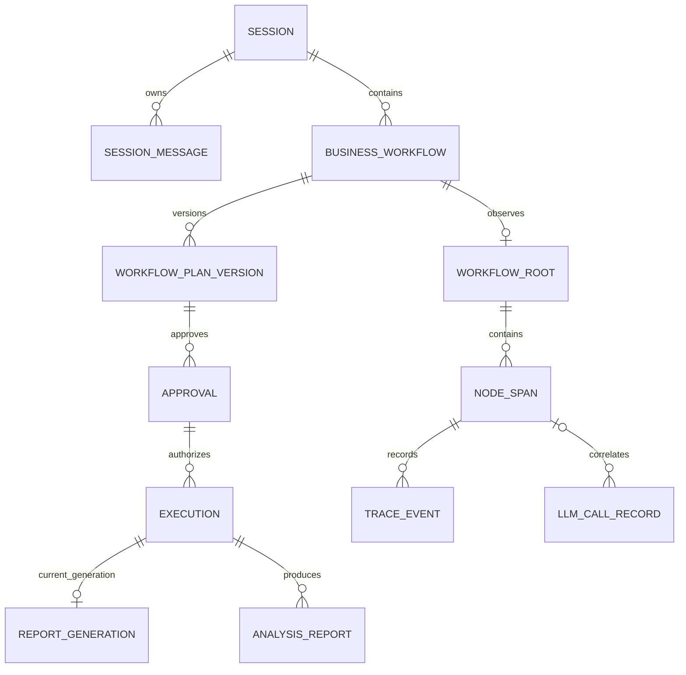

# InsightFlow Lifecycle Contract V1.0

日期：2026-10-31（Asia/Shanghai）  
需求：REQ-0078；关联 REQ-0075、REQ-0076、REQ-0077。  
性质：基于当前源码的设计契约，供评审；本轮只新增文档，不修改运行代码、数据库或业务状态机。

## 1. 契约边界与实施标记

本文用三种标记区分能力，不能把设计方案当作已上线事实：

- **现有**：可以从当前源码验证的运行行为。
- **结构已具备**：Phase 02-A 已有空表、约束或只读仓储，没有原生业务写入。
- **目标**：后续 Backfill、Writer、Switch 和埋点阶段必须实现并验收的契约。

当前 SessionState 仍是业务控制状态权威。Business Workflow 的新表尚未接管业务，生产入口不得创建第二个 Workflow。当前 Workflow Root 只覆盖准备流程，停在 waiting_approval；不能据此声称 Engine 或 Reporting 已被同一个 Root 完整追踪。历史 Report Run 继续独立保存。

依据：`backend/app/domain/enums.py:SessionStatus`、`backend/app/workflow/transitions.py:transition`、`backend/app/observability/workflow.py:checkpoint`、`backend/app/storage/trace_repository.py:TraceRepository.update_run`；已交付 Phase 02-A `docs/implementations/business-workflow-expand-2026-10-30/README.md`。

## 2. 身份、归属与不变量

### 2.1 目标实体关系



逻辑上每个 Workflow 必须预留一个唯一 root_run_id；实际 Trace 数据可以因采集失败而缺失，因此物理 Root 记录为 0..1。LLMCallRecord 是调用日志，不是第三层 Trace，也不是独立 Attempt。Event 是事件而非 Trace 层级。历史独立 Report Run 不因目标关系图而被删除或改写；其现有关系另见第 8 节。

### 2.2 强制不变量

| 编号 | 契约 | 实施状态 |
|---|---|---|
| I01 | Session 表示持续对话空间，不代表单条消息；同一 Session 可包含不同分析目标 | 目标；当前业务仍单流程 |
| I02 | Workflow 锁定目标、Session、来源消息、Root ID；同目标澄清/修订/重试不换 Workflow | 身份约束结构已具备；运行 Writer 待实现 |
| I03 | 新独立目标创建新 Workflow；parent_workflow_id 只表达来源，不继承审批、执行权限或 Trace 父子关系 | 目标 |
| I04 | Workflow 创建、创建请求幂等键、目标哈希、Root ID 预留在同一业务事务提交 | 结构已具备；Writer 待实现 |
| I05 | 数据集版本一经绑定不可换；新数据版本创建新 Workflow，不静默替换旧批准输入 | 结构已具备；新入口待实现 |
| I06 | 新 PlanVersion、Approval、Execution、Report 的业务事实及归属链接在同库事务提交 | 组合 FK 已具备；当前 legacy 写路径不受此新要求拦截 |
| I07 | PlanVersion 在 Workflow 内递增，不同 Workflow 可分别拥有版本 1；历史内容不可覆盖 | 新仓结构已具备；旧 Session 版本主键保留 |
| I08 | 每次执行精确绑定 dataset、plan、validation、approval；禁止 Session 最新记录替代精确引用 | 当前服务有版本校验；目标需补 workflow_id |
| I09 | Trace 失败不能改变业务结论；缺 Span 不推断节点成功 | 当前 TraceRecorder fail-open，目标继续保持 |
| I10 | Root + Node Span 两层；不创建第三层节点和独立 Attempt 表 | 目标与历史兼容要求 |
| I11 | 业务提交未 accepted 的 Report 不得标记成功 Trace | 已实现 Report stale callback 保护 |
| I12 | unknown 表示无法可靠判断；inconsistent 是一致性维度，不伪装业务成功或自动修复数据 | 当前只读模型已实现 |

身份约束依据：`backend/app/storage/migrations/workflow_expand_business_001.sql` 的 business_workflows、workflow_identity_immutable、workflow_revision_guard 和各归属链接。新表只提供结构约束，不等于业务写入已原子化。

## 3. 多维状态与权威来源

### 3.1 状态不能压缩成一个 status

| 对象/维度 | 已有值与含义 | 权威来源 |
|---|---|---|
| 控制状态 | CREATED、PREPARING、PROFILING、PARSING_INTENT、PLANNING、VALIDATING、WAITING_FOR_CLARIFICATION、AWAITING_APPROVAL、APPROVED、RUNNING、COMPLETED、FAILED | 现有 SessionState.status；目标 Switch 后才是 Workflow.control_status |
| 业务生命周期 | created/running/waiting_input/waiting_approval/succeeded/partially_succeeded/failed/interrupted/unknown | Lifecycle Aggregator 的只读派生，不新增镜像可写状态 |
| 当前活动 | not_started/preparing/profiling/parsing_intent/planning/validating/clarification/review/approved_not_started/executing/report_not_started/report_queued/reporting/finished/unknown | 当前分支事实派生；不把 UI 进度写回数据库 |
| Plan 覆盖 | complete/partial/blocked；任务 F0/F1/F2 | ValidatedAnalysisPlan，不是 LLM 自报 |
| Approval | ReviewApproval 的历史记录是 approved；批准快照支持 approved/revoked | 保存快照及当前引用；历史批准不因指针失效被覆盖 |
| 执行存储 | running/finished | executions 行 |
| 执行业务结果 | success/partial_success/failed | ExecutionResultV1，不等同 executions.status |
| Task | success/failed/skipped；步骤 success/failed | 保存的任务结果与步骤日志 |
| ReportGeneration | queued/generating/completed/failed/unavailable，当前 attempt | 每 execution_id 一条当前记录，不是完整尝试历史 |
| 报告内容 | report_status=complete/partial/unavailable；goal_coverage=complete/partial/blocked | 已提交 AnalysisReport |
| 报告交付 | delivered/not_delivered/unknown | 有效分支上 generation、报告和提交关系验证结果 |
| Trace Run | queued/running/waiting_input/waiting_approval/complete/partial/unavailable/failed/interrupted | TraceRepository；必须按 kind 限制转换 |
| Node Span | running/complete/partial/failed/skipped/interrupted | 真实采集记录，终态不可重新打开 |
| LLM 调用 | running/succeeded/failed/cancelled/interrupted | LLMCallRecord；调用成功不代表 Schema 或业务校验成功 |
| 采集完整性 | availability=available/not_collected/unavailable/unknown；integrity=incomplete/unknown | 只读聚合；当前没有“端到端完整已证明”的标记 |
| 一致性 | consistent/unknown/inconsistent；cross_store_snapshot=non_atomic | 事务业务快照加 revision 复核，不宣称跨库原子快照 |

COMPLETED 在当前代码中表示计算结束，包含 Engine partial_success，不表示报告完成。ReportGeneration.completed 也允许对应 partial 报告。TraceRun.complete 不自动等于业务 succeeded。三个名词不能互换。

依据：`backend/app/domain/lifecycle.py`、`backend/app/domain/execution.py`、`backend/app/domain/models.py:ReportGeneration`、`backend/app/domain/tracing.py`、`backend/app/storage/execution_repository.py:ExecutionRepository.finish`。

### 3.2 关联键与读路径

| 对象 | 精确选择依据 | 禁止替代依据 |
|---|---|---|
| 当前 Workflow | session_id + 显式 workflow_id + 已确认迁移路由 | Session 中最后一条消息或最近成功时间 |
| DatasetProfile | 固定 dataset_id + dataset_version + manifest/content hash | 当前上传目录中同名文件 |
| 当前 Plan | Workflow.current_plan_version_id；内部核对 plan_id/version、Dataset、validation | MAX(plan_version) 跨 Workflow |
| 当前批准 | current_approval_id，精确当前计划和批准快照 | Session 中任意 approved 记录 |
| 当前执行 | current_execution_id，批准快照和请求绑定 | 最近完成 Execution |
| 当前报告生成 | 当前 execution_id + 当前 attempt | 最近完成 Report Run |
| 已交付报告 | generation.report_id + 实际持久报告 + audit 归属 + accepted 提交 | LLM 返回候选或已结束 Span |
| Trace | 预留 Root ID；历史 report run 用 execution_id + attempt | 节点名字、时间邻近或模型响应相似度 |
| LLM 调用 | call_id、operation_id、call_sequence、retry_index、template/request snapshot | 重新渲染当前 Prompt 推测历史请求 |

当前 Lifecycle Reader 仍以 Session 取快照，再通过当前 plan/approval 精确筛选执行；多个匹配执行返回 execution_ambiguous，不选择“最近一个”。目标只替换作用域与显式当前引用，不降低验证强度。依据：`backend/app/services/lifecycle.py:aggregate`、`backend/app/storage/lifecycle_reader.py:LifecycleReader`、`backend/app/storage/workflow_reader.py:WorkflowReader`。

## 4. 控制状态转换矩阵

### 4.1 当前 ALLOWED 全矩阵

下表完整抄录当前 transition() 允许的目标集合。未列出的转换均不允许通过该函数。允许边不意味着有对应用户 API；部分真实服务直接在事务中写状态，必须额外检查服务守卫。

| 当前状态 | ALLOWED 目标集合 |
|---|---|
| CREATED | PREPARING、PROFILING、FAILED |
| PREPARING | WAITING_FOR_CLARIFICATION、AWAITING_APPROVAL、FAILED |
| PROFILING | PARSING_INTENT、FAILED |
| PARSING_INTENT | WAITING_FOR_CLARIFICATION、PLANNING、FAILED |
| PLANNING | VALIDATING、FAILED |
| VALIDATING | AWAITING_APPROVAL、FAILED |
| WAITING_FOR_CLARIFICATION | PREPARING、PARSING_INTENT |
| AWAITING_APPROVAL | AWAITING_APPROVAL、APPROVED |
| APPROVED | AWAITING_APPROVAL、RUNNING |
| RUNNING | COMPLETED、FAILED |
| COMPLETED | AWAITING_APPROVAL |
| FAILED | PROFILING、PARSING_INTENT、PLANNING、VALIDATING、AWAITING_APPROVAL |

PREPARING 是兼容旧路径的状态，不要把真实 V1 流程显示为 Mock 准备。真实主路径使用明确的 PROFILING/PARSING_INTENT/PLANNING/VALIDATING。

### 4.2 业务命令与提交矩阵

目标 Workflow 控制状态优先沿用上述状态集合。reporting 等活动继续派生，不为报告失败新增 FAILED 的第二套定义。下表对现有行为加上目标 Workflow 作用域，未实现项标为目标。

| 命令/事件 | 前态 | 必要守卫 | 原子提交/检查点 | 后态及结果 |
|---|---|---|---|---|
| 创建分析 | 不存在 | 同 Session 的消息、文件授权；创建键未冲突 | 目标：Workflow + Root ID 预留 + 创建键/哈希，同库事务 | CREATED；Trace 允许缺失 |
| 开始画像 | CREATED | 当前 revision、真实上传文件 | 当前控制状态和状态消息 | PROFILING |
| 画像完成 | PROFILING | 文件/版本/hash 匹配，画像已保存 | profile、dataset_ref 与当前状态更新 | PARSING_INTENT |
| 意图需澄清 | PARSING_INTENT | 合法 IntentResult，next_action=clarify | 保存 intent/history/questions | WAITING_FOR_CLARIFICATION；不得规划 |
| 用户补充 | WAITING_FOR_CLARIFICATION | expected_revision，回答属于本目标 | append answer/message，清旧 planner_result | PARSING_INTENT；保留画像 |
| 意图可继续 | PARSING_INTENT | next_action=proceed、真实 LLM 来源 | 保存意图检查点 | PLANNING |
| 规划完成 | PLANNING | 真实模型、Schema 合法、Dataset 相符 | planner_result 检查点 | VALIDATING；不代表任务可执行 |
| 保存校验计划 | VALIDATING | 当前 revision、真实候选、无已保存 review_plan | PlanVersion + Session 当前计划同一审计事务 | AWAITING_APPROVAL，即使含 F0 也保留 |
| 删除任务 | 有当前计划且服务守卫允许；非运行中 | 当前计划与 revision，任务存在，不接自然语言修订 | 新版本 + 重新校验 + 清有效批准引用 | AWAITING_APPROVAL；历史版本/批准保留 |
| 用户批准 | AWAITING_APPROVAL | 见第 6 节完整资格 | 批准快照 + 审计 + 当前批准引用，同事务 | APPROVED |
| 请求执行 | APPROVED | 精确批准/版本/校验；合法幂等请求 | Execution claim + 批准快照 + 当前引用 | RUNNING |
| 任务成功/失败 | RUNNING | 属于当前 execution | 保存任务进度及完整结果 | 不立刻终结其他独立任务 |
| 执行结束 | RUNNING | 保存 ExecutionResult | executions.finished + Session 状态 | success/partial_success 对应 COMPLETED；全部失败对应 FAILED |
| 报告排队/执行 | Execution 已结束且来源真实 | 精确 execution、approval、Dataset；独立 generation 守卫 | ReportGeneration queued/generating | Session 不因报告改为 RUNNING；活动 report_queued/reporting |
| 报告提交 | generating（当前 finish 也接受 queued） | 精确 execution+attempt、提交未失效 | AnalysisReport + generation + Session 镜像同事务 | completed/unavailable；不改 Engine 结果 |
| 报告失败 | queued/generating | 当前 attempt | generation.failed + error | Engine 已成功时派生 partially_succeeded |
| 准备重试 | FAILED | retryable，无 review_plan、无执行，revision 相符 | 选择有效检查点，清 error | VALIDATING/PLANNING/PARSING_INTENT/PROFILING |
| 报告重试 | generation.failed | expected_attempt 精确相符 | attempt+1 + queued | 保留 execution，不重跑 Engine |
| 独立新目标/新数据 | 任意历史目标 | 目标：显式新创建请求 | 新 Workflow；不覆盖原对象 | 原 Workflow 保留；当前未开放 |

当前删除接口的实际守卫以 `PlanReviewService.revision_guard/current_guard/revise_v1` 为准，不把 transition 的边集合误当作 API 授权。当前 Engine 结束与 Report 排队不是同一个事务，故必须支持 report_not_started 的真实间隙。

### 4.3 ReportGeneration 独立状态矩阵（现有）

| 前态 | 操作 | 后态/幂等结果 | 守卫 |
|---|---|---|---|
| 不存在 | queue | queued，attempt=1 | expected_attempt 必须为空 |
| 任意已有状态 | queue，不传 expected_attempt | 返回原记录，不派发 | 不代表“重试成功” |
| failed | queue，传 expected_attempt | queued，attempt+1 | 必须等于当前 attempt |
| completed/unavailable | queue，即使传 expected_attempt | 返回原记录，不派发 | 当前不支持重试已完成/不可生成记录 |
| queued | start | generating | 精确 attempt；否则 None |
| queued/generating | finish(report) | completed 或 unavailable | 当前 attempt；报告与 generation 同事务 |
| queued/generating | finish(error) | failed | 当前 attempt |
| 终态或旧 attempt | finish | False，无业务提交 | 不得再结束为成功 Trace |
| queued/generating | 启动恢复 | failed | REPORT_PROCESS_INTERRUPTED；单进程恢复边界 |

ReportGeneration 是当前记录；attempt 是计数及隔离标识，不是完整尝试实体。旧 Report Run 与 CallRecord 可保留部分历史，但不能由它们反推不存在的业务 Attempt。

## 5. 业务 Lifecycle 判定矩阵

所有行先验证当前分支归属和一致性。发现 branch_mismatch、缺必要记录、读取期间 revision 变化等问题，优先返回 unknown，consistency 分别为 inconsistent 或 unknown；保留 source_refs 与诊断，不择一猜测。

| 当前有效业务事实 | lifecycle | activity | 关键原因/交付 |
|---|---|---|---|
| 新建、尚未准备 | created | not_started | 无成功结论 |
| 画像/理解/规划/校验中 | running | 对应节点活动 | 只展示业务状态，不伪造 Span |
| Intent clarify | waiting_input | clarification | clarification_required |
| 待审批，含可执行或阻断任务 | waiting_approval | review | approval_required；必要时 core_requirements_unmet |
| 已批准未 claim | running | approved_not_started | approved_not_started |
| Execution running | running | executing | 结果未完成 |
| Execution success，无 generation | running | report_not_started | report_not_started、report_not_delivered |
| Execution partial_success，无 generation | partially_succeeded | report_not_started | execution_partial、report_not_delivered |
| generation queued/generating | running | report_queued/reporting | report_not_delivered；底层保留 execution_status |
| Execution failed，无有效报告 | failed | finished | execution_failed |
| 中断导致执行失败且无 generation | interrupted | finished | process_interrupted；保留已完成任务 |
| Engine success 或 partial_success，Report failed | partially_succeeded | finished | report_failed、report_not_delivered；Engine 不回退 |
| Engine 有成功结果，Report unavailable | partially_succeeded | finished | report_unavailable、report_not_delivered |
| Report complete + 所有目标/计划覆盖 complete + Engine success | succeeded | finished | delivered |
| 报告已交付，但 Engine partial、Report partial 或目标覆盖非 complete | partially_succeeded | finished | delivered；保留所有局限性 |
| 准备阶段失败 | failed | finished | 当前错误；PROCESS_INTERRUPTED 映射 interrupted |
| 任意必要业务关联无法确认 | unknown | unknown | record_missing/record_invalid/branch_mismatch 等 |
| 仅 Trace 缺失，业务已可靠成功 | 仍按业务事实判断 | 仍按业务事实判断 | trace_not_collected/trace_unavailable，不能降为业务失败 |
| Trace 与分支矛盾 | unknown | unknown | 当前聚合器按 trace_binding_mismatch/state_conflict 标记不一致 |

此矩阵反映现有聚合器：Report 重试进行时可由 partially_succeeded 回到 running；历史失败仍在记录中。不得将投影状态的变化当成覆盖不可变 ExecutionResult。目标若要在 reporting 活动中始终显示 partial，必须单独评审 API 语义，本稿不擅自改变现有规则。

目标 succeeded 的前提是**当前分支**真实交付，不是所有历史 Workflow 都成功。无有效证据的 unavailable 不能被空摘要伪装为成功。

## 6. 审批、执行与恢复资格

### 6.1 批准资格（全部满足）

1. 当前保存版本与请求 plan_id/plan_version、Dataset、validation_version 一致。
2. expected_revision 相符；同 approval_request_id 相同请求可幂等重放，不同参数拒绝。
3. 服务端重新校验与保存结果完全一致；不是仅依赖前端 can_approve。
4. Intent next_action=proceed；当前批准实现拒绝所有 clarify/defer，不以勾选框代替解决。
5. 约束审计 all_verified；时间、筛选、指标、排序、排除/禁止边界都不能静默丢失。
6. 覆盖非 blocked，且至少一个 executable task。
7. acknowledged_warnings 精确覆盖服务端要求，partial 目标缺口明确保留。
8. 当前不在执行/准备互斥阶段；目标还须核对 workflow_id 和有效路由。

依据：`backend/app/services/plan_review.py:PlanReviewService.approve_v1`。P0/F0 不是一律删除或批准：保留缺口；partial 且剩余有价值时可按现有规则确认限制，blocked 不能批准。

### 6.2 重试的四种身份

| 类型 | 保留身份 | 新增/变动 | 严禁 |
|---|---|---|---|
| LLM 内部有限重试 | 原 Workflow、Root、节点执行 Span、operation_id | 独立 Call ID、sequence/retry_index、最终请求快照 | 把失败调用覆盖成成功 |
| 准备阶段显式重试 | 同目标、Dataset、Workflow/Root（若可观察） | 新 revision；节点重入有新 Span/node_attempt | 无批准自动执行 |
| 执行请求重放 | 同 execution_request_id、同请求 | 返回原结果或 in_progress，不新建执行 | 用同幂等键换参数 |
| 报告显式重试 | 同 Execution、Workflow | generation attempt+1；当前兼容独立新 Report Run，旧 Run 保留 | 重跑已成功 Engine 或重开旧终态 Span |

Engine 执行失败并不自动获得“直接再次执行”的资格：当前 Session FAILED 不满足 APPROVED。应按已有 HITL 修订/审批入口建立有效版本与批准，再新请求执行；没有这条受支持路径时明确拒绝。数据加载失败发生在 claim 之前时，原批准仍可有效，须核对状态后再用原请求重试。

## 7. Runtime 节点 Lifecycle Contract

所有节点共用：开始时间只能来自真实入口；业务完成必须有结果/提交证据；Trace 完成不能代替业务提交。重入创建新 Node Span，而非重开终态 Span。以下“目标 Span”不代表当前已采集。

| 节点与真实入口 | 进入条件 | 正常退出/业务结果 | 异常与恢复 | 当前 Trace 位置 |
|---|---|---|---|---|
| Data Profiler：DataProfilerService.profile | 上传文件、ProfileOptions，当前 Dataset 输入 | 确定性 DatasetProfile 保存，固定 DatasetRef | 解析/空文件/表头/Sheet 错误拒绝；重新提交正确输入或合法准备重试，不造画像 | observed_node(data_profiler) |
| Intent Parser：IntentParserService.parse | 画像轻量上下文、原问题及补充 | 合法结构化 IntentResult；proceed 或 clarify | 超时/JSON/语义错误明确失败；有限调用重试；clarify 等待用户 | observed_node(intent_parser)，调用日志记录每次真实 HTTP 请求 |
| Analysis Planner：AnalysisPlannerService.plan | proceed Intent、Profile、能力摘要 | 候选计划经 Validator；不执行计算 | 调用/Schema 失败；保留准备检查点重试；F0 不静默丢任务 | observed_node(analysis_planner)，内部校验不等于独立调度节点 |
| Plan Validator：PlanReviewService.validate_v1 | 当前候选/修订计划与画像 | 保存 F0/F1/F2、coverage、未满足要求、validation_version | Schema/字段/类型/能力/顺序不通过；保留真实缺口 | 保存/审批/修订中 validation Span，具体依绑定 TraceContext |
| HITL：approve_v1/revise_v1 | 当前不可变计划、有效 revision | 新 PlanVersion 或批准快照 | 旧版本/未验证约束拒绝；删除任务重校验；不支持 AI 自然语言修订 | 无完整审批/等待 Span 生命周期承诺；以业务记录为事实 |
| Analysis Engine：AnalysisEngineService.execute | 精确有效批准，真实版本文件 | ExecutionResult + 完整任务结果与日志持久化 | 独立任务隔离；服务中断保留 progress，剩余 skipped；不自动重算 | 尚非统一 Root 下完整节点埋点；以 execution 记录为准 |
| Evidence Builder：EvidenceBuilder.build | 保存的真实 ExecutionResult、Profile、统计说明 | 来源明确的确定性 Evidence | 无证据正常进入 unavailable 分支；错误不造分母或总体占比 | evidence_builder Span + 受控证据快照 |
| Chart Builder：VisualizationBuilder.build | 真实结果、字段与口径 | 受控 ChartSpec；不适用回退表格 | 不宣称所有错误都有独立恢复；当前异常可能使报告失败 | 当前在 generate 内调用，未独立 chart_builder Span |
| Insight Generator：AnalysisReportService.generate 内模型调用 | 非空有效证据、绑定模板/动态 Schema | 候选选择、解释、建议；不是计算事实权威 | 调用失败明确失败；无证据 skipped；未实现无限自动修复 | insight_generator Span；LLMCallRecord/快照 |
| Fact Validator：同服务候选校验阶段 | 候选及真实 Evidence | 合法候选、拒绝规则、数量；可 partial | 拒绝无依据事实、非法组合；不能静默清洗为完整成功 | fact_validator Span + candidate 事件 |
| Report Assembler：同服务组装阶段 | 已验事实、图表、覆盖与局限性 | AnalysisReport；核心无有效洞察不能 complete | Schema/业务条件不合法则失败；无证据 unavailable | report_assembler Span |
| Report Persistence：ReportRepository.finish | 当前 execution_id+attempt，业务归属匹配 | report 与 generation 原子提交，accepted=True | 旧 attempt/终态返回 False；旧回调 interrupted，不能 complete | report_persistence Span，提交后才 finish Report Run |

入口源码位置统一列于文末证据索引。HITL 是业务等待与命令边界，不必为了看起来完整而制造长时间 running 的假节点。当前 Report Workflow 的 generate 负责审批快照匹配、调用服务和提交；上表细分是逻辑节点，不是新 Agent。

## 8. Trace 状态转换与兼容矩阵

### 8.1 当前 Workflow Root（准备阶段）

| 前态 | 当前允许后态 | 附加守卫 |
|---|---|---|
| queued | running/interrupted | observation_revision CAS |
| running | running/waiting_input/waiting_approval/failed/interrupted | business_revision 不得倒退；CAS 精确匹配 |
| waiting_input | running | business_revision 必须严格增加，CAS |
| failed | running | 合法业务重试使 revision 严格增加，CAS |
| interrupted | running | 有显式恢复，revision 严格增加，CAS |
| waiting_approval | 无 | 当前准备追踪边界，不能继续伪装端到端 Root |
| complete/partial/unavailable | 无准备阶段写入路径 | 枚举存在不代表此 kind 当前支持 |

`TraceRepository.update_run` 以 BEGIN IMMEDIATE 同锁读、比、写；observation_revision 不同返回 False。同一 business_revision 的旧对象也会被 observation_revision 拦截。CAS 失败不刷新令牌后重放旧业务动作。

### 8.2 当前独立 Report Run

| 前态 | 允许后态 |
|---|---|
| queued | queued/running/interrupted |
| running | running/complete/partial/failed/unavailable/interrupted |
| complete/partial/failed/unavailable/interrupted | 不可更新；新报告重试新建 Run |

Report Run 精确 execution_id+attempt，与 Root 用 workflow_run_id 关联；不是 Root 的第三层 Span。当前 Root 不能因为 Report complete 就被反向更新为 complete。Report Run 成功必须在 accepted=True 后；Trace 缺失仍不阻止已接受的业务报告交付。

### 8.3 目标完整 Workflow Root（待单独实施评审）

复用现有 status 字符串，**需要修改 kind=workflow 的转换守卫并增加提交事实核对，当前尚未支持**：

| 前态 | 目标允许后态 | 业务证据 |
|---|---|---|
| queued | running/interrupted | 有效 Workflow dispatch/明确中断 |
| running | running/waiting_input/waiting_approval/complete/partial/failed/unavailable/interrupted | 精确当前分支和阶段提交；complete/partial 需对应交付证据 |
| waiting_input | running | 同 Workflow 合法澄清，新的执行令牌与 revision |
| waiting_approval | running | 精确批准版本；继续执行或修订再校验 |
| failed/interrupted | running | 受支持显式重试/恢复；新 active key；不复活旧回调 |
| partial | running | 仅业务允许的报告重试或同目标修订，必须有新控制令牌 |
| complete | running | 仅显式同目标新修订并形成新版本；新目标必须新 Workflow |
| unavailable | 无自动重试 | 当前 generation.unavailable 不能重排；未来开放需独立业务规则评审 |

目标 Root.complete 映射完整交付，partial 映射部分业务成功，failed 映射无有效成功结果，unavailable 保留给明确不可生成/不可交付语义；不能用它表示 Trace 数据库不可用。报告失败但 Engine 成功时 Root 应为 partial，而历史 Report Run 为 failed，两者不矛盾。

该目标矩阵不是授权改枚举或切换状态机。新 Reporting 节点将来可直接挂 Workflow Root；旧 Report Run 永久按旧 kind 读取，不能复用新守卫重解释旧记录。

当前通用 TraceSpan Schema 和 SpanHandle 仍允许 parent_span_id，validate_v1 也可能在已激活节点内嵌 Span。这是现有实现与严格两层目标之间的兼容差距，不能因为本稿约定两层就宣称源码已经完全禁止嵌套。后续新节点应直接挂 Root，技术子步骤使用 Event/属性；历史嵌套 Span 原样保留读取。本轮不压平历史，也不修改采集逻辑。

### 8.4 Span / Event / Call

| 对象 | 转换契约 | 重试/缺失语义 |
|---|---|---|
| Node Span | 开始即 running；只能退出 complete/partial/failed/skipped/interrupted | 终态不可重开；新节点执行使用稳定 node_key + 新 node_attempt，新 span_id |
| skipped Span | 必须真实进入 skip 分支并记录原因 | 没调用节点不补造 skipped 历史 |
| Trace Event | 追加，按真实采集顺序 sequence | 不回填虚构开始/结束时间；event 不作为独立 Attempt |
| LLMCallRecord | running 结束为 succeeded/failed/cancelled/interrupted | 每次 HTTP 调用独立 Call；应用校验失败可发生在 succeeded 之后 |
| RunManifest | 创建时固定，不可变 | 不用当前配置填补历史 unknown |

## 9. 异常恢复矩阵

恢复必须先读当前业务事实，验证作用域、revision、active key 和绑定引用，再申请新工作。不自动依照 Trace 单方面重放业务。

| 场景 | 保留的可信事实 | 当前处理 | 合法恢复/目标补充 | Trace 与 UI |
|---|---|---|---|---|
| 文件解析失败 | 原文件引用、错误 | 准备 FAILED | 修正上传或解析选项；数据变更未来新 Workflow | 真实失败；不造画像 |
| Intent 超时/Provider 失败 | 画像、原始需求、失败 Call | 有限重试后 FAILED | 显式准备重试至 parsing_intent | 同 Root，新节点执行；旧失败保留 |
| Intent 要澄清 | Intent、问题、Dataset | WAITING_FOR_CLARIFICATION | 同目标追加回答，清旧 planner 检查点，再解析 | waiting_input；不运行 Planner |
| Planner 超时/JSON 错 | 合法 Intent、画像、失败 Call | FAILED，记录 stage/retryable | 无计划/执行时至 PLANNING；不重跑成功画像 | 不显示假计划 |
| 已有候选、保存计划前失败 | planner_result | FAILED | 合法准备重试直接 VALIDATING | 不重新调用 LLM 伪造历史 |
| F0/核心缺口 | 真实计划与校验 | 待审核，blocked 不可批 | 补数据/改变需求；partial 明确认可限制 | 显示缺口，不自动删 P0 |
| defer/未核实约束 | 意图、约束审计 | 批准拒绝 | 通过受支持入口补充后重建可验证版本；没有修订能力则重新提出需求 | 不以勾选替代解决 |
| 删除任务/修订 | 原计划与历史批准 | 新版本，清当前批准 | 新校验、新审批 | 旧执行/报告不代表新版本成功 |
| 重复批准 | 原批准、原 request | 参数同且仍当前可重放；不同拒绝 | 刷新当前计划/批准 | 不多次批准新版本 |
| 执行前加载失败 | 原有效批准 | claim 前失败，无新执行 | 核对固定文件可读性和批准后显式重试 | 不显示已执行 |
| 同请求并发执行 | 一个已 claim execution | in_progress 或原完成结果 | 查询原 ID | 不产生第二次计算 |
| 同一 execution_request_id 换参数 | 原请求快照 | EXECUTION_REQUEST_CONFLICT | 新业务命令与新请求键；不得覆盖 | 明确冲突 |
| 一个任务失败 | 其余独立任务及已存结果 | partial_success 或 failed | 不自动再算成功任务；合法新审批/执行才重算 | partial 不显示全部成功 |
| 空结果 | 成功空表与统计口径 | 任务可 success | 无证据报告 unavailable；不强制重跑 | 空数据说明而非虚构结论 |
| Engine 过程中进程退出 | 已保存 progress、结果表 | 单进程启动恢复：剩余 skipped，生成真实部分/失败结果 | 不自动重算；合法后续执行需重新获资格 | interrupted 原因；保留有效任务 |
| Engine 完成、报告未排队时退出 | ExecutionResult | report_not_started；当前无持久自动补排保证 | 显式为该 execution 生成报告 | 不推断已交付 |
| 证据为空 | 真实空证据 | skipped LLM/Fact 分支，unavailable 报告 | 当前 unavailable 不可按 failed 重试；补充数据需新目标流程 | 不声称 LLM 成功 |
| LLM 洞察调用失败 | Execution、Evidence、失败 Call | generation.failed | 同 Execution 报告重试 attempt+1 | 执行成功不丢失，生命周期 partial |
| 部分候选不合法 | 证据、合法/拒绝候选及规则 | 保留合法候选，按实际覆盖 partial；核心无有效洞察不得 complete | 新报告重试仅在现有业务资格允许时；不静默删错后算完整 | 显示局限及拒绝数量 |
| 报告持久化失败 | Execution；可能有候选但无已提交报告 | 失败/中断；不能标 complete | 先查 generation 和 report 提交事实，避免重复插入 | 未提交不交付 |
| 已提交报告、Trace 完成写入失败 | 已保存 report 与 generation | 业务交付成功，Trace 降级 | 只修观测，不重算报告 | collection incomplete/unavailable |
| 老 report attempt 迟到 | 当前 generation 及新 attempt | finish=False；不保存旧报告 | 忽略旧回调 | 旧 Run interrupted + REPORT_STALE_CALLBACK，不能 complete |
| 准备阶段旧 revision 回调 | 新 Session 检查点 | STALE_SESSION；不写当前业务 | 仅新 dispatch 继续 | callback_ignored；不抢新 Root |
| 同 revision 的旧 Root 对象 | 当前 observation_revision | CAS=False | 丢弃旧观察，不自动重试更新 | 保留旧 Span，不改新状态 |
| 旧计划/旧 Dataset/旧 Workflow 回调 | 当前绑定链 | 当前版本守卫；目标需完整 Workflow fencing | 拒绝业务提交，历史仅可归档查询 | 不选最近成功结果 |
| Trace/Events/侧库暂不可写 | 已提交业务事实 | TraceRecorder 受控日志并降级 | 不阻断业务；缺口明确，不伪造补齐 | collection not_collected/unavailable |
| Registry 请求快照失败 | 未发起或未确认的 Call | 当前 Provider fail-closed，拒绝模型请求/结果 | 恢复 Registry 后显式重试 | 不是普通 Trace fail-open；见第 11 节 |
| 服务启动时遗留 queued/running | 各库当前业务/观测记录 | 业务与 Trace 分别 recover | 仅单进程、旧 worker 已终止时安全；多 worker 待 fencing | 不能按旧记录自动成功 |
| 跨库读取错位/业务 revision 变更 | 当前能验证的 refs | unknown/inconsistent | 重读，不改业务记录；持续矛盾人工调查 | 不用 Trace 抹平业务冲突 |
| 历史数据归属不足 | 保存的原载荷 | 不推测 Workflow 归属 | Backfill 标记未确认/隔离，待可靠证据 | unknown/unavailable，禁止时间猜测 |

## 10. 并发、事务与旧回调隔离契约

### 10.1 提交守卫

目标每个异步提交必须核对同一组绑定：

```text
session_id, workflow_id, dataset_id, dataset_version,
plan_version_id, validation_version, approval_id,
execution_id（如有）, report_attempt（如有）,
expected_workflow_revision, active_execution_key
```

不是所有字段在最初准备阶段都有值：只校验阶段应已固定的字段，不为缺失引用造占位事实。active_execution_key 是运行隔离令牌，不是 Attempt 实体。Workflow revision、Root observation_revision、节点 node_attempt、LLM retry_index、报告 attempt 语义不同，不互相替代。

- **现有 Session**：mutate 使用 BEGIN IMMEDIATE 与 expected_revision；prepare_real 用本次 guard 串联检查点，旧 revision 不得写。
- **现有 Root**：update_run 使用独立 observation_revision CAS，阻止同业务 revision 的迟到对象覆盖新观察。
- **现有 Report**：finish 在事务内核对 attempt 和可结束状态，返回 accepted；只有 True 后调用 trace.finish(report_status)。
- **现有 Engine**：claim 使用批准与 Session revision；finish 检查 execution running，更新 Session 依赖当前 RUNNING。这里不是完整 Workflow token fencing；切换前必须补齐精确当前引用/active key，不能假设已有。
- **目标原生 Writer**：单个业务事务内同时写事实、归属链接、当前指针及 revision；若校验/链接失败则全部回滚。Trace 跨库记录不参加业务事务。

报告生成自身会更新 Session.revision，因此不能把任意 Session revision 变化一概视为报告无效。当前报告受 execution+attempt 保护；目标必须明确 token 生命周期和允许的合法写入，不能简单在 finish 比较最初 Session revision 导致误拒绝。

### 10.2 幂等契约

| 命令 | 幂等作用域 | 相同键不同载荷 |
|---|---|---|
| 创建 Workflow | 目标：(session_id, creation_request_id) + payload hash | 拒绝；不返回另一个目标 |
| 批准 | 当前：(session_id, approval_request_id)；目标需明确 Workflow 作用域且兼容旧键 | 拒绝；不重用旧审批给新版本 |
| 执行 | 当前 execution_request_id 的持久请求唯一约束 | EXECUTION_REQUEST_CONFLICT |
| 报告初次排队 | execution_id | 返回现有 generation，不重复派发 |
| 报告重试 | execution_id + expected_attempt | 旧 attempt 拒绝；成功后递增 |
| Trace Run 更新 | run_id + observation_revision | CAS False；不套用“幂等成功” |
| Prompt 模板 | 内容哈希与版本冲突规则 | 相同版本不同内容拒绝 |

### 10.3 进程恢复与 Switch 前置条件

当前 startup 按 Engine、Workflow、Report、Trace、Registry 顺序恢复遗留状态。该策略明确依赖单进程，不能在旧 Worker 仍运行时把它的工作标记中断再自动接管。

Switch 前必须：拒绝新写、排空或终止旧 Worker，核对实例版本；检查准备/执行状态、queued/generating Report、running Call、queued/running Trace 与内存任务；部署有效 Workflow route/fencing；验证旧回调无法取得新 token；最后切换权威。仅“数据库没有 running 行”不足以证明安全。保留现有 Root CAS 和 Report accepted 屏障。

依据：`backend/app/main.py:create_app` 的 lifespan、各 recover_interrupted/recover；设计补充 `docs/implementations/business-workflow-expand-2026-10-30/design-addendum.md`。

## 11. 错误、可观测性与安全边界

1. 错误必须含稳定 code、阶段、可读原因、retryable 和关联 ID；retryable 只表示可考虑重试，不授予审批/执行资格。
2. Trace 仅存受控摘要/引用，Prompt 原始请求用现有隔离权限与保留策略；UI 不暴露 Key 或完整用户数据。
3. **当前不一致边界必须公开**：TraceRecorder 观测失败可降级；但 LLM 请求 Registry 是强制请求日志，快照写失败会阻止 HTTP 调用，完成日志失败也可能拒绝返回业务结果。它不等价普通 Trace 写失败。若要“所有观测设施都 fail-open”，需要另行评审安全/追溯策略；本轮不改现有行为。
4. Event 可帮助诊断，不得凌驾于报告提交事务。RunManifest 不能重写为当前 Prompt/模型配置；历史没有记录显示 unknown。
5. LLMCallRecord.succeeded 只表示调用层完成；Intent/Planner/Fact 校验可继续失败。Admin 必须同时展示 Call 与节点结果。
6. 不对无法自动确认的解释性陈述声称已完成严格事实验证；跨指标并列、同指标比较、跨指标派生按现有证据能力分别判断。
7. 历史 Span、Report Run、审批、Execution、Report 保留，不为了状态机整齐而删除旧分支。

## 12. API / 前端可见契约

当前公开接口保持原状；本轮不新增 API。当前入口见 `backend/app/api/routes.py`、`executions.py`、`reports.py`、`admin.py`。前台和 Admin 应分别使用业务 lifecycle 和真实观察状态，不混合推断。

目标查询必须显式 workflow_id；Session 只列消息、Dataset 授权与 Workflow 列表。旧 Session API 仅在迁移路由已确认唯一 Workflow 时兼容解析，多目标存在时返回明确歧义，不静默选择最新一个。

生命周期响应继续包含：business_lifecycle、activity、reason_codes、source_refs、collection、consistency。目标只在版本化兼容方案下补 workflow_id、当前作用域 refs；不把 control_status 重复保存为业务生命周期。新增字段/新路由是待实现设计，不代表当前 LifecycleReadModel 已支持。

前台运行锁定应根据可接受命令判断：准备、规划、执行、报告生成时禁止重复派发；等待澄清允许回答，等待审核允许受支持审核命令。若未来允许 Session 中并行多个 Workflow，须另评审锁粒度，不能由本稿默认开放。

## 13. 验收与测试矩阵（设计，不冒充已运行）

| 组 | 必验场景 | 断言 |
|---|---|---|
| 状态转换 | 第 4 节所有合法/非法边、旧 PREPARING 路径 | 状态集合与服务守卫一致，非法不改状态 |
| 两目标隔离 | 同 Session 两 Workflow 各自版本 1、批准、执行、报告 | 不串目标/数据/审批；仅测试库，当前生产不开放 |
| 澄清 | clarify 暂停、多次回答、旧 revision 回答 | 不触发 Planner；旧回答拒绝；画像保留 |
| Planner | 超时、非法 JSON、候选已保存但校验失败、显式重试 | 正确检查点；不调用已成功前序；旧回调拒绝 |
| HITL | 删除任务、旧审批、partial、blocked、未验证约束/defer | 新版本不复用旧批准；不可执行不放行 |
| Engine | 成功、任务失败、空表、重复请求、加载失败、崩溃恢复 | 对照独立 Pandas；不重复运行、不丢成功任务 |
| Report | 无证据、部分候选、失败重试、旧 attempt、提交失败 | 无有效核心洞察不 complete；accepted=False 不成功 |
| 分支选择 | 旧成功报告、新计划无执行、多匹配执行 | 不用最近时间；unknown/inconsistent/ignored 原因准确 |
| CAS | 并发不同 revision、同 revision 两观察者、终态更新 | 只有一个 CAS 提交；旧对象不能覆盖 |
| 进程恢复 | 每个检查点崩溃、Engine 完成未 enqueue、写报告后 Trace 失败 | 保存事实优先；无自动伪造成功；说明单进程限制 |
| Trace 兼容 | legacy Report Run、准备 Root、目标完整 Root 分 kind | 不扩大旧 kind 守卫；旧历史可读 |
| 无观测运行 | Trace关闭/侧库失败、Span/Event缺失 | 业务仍按真实事实；collection 明确缺口 |
| Registry 边界 | begin失败、finish失败、Call成功但输出非法 | 未请求不造 Call成功；不把调用成功当节点成功 |
| 数据库 | FK开启、原子链接回滚、migration幂等、旧主键/触发器 | 无归属 native事实不可见；legacy不被强制新链接拦截 |
| Read Model | 业务库缺失、跨库错位、revision复核变化、刷新 | unknown/inconsistent优先；纯只读不重新 Validator |

本次只核对源码并验证文档引用/源码未改变，不重新运行模型和业务回归。Phase 02-A 已有测试结果属于其原交付，不能替代未来目标状态机测试。

## 14. 实施门槛与评审结论

- **现在可依赖**：Session 控制状态、真实持久 Execution/Report、准备 Root CAS、Report accepted 屏障、纯只读 Lifecycle 聚合和 Expand 空结构。
- **Backfill 前**：确认本契约的身份语义与历史不确定归属策略；保留无证据记录，不造 origin message/Root/Attempt。
- **Writer/Switch 前**：实现同事务归属、精确 Workflow fencing、只读作用域与旧 API 歧义处理；多库维护/旧 Worker 隔离演练。
- **端到端 Root 前**：单独扩展 kind=workflow 转换守卫与真实埋点，维持历史 Report Run 兼容；不得仅改 UI。
- **待确认推荐**：同目标允许修订并重开已结束 Root，新目标新 Workflow；unavailable 不自动重试；旧结果继续可读；本稿未替用户授权这些目标行为上线。

结论：这是可供评审的完整 Lifecycle Contract。当前 Expand 完成不代表运行权威已切换；本稿不执行 Backfill、Switch、状态机改造或 UI 开发。

## 15. 源码证据索引

以下索引由本次当前源码 AST 自动生成，包含真实路径、函数和行号。上文 `路径:符号` 均可在此定位。`source-before.json` 与 `source-after.json` 用于验证业务源码未改变。


| 源码路径与行号 | 类 / 函数 |
|---|---|
| `backend/app/workflow/transitions.py:23` | `transition` |
| `backend/app/domain/enums.py:4` | `SessionStatus` |
| `backend/app/domain/enums.py:19` | `AnalysisMode` |
| `backend/app/domain/enums.py:25` | `Operation` |
| `backend/app/domain/lifecycle.py:19` | `Projection` |
| `backend/app/domain/lifecycle.py:22` | `BusinessLifecycle` |
| `backend/app/domain/lifecycle.py:30` | `SourceRefs` |
| `backend/app/domain/lifecycle.py:45` | `ObservedSpan` |
| `backend/app/domain/lifecycle.py:53` | `Collection` |
| `backend/app/domain/lifecycle.py:65` | `Consistency` |
| `backend/app/domain/lifecycle.py:72` | `LifecycleReadModel` |
| `backend/app/domain/tracing.py:5` | `TraceModel` |
| `backend/app/domain/tracing.py:8` | `RunManifest` |
| `backend/app/domain/tracing.py:20` | `TraceRun` |
| `backend/app/domain/tracing.py:46` | `TraceRun.valid_kind` |
| `backend/app/domain/tracing.py:53` | `TraceSpan` |
| `backend/app/domain/tracing.py:69` | `TraceEvent` |
| `backend/app/domain/tracing.py:78` | `TraceSnapshot` |
| `backend/app/domain/models.py:16` | `uid` |
| `backend/app/domain/models.py:20` | `now` |
| `backend/app/domain/models.py:24` | `WorkflowError` |
| `backend/app/domain/models.py:32` | `FileInfo` |
| `backend/app/domain/models.py:40` | `Intent` |
| `backend/app/domain/models.py:48` | `DataProfile` |
| `backend/app/domain/models.py:56` | `AnalysisTask` |
| `backend/app/domain/models.py:64` | `Plan` |
| `backend/app/domain/models.py:72` | `Message` |
| `backend/app/domain/models.py:81` | `NodeRun` |
| `backend/app/domain/models.py:90` | `TaskResult` |
| `backend/app/domain/models.py:99` | `ExecutionResult` |
| `backend/app/domain/models.py:105` | `ReportSection` |
| `backend/app/domain/models.py:113` | `Report` |
| `backend/app/domain/models.py:120` | `WorkflowEvent` |
| `backend/app/domain/models.py:125` | `ReportGeneration` |
| `backend/app/domain/models.py:137` | `SessionState` |
| `backend/app/domain/models.py:172` | `SessionState.current_plan` |
| `backend/app/domain/models.py:176` | `record_status_event` |
| `backend/app/domain/execution.py:15` | `ResultColumn` |
| `backend/app/domain/execution.py:23` | `TotalReference` |
| `backend/app/domain/execution.py:29` | `ResultTable` |
| `backend/app/domain/execution.py:40` | `ResultTable.structure` |
| `backend/app/domain/execution.py:65` | `ExecutionError` |
| `backend/app/domain/execution.py:72` | `StepExecutionLog` |
| `backend/app/domain/execution.py:83` | `TaskExecutionMetadata` |
| `backend/app/domain/execution.py:94` | `ApprovedExecutionSnapshot` |
| `backend/app/domain/execution.py:107` | `ExecutionRequest` |
| `backend/app/domain/execution.py:114` | `ExecutedTask` |
| `backend/app/domain/execution.py:131` | `ExecutedTask.outcome` |
| `backend/app/domain/execution.py:145` | `ExecutionResultV1` |
| `backend/app/domain/execution.py:166` | `ExecutionResultV1.outcome` |
| `backend/app/domain/plan_review.py:11` | `PlanVersion` |
| `backend/app/domain/plan_review.py:23` | `SavePlanRequest` |
| `backend/app/domain/plan_review.py:28` | `ReviewApproval` |
| `backend/app/domain/prompt_registry.py:6` | `RegistryModel` |
| `backend/app/domain/prompt_registry.py:10` | `PromptTemplateSnapshot` |
| `backend/app/domain/prompt_registry.py:26` | `LLMRequestSnapshot` |
| `backend/app/domain/prompt_registry.py:39` | `LLMCallRecord` |
| `backend/app/domain/prompt_registry.py:60` | `CallBinding` |
| `backend/app/workflow/orchestrator.py:25` | `NodeFailure` |
| `backend/app/workflow/orchestrator.py:26` | `NodeFailure.__init__` |
| `backend/app/workflow/orchestrator.py:30` | `WorkflowOrchestrator` |
| `backend/app/workflow/orchestrator.py:31` | `WorkflowOrchestrator.__init__` |
| `backend/app/workflow/orchestrator.py:44` | `WorkflowOrchestrator.trace_created` |
| `backend/app/workflow/orchestrator.py:48` | `WorkflowOrchestrator.observed_node` |
| `backend/app/workflow/orchestrator.py:61` | `WorkflowOrchestrator.record` |
| `backend/app/workflow/orchestrator.py:73` | `WorkflowOrchestrator.fail` |
| `backend/app/workflow/orchestrator.py:80` | `WorkflowOrchestrator.prepare` |
| `backend/app/workflow/orchestrator.py:112` | `WorkflowOrchestrator._interpret_and_plan` |
| `backend/app/workflow/orchestrator.py:140` | `WorkflowOrchestrator.clarify` |
| `backend/app/workflow/orchestrator.py:159` | `WorkflowOrchestrator.execute` |
| `backend/app/workflow/orchestrator.py:187` | `WorkflowOrchestrator.recover_interrupted` |
| `backend/app/workflow/orchestrator.py:198` | `WorkflowOrchestrator.real_output` |
| `backend/app/workflow/orchestrator.py:207` | `WorkflowOrchestrator.fail_real` |
| `backend/app/workflow/orchestrator.py:220` | `WorkflowOrchestrator.preparation_mutate` |
| `backend/app/workflow/orchestrator.py:227` | `WorkflowOrchestrator.prepare_real` |
| `backend/app/workflow/orchestrator.py:249` | `WorkflowOrchestrator._prepare_real` |
| `backend/app/workflow/orchestrator.py:321` | `WorkflowOrchestrator.save_generated_plan` |
| `backend/app/workflow/orchestrator.py:350` | `WorkflowOrchestrator.begin_real_clarification` |
| `backend/app/workflow/orchestrator.py:361` | `WorkflowOrchestrator.begin_real_retry` |
| `backend/app/workflow/reporting.py:7` | `ReportWorkflow` |
| `backend/app/workflow/reporting.py:8` | `ReportWorkflow.__init__` |
| `backend/app/workflow/reporting.py:13` | `ReportWorkflow.enqueue` |
| `backend/app/workflow/reporting.py:28` | `ReportWorkflow.generate` |
| `backend/app/services/plan_review.py:12` | `RevisionRequest` |
| `backend/app/services/plan_review.py:20` | `RevisionRequest.has_change` |
| `backend/app/services/plan_review.py:26` | `ApprovalRequest` |
| `backend/app/services/plan_review.py:38` | `PlanReviewService` |
| `backend/app/services/plan_review.py:39` | `PlanReviewService.__init__` |
| `backend/app/services/plan_review.py:46` | `PlanReviewService.check_version` |
| `backend/app/services/plan_review.py:54` | `PlanReviewService.revise` |
| `backend/app/services/plan_review.py:92` | `PlanReviewService.approve` |
| `backend/app/services/plan_review.py:107` | `PlanReviewService.revision_guard` |
| `backend/app/services/plan_review.py:113` | `PlanReviewService.validate_v1` |
| `backend/app/services/plan_review.py:129` | `PlanReviewService.save_v1` |
| `backend/app/services/plan_review.py:158` | `PlanReviewService.current_guard` |
| `backend/app/services/plan_review.py:169` | `PlanReviewService.revise_v1` |
| `backend/app/services/plan_review.py:199` | `PlanReviewService.warning_ids` |
| `backend/app/services/plan_review.py:209` | `PlanReviewService.constraint_audit` |
| `backend/app/services/plan_review.py:213` | `PlanReviewService.review_presentation` |
| `backend/app/services/plan_review.py:273` | `PlanReviewService.approve_v1` |
| `backend/app/services/analysis_engine.py:15` | `AnalysisEngineService` |
| `backend/app/services/analysis_engine.py:16` | `AnalysisEngineService.__init__` |
| `backend/app/services/analysis_engine.py:20` | `AnalysisEngineService.check_approval` |
| `backend/app/services/analysis_engine.py:75` | `AnalysisEngineService.skipped` |
| `backend/app/services/analysis_engine.py:81` | `AnalysisEngineService.outcome` |
| `backend/app/services/analysis_engine.py:94` | `AnalysisEngineService.execute` |
| `backend/app/services/analysis_engine.py:125` | `AnalysisEngineService.recover_interrupted` |
| `backend/app/services/analysis_report.py:31` | `AnalysisReportService` |
| `backend/app/services/analysis_report.py:32` | `AnalysisReportService.__init__` |
| `backend/app/services/analysis_report.py:39` | `AnalysisReportService.generate` |
| `backend/app/services/lifecycle.py:12` | `aggregate` |
| `backend/app/services/lifecycle.py:14` | `aggregate.reason` |
| `backend/app/services/lifecycle.py:17` | `aggregate.problem` |
| `backend/app/services/lifecycle.py:23` | `aggregate.state` |
| `backend/app/services/lifecycle.py:25` | `aggregate.finish` |
| `backend/app/services/lifecycle.py:271` | `_collection` |
| `backend/app/services/lifecycle.py:343` | `LifecycleService` |
| `backend/app/services/lifecycle.py:344` | `LifecycleService.__init__` |
| `backend/app/services/lifecycle.py:347` | `LifecycleService.get` |
| `backend/app/services/data_profiler.py:8` | `DataProfilerService` |
| `backend/app/services/data_profiler.py:11` | `DataProfilerService.__init__` |
| `backend/app/services/data_profiler.py:15` | `DataProfilerService.profile` |
| `backend/app/services/intent_parser.py:43` | `IntentParserService` |
| `backend/app/services/intent_parser.py:44` | `IntentParserService.__init__` |
| `backend/app/services/intent_parser.py:56` | `IntentParserService._generate` |
| `backend/app/services/intent_parser.py:69` | `IntentParserService.parse` |
| `backend/app/services/analysis_planner.py:34` | `AnalysisPlannerService` |
| `backend/app/services/analysis_planner.py:35` | `AnalysisPlannerService.__init__` |
| `backend/app/services/analysis_planner.py:48` | `AnalysisPlannerService.plan` |
| `backend/app/storage/session_repository.py:9` | `SessionRepository` |
| `backend/app/storage/session_repository.py:10` | `SessionRepository.__init__` |
| `backend/app/storage/session_repository.py:13` | `SessionRepository.create` |
| `backend/app/storage/session_repository.py:19` | `SessionRepository.get` |
| `backend/app/storage/session_repository.py:26` | `SessionRepository.list` |
| `backend/app/storage/session_repository.py:33` | `SessionRepository.mutate` |
| `backend/app/storage/trace_repository.py:9` | `TraceRepository` |
| `backend/app/storage/trace_repository.py:10` | `TraceRepository.__init__` |
| `backend/app/storage/trace_repository.py:37` | `TraceRepository.connect` |
| `backend/app/storage/trace_repository.py:43` | `TraceRepository.attempt` |
| `backend/app/storage/trace_repository.py:48` | `TraceRepository.create` |
| `backend/app/storage/trace_repository.py:55` | `TraceRepository.workflow` |
| `backend/app/storage/trace_repository.py:60` | `TraceRepository.update_run` |
| `backend/app/storage/trace_repository.py:102` | `TraceRepository.reserve_workflow_span` |
| `backend/app/storage/trace_repository.py:116` | `TraceRepository.save_span` |
| `backend/app/storage/trace_repository.py:131` | `TraceRepository.event` |
| `backend/app/storage/trace_repository.py:149` | `TraceRepository.get` |
| `backend/app/storage/trace_repository.py:154` | `TraceRepository.span` |
| `backend/app/storage/trace_repository.py:159` | `TraceRepository.runs` |
| `backend/app/storage/trace_repository.py:183` | `TraceRepository.spans` |
| `backend/app/storage/trace_repository.py:188` | `TraceRepository.events` |
| `backend/app/storage/trace_repository.py:194` | `TraceRepository.recover` |
| `backend/app/storage/trace_repository.py:213` | `TraceRepository.save_snapshot` |
| `backend/app/storage/trace_repository.py:228` | `TraceRepository.snapshots` |
| `backend/app/storage/trace_repository.py:233` | `TraceRepository.run_events` |
| `backend/app/storage/execution_repository.py:12` | `ExecutionRepository` |
| `backend/app/storage/execution_repository.py:13` | `ExecutionRepository.__init__` |
| `backend/app/storage/execution_repository.py:27` | `ExecutionRepository._existing` |
| `backend/app/storage/execution_repository.py:35` | `ExecutionRepository.replay` |
| `backend/app/storage/execution_repository.py:40` | `ExecutionRepository.claim` |
| `backend/app/storage/execution_repository.py:70` | `ExecutionRepository.save_task` |
| `backend/app/storage/execution_repository.py:86` | `ExecutionRepository.finish` |
| `backend/app/storage/execution_repository.py:105` | `ExecutionRepository.get` |
| `backend/app/storage/execution_repository.py:114` | `ExecutionRepository.get_table` |
| `backend/app/storage/execution_repository.py:124` | `ExecutionRepository.approved_snapshot` |
| `backend/app/storage/execution_repository.py:131` | `ExecutionRepository.complete` |
| `backend/app/storage/execution_repository.py:145` | `ExecutionRepository.running` |
| `backend/app/storage/report_repository.py:9` | `ReportRepository` |
| `backend/app/storage/report_repository.py:10` | `ReportRepository.__init__` |
| `backend/app/storage/report_repository.py:16` | `ReportRepository.save` |
| `backend/app/storage/report_repository.py:22` | `ReportRepository.get` |
| `backend/app/storage/report_repository.py:29` | `ReportRepository.generation` |
| `backend/app/storage/report_repository.py:35` | `ReportRepository.queue` |
| `backend/app/storage/report_repository.py:53` | `ReportRepository.start` |
| `backend/app/storage/report_repository.py:65` | `ReportRepository.finish` |
| `backend/app/storage/report_repository.py:84` | `ReportRepository._write_generation` |
| `backend/app/storage/report_repository.py:98` | `ReportRepository.recover_interrupted` |
| `backend/app/storage/report_repository.py:109` | `ReportRepository.owner` |
| `backend/app/storage/workflow_reader.py:16` | `WorkflowReader` |
| `backend/app/storage/workflow_reader.py:17` | `WorkflowReader.__init__` |
| `backend/app/storage/workflow_reader.py:21` | `WorkflowReader.snapshot` |
| `backend/app/storage/workflow_reader.py:30` | `WorkflowReader._require` |
| `backend/app/storage/workflow_reader.py:34` | `WorkflowReader._workflow` |
| `backend/app/storage/workflow_reader.py:43` | `WorkflowReader.get` |
| `backend/app/storage/workflow_reader.py:47` | `WorkflowReader.list` |
| `backend/app/storage/workflow_reader.py:52` | `WorkflowReader._plan` |
| `backend/app/storage/workflow_reader.py:74` | `WorkflowReader.plan` |
| `backend/app/storage/workflow_reader.py:78` | `WorkflowReader.current_plan` |
| `backend/app/storage/workflow_reader.py:83` | `WorkflowReader._approval` |
| `backend/app/storage/workflow_reader.py:96` | `WorkflowReader.approval` |
| `backend/app/storage/workflow_reader.py:100` | `WorkflowReader._execution` |
| `backend/app/storage/workflow_reader.py:121` | `WorkflowReader.execution` |
| `backend/app/storage/workflow_reader.py:125` | `WorkflowReader.report` |
| `backend/app/storage/workflow_reader.py:142` | `WorkflowReader.observation_links` |
| `backend/app/storage/lifecycle_reader.py:10` | `LifecycleSnapshot` |
| `backend/app/storage/lifecycle_reader.py:30` | `readonly` |
| `backend/app/storage/lifecycle_reader.py:41` | `LifecycleReader` |
| `backend/app/storage/lifecycle_reader.py:42` | `LifecycleReader.__init__` |
| `backend/app/storage/lifecycle_reader.py:45` | `LifecycleReader.read` |
| `backend/app/observability/workflow.py:11` | `register_root` |
| `backend/app/observability/workflow.py:12` | `register_root.create` |
| `backend/app/observability/workflow.py:40` | `preparation_context` |
| `backend/app/observability/workflow.py:47` | `start_preparation` |
| `backend/app/observability/workflow.py:69` | `checkpoint` |
| `backend/app/observability/workflow.py:92` | `interrupt` |
| `backend/app/observability/recorder.py:28` | `safe_error_message` |
| `backend/app/observability/recorder.py:37` | `safe` |
| `backend/app/observability/recorder.py:46` | `error_code` |
| `backend/app/observability/recorder.py:50` | `SpanHandle` |
| `backend/app/observability/recorder.py:51` | `SpanHandle.__init__` |
| `backend/app/observability/recorder.py:70` | `SpanHandle.event` |
| `backend/app/observability/recorder.py:71` | `SpanHandle.attributes` |
| `backend/app/observability/recorder.py:73` | `SpanHandle.finish` |
| `backend/app/observability/recorder.py:87` | `TraceContext` |
| `backend/app/observability/recorder.py:88` | `TraceContext.__init__` |
| `backend/app/observability/recorder.py:94` | `TraceContext.call` |
| `backend/app/observability/recorder.py:98` | `TraceContext.event` |
| `backend/app/observability/recorder.py:114` | `TraceContext.span` |
| `backend/app/observability/recorder.py:125` | `TraceContext.verify_inputs` |
| `backend/app/observability/recorder.py:131` | `TraceContext.snapshot` |
| `backend/app/observability/recorder.py:140` | `TraceContext.candidate` |
| `backend/app/observability/recorder.py:144` | `TraceContext.finish` |
| `backend/app/observability/recorder.py:156` | `TraceRecorder` |
| `backend/app/observability/recorder.py:157` | `TraceRecorder.__init__` |
| `backend/app/observability/recorder.py:163` | `TraceRecorder.workflow_gap` |
| `backend/app/observability/recorder.py:170` | `TraceRecorder.call` |
| `backend/app/observability/recorder.py:180` | `TraceRecorder.queue` |
| `backend/app/observability/recorder.py:222` | `TraceRecorder.start` |
| `backend/app/observability/recorder.py:230` | `TraceRecorder.recover` |
| `backend/app/llm/capture.py:17` | `CallRecorder` |
| `backend/app/llm/capture.py:18` | `CallRecorder.__init__` |
| `backend/app/llm/capture.py:21` | `CallRecorder.begin` |
| `backend/app/llm/capture.py:55` | `CallRecorder.finish` |
| `backend/app/main.py:41` | `create_app` |
| `backend/app/main.py:80` | `create_app.lifespan` |
| `backend/app/api/routes.py:23` | `ClarificationRequest` |
| `backend/app/api/routes.py:28` | `RetryPreparationRequest` |
| `backend/app/api/routes.py:32` | `create_router` |
| `backend/app/api/routes.py:37` | `create_router.health` |
| `backend/app/api/routes.py:45` | `create_router.sessions` |
| `backend/app/api/routes.py:49` | `create_router.create_session` |
| `backend/app/api/routes.py:86` | `create_router.get_session` |
| `backend/app/api/routes.py:90` | `create_router.get_plans` |
| `backend/app/api/routes.py:95` | `create_router.save_plan` |
| `backend/app/api/routes.py:101` | `create_router.current_plan` |
| `backend/app/api/routes.py:108` | `create_router.review_presentation` |
| `backend/app/api/routes.py:112` | `create_router.constraint_audits` |
| `backend/app/api/routes.py:117` | `create_router.plan_version` |
| `backend/app/api/routes.py:125` | `create_router.approvals` |
| `backend/app/api/routes.py:132` | `create_router.review_execution_approval` |
| `backend/app/api/routes.py:141` | `create_router.clarify_intent` |
| `backend/app/api/routes.py:149` | `create_router.retry_preparation` |
| `backend/app/api/routes.py:155` | `create_router.revise_plan` |
| `backend/app/api/routes.py:159` | `create_router.approve_plan` |
| `backend/app/api/routes.py:163` | `create_router.execute` |
| `backend/app/api/routes.py:166` | `create_router.completed_report` |
| `backend/app/api/routes.py:173` | `create_router.get_report` |
| `backend/app/api/routes.py:177` | `create_router.preview_report` |
| `backend/app/api/routes.py:181` | `create_router.download_report` |
| `backend/app/api/executions.py:11` | `GenerateExecutionReport` |
| `backend/app/api/executions.py:16` | `create_execution_router` |
| `backend/app/api/executions.py:20` | `create_execution_router.execute` |
| `backend/app/api/executions.py:30` | `create_execution_router.get` |
| `backend/app/api/executions.py:34` | `create_execution_router.table` |
| `backend/app/api/reports.py:18` | `GenerateReportRequest` |
| `backend/app/api/reports.py:24` | `create_report_router` |
| `backend/app/api/reports.py:28` | `create_report_router.generate` |
| `backend/app/api/reports.py:37` | `create_report_router.get` |
| `backend/app/api/reports.py:41` | `create_report_router.presentation` |
| `backend/app/api/reports.py:47` | `create_report_router.download` |
