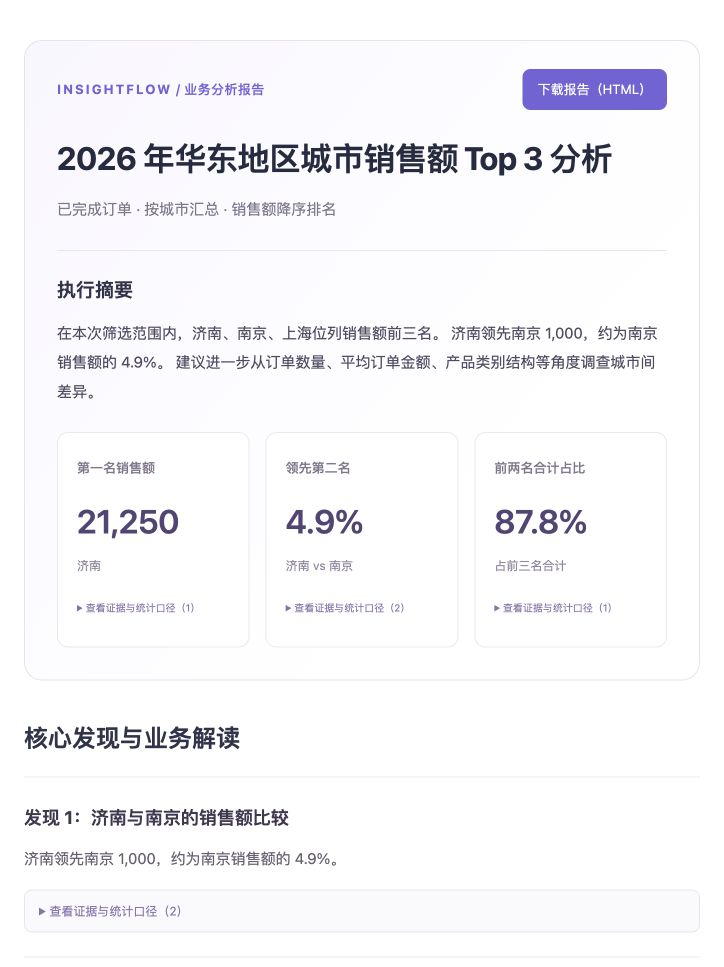
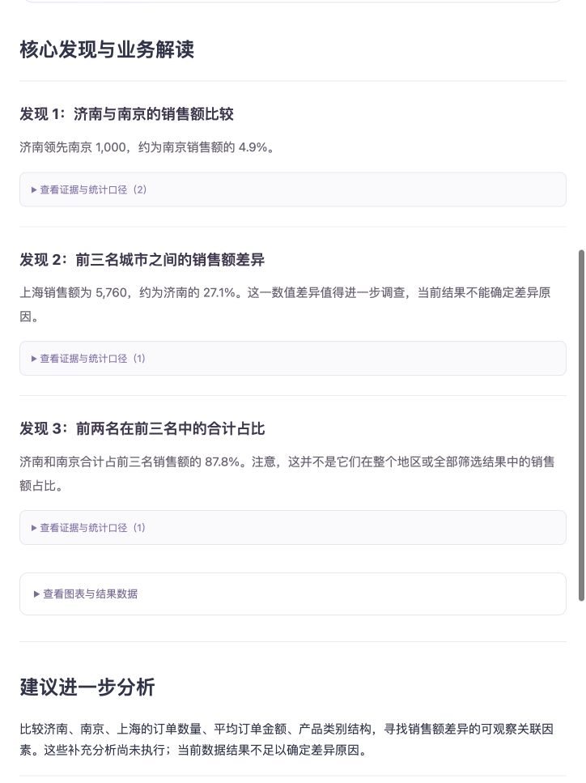

# 业务报告展示验收（2026-10-28）

已按用户指定结构提供业务标题/范围、执行摘要、三项重点指标、核心发现与业务解读、建议进一步分析、数据说明。原图表、完整表格、证据与原始结果通过折叠入口保留。

当前报告 ID 不变：`report_9bc9b4b0184f4d3084ede0fb806230d3`。读取旧报告即可获得新结构，无需重新规划、审批、执行或调用模型。

- 三张卡片：济南 21,250、领先南京 4.9%、前两名占前三名合计 87.8%。
- 发现部分补充：领先差额 1,000；上海 5,760，约为济南 27.1%。
- 数据说明：上传 60 条，有效样本 16 条，2026 年华东地区已完成订单，仅返回销售额前三名。
- 数值比较由 Decimal 确定性计算；占比分母只含返回三个城市，未推断全部华东总体。
- 文案用实际数值描述差距，不把“接近”“明显”写成已经通过显著性检验。
- 后续建议明确尚未执行，不生成原因断言。
- 零分母/负值不生成不合理比例；并列/截断/升序/多核心任务不套用唯一降序排名叙述。
- 默认不强制下载；HTML 导出与在线内容使用同一展示模型，后端接口及转义测试通过。本次未重复进行浏览器下载操作。

自动化：**后端601通过**（新增15项展示测试）、**前端49通过**（新增4项），TypeScript/Vite生产构建通过。测试含真实已保存报告快照、受控内核案例、鉴权、查询不触发模型、不修改原报告、零分母、并列、少于Top N、部分覆盖、金额精度与导出转义。原核心模块9个保护文件SHA一致。

文件：`presentation.example.json` 为真实报告的新展示模型；`report.example.html` 为同模型导出示例；`verification.json` 为不可变结果、分母与模型调用核验；三个文本日志保存完整测试/构建输出。实现与限制见 [业务展示说明](../../report-business-view.md)。此前审计记录独立保留，未把版式变更当作所有语义校验问题已修复。

