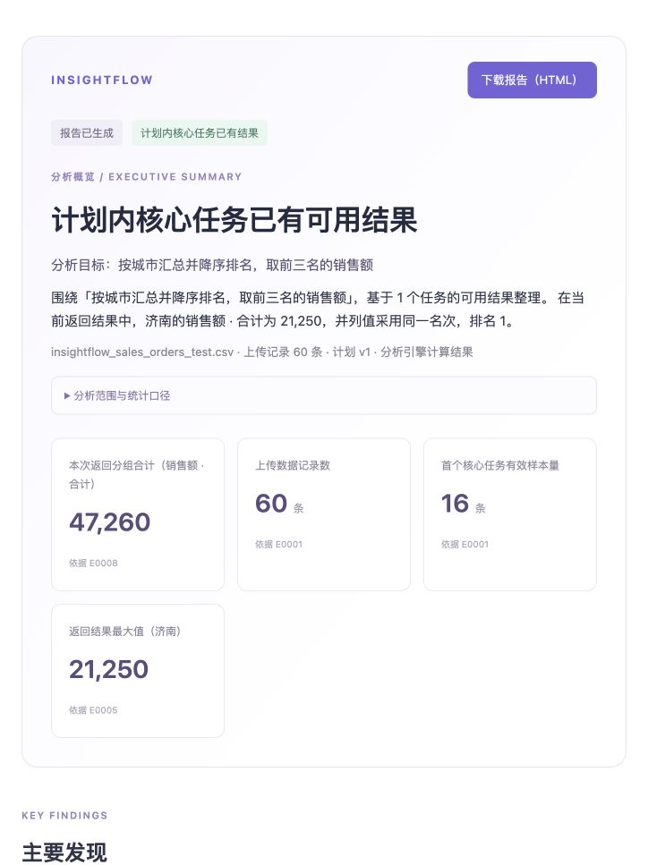
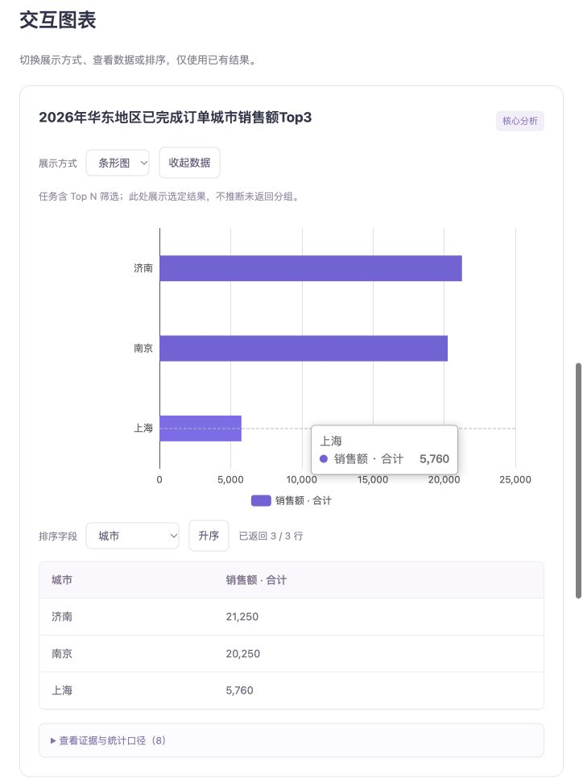

# Report Workflow V1 真实接入验收

实施日期：2026-10-27 至 2026-10-28。验收为本地单用户 MVP 集成验证，不代表通用业务洞察语义质量已达标。

## 交付结论与审计

既有 Report Module 已有 Evidence Builder、Visualization Builder、Insight Generator、AnalysisReport、ReportRepository、导入报告 API、交互式报告页。本轮复用并补齐真实 Workflow 接线、执行批准快照、状态恢复、鉴权、返回合计证据和前端预览。

真实路径：上传 CSV → 真实 Profiler → qwen Intent → qwen Planner → 原 Validator → 真实 HITL 服务端批准 → 原 Engine → 保存 ExecutionResult → 执行时批准快照 + 指定版本画像 → 确定性 Evidence / ChartSpec → 原 Provider 的洞察生成 → 引用和事实校验 → 保存 AnalysisReport。

未修改 Planner、Validator、HITL 审批服务、Engine 执行规则及主 Orchestrator。9 个保护文件 SHA 全部一致，见 [保护清单](protected-modules.json)。状态图、API、文件清单及兼容说明见 [接入文档](../../report-workflow-v1.md)。

## 实际数据核验

使用用户提供的 `/Users/lainey/Downloads/insightflow_sales_orders_test.csv`，60 行、12 列。原文件 SHA：`8f59a00be875e6fed684be4b388b579d8b0ed9bc5f302be6deb842bc1bfcdd34`。

问题：“帮我分析2026年华东地区已完成订单的销售额，按照城市汇总并降序排名，取前三名。”

2026 全年 + 华东 + 已完成，共 16 行参与计算。独立 Pandas 与 CSV/Decimal 两种基准均一致：

| 城市 | 销售额合计 |
| --- | ---: |
| 济南 | 21,250 |
| 南京 | 20,250 |
| 上海 | 5,760 |
| 返回前三名合计 | 47,260 |

合计由 Evidence Builder 对真实返回的可加指标确定性求和，绑定全部来源结果行。名称明确为“本次返回分组合计”，没有把 Top N 结果用于整体占比分母。图表是按销售额降序的条形图，仅支持兼容的条形图/表格切换。

[Pandas 与 Decimal 对照](pandas-verification.json)；[完整 AnalysisReport 示例](fresh-workflow-analysis-report.json)；[完整 ExecutionResult](fresh-workflow-execution.json)；[执行批准快照](fresh-workflow-approved-snapshot.json)；[保存的 Session](fresh-workflow-session.json)。上述报告表格与对应 ExecutionResult 表格逐字段一致。

## 浏览器记录

1. 读取已有 60 行销售会话的真实执行，通过页面“生成分析报告”接入旧结果；真实模型返回违规或无效内容时，页面明确失败，Engine 始终保留 completed/success。
2. 新建分析，使用文件选择器上传原 CSV，输入上述问题。真实模型 Intent 和 Planner 均正常返回。
3. 审核页面确认 2026 时间范围、华东、已完成、销售额 sum、按城市分组、降序与 Top 3；批准前没有执行 ID。
4. 点击真实“确认并开始分析”，Engine 操作链为 `filter → group_aggregate → sort → top_n`；服务端保存结果后自动出现报告生成状态。
5. 新会话首轮报告被保守校验拒绝，保存了原始返回；纠正对否定警示的误拦截后，点击“重新生成报告”，仅重试报告，原执行 ID 与结果不变。
6. 报告在线打开，显示 47,260、60 条上传数据、16 条有效样本、济南 21,250；图表和结果表包含三个正确城市和值。
7. 展开分析范围：显示真实批准步骤的时间上下界、地区、状态、分组、sum、降序与 Top 3。
8. 展开洞察证据：E0002 指向真实 task T01、结果字段 sales_total、结果来源行；所有 insight refs 均存在。
9. 切换表格、选择销售额并降序排序；点击“查看原始计算结果”可读取原完整 ExecutionResult，不触发分析。
10. 页面预览未强制下载。主动点击“下载报告（HTML）”后，实际文件保存至用户下载目录；读取实际文件与服务端已保存报告的导出结果字节一致。下载工具等待后才返回保存路径，本次不将此记录作为下载性能测试。
11. 后端实际停启，报告页面刷新后恢复同一 report_id、图表及数值。模型调用记录仍为 9 条，没有因刷新、切换图表或重启增加调用。

真实运行数据目录为 `var/workflow-v1-e2e`；沿用现有同源会话凭证，未把令牌写入报告 URL 或交付记录。普通启动默认目录仍为 `var`，复现当前浏览器历史需使用本次目录。

新会话：`d5d7b017255b47d284844d77aaafa331`。执行：`exec_ac4cacacb9954a0693a944b331fa3db4`。报告：`report_9bc9b4b0184f4d3084ede0fb806230d3`。

[重启验证](restart-verification.json)；[下载验证](download-verification.json)；[实际下载 HTML 副本](downloaded-report.html)。下载仅由测试中的显式点击触发。





[证据展开截图](fresh-report-evidence.jpg)；[批准前截图](fresh-plan-before-approval.jpg)。

## 真实 LLM 配置与返回

- 模型：沿用 `qwen3.8-flash`，原 OpenAI-compatible Provider，未更换模型或新增节点。
- Intent Prompt：`intent-v1.3.3`；Planner Prompt：`planner-v1.2`，本轮未改动。
- 最终 Report Prompt：`report-insights-v1.1.4`。
- 报告启用严格 JSON Schema；enable_thinking=false，超时沿用现有 Settings。
- 只发送分析目标、任务摘要、有界结构化证据与局限，不发送完整上传数据或大量原始记录。API Key 沿用本地环境配置，不记录到评测日志。
- 总计 9 次真实模型调用均返回：1 次 Intent、1 次 Planner、7 次 Report。7 次报告调用中，原运行 5 次拒绝、2 次生成持久化报告；拒绝含模型违规和保守规则误拦截，不能混为同一语义错误率。
- 最终 Prompt + 最终校验组合只有 1 次真实报告调用，成功。历史 1.1.4 返回另有 2 条通过当前规则离线重评；这不算新的真实调用，也不改变原失败记录。不据此宣称高比例质量验收。

[全部实际模型输入/返回与耗时](live-model-calls.json)；[最终完整 Prompt](prompt-final.txt)；[模型请求 Schema 快照](llm-request-schema.example.json)；[历史重评，新文件保留旧结果](historical-output-reevaluation.json)。前两次记录保存了 Prompt/Schema 哈希，后续记录同时保存完整请求文本。

最终真实模型的定性输出：

```json
{
  "primary_evidence_id": "E0002",
  "evidence_refs": ["E0002"],
  "finding_type": "highlight",
  "implication": "该分组在当前筛选范围内销售额表现突出，可作为进一步核查业务表现的切入点。",
  "recommendation": "结合订单结构、成本资料及未返回分组的完整性继续评估经营情况。",
  "limitations": [
    "结论仅适用于当前筛选范围，不能外推至整体市场。",
    "样本范围有限，适用范围需结合采集口径核查。",
    "销售额排名不能证明利润或效率，需补充成本资料再评估经营情况。"
  ]
}
```

fact/finding 的实际 21,250 和名次由 E0002 的真实结果确定性生成。自由业务解释仍标注“未经过严格事实验证”，不是因果或盈利结论。摘要的客观内容从这些已核对事实组合，标题与框架保留原实现。

## 所有被拦截案例及剩余问题

| 调用序号 | 原因 | 处理/当前状态 |
| --- | --- | --- |
| 1 | 非空正则在模型解码端被全匹配解释，证据 ID 截断成 E | 修正模型请求 Schema 的等价非空正则，并对 ID 加真实证据枚举；原返回保留且仍拒绝 |
| 2 | 过多重复发现；自由文本出现显著、最高、最低、数字及因果相关词，同时包含部分合法警示 | Prompt 收紧重点与用语；原输出仍不能通过当前校验 |
| 3 | “不能…代表所有城市”等警示误拦截，同时出现“前两个”数值指代及不恰当覆盖解释 | 原输出仍拒绝；仅减少误差不等于已具备通用否定语义校验 |
| 4 | “两个主要分组”属于已知差异证据的指代，当前数值正则仍保守拒绝 | 未广泛放宽任意数量指代；保留为剩余误拦截 Bad Case |
| 8 | “已返回的排名结果”中性引用，以及“排名不直接证明盈利能力”的否定警示被拒绝 | 增加仅适用于真实排名引用和有限推断边界的规则；正向利润/经营效率及任意数字断言继续拒绝，原运行失败保留 |

尚有限制：自由解释不能被确定性规则完整证明；当前拒绝规则仍有保守误拦截。现有销售验证不足以宣称招聘、客服、运营等所有主题的真实模型语义可靠。应继续扩充独立数据与重复调用评测，但本轮没有更改 Planner、HITL 或 Engine。

## 自动化与构建

- 后端：**586 passed**，原 562 项未退化；新增 24 项报告工作流/事实校验场景。
- 前端：**45 passed**，原 40 项未退化；新增 5 项报告交互与恢复场景。
- TypeScript + Vite 生产构建：通过。
- 覆盖 CSV/XLSX 真解析、真实批准与版本绑定、完整结果 vs 预览、合计/平均数边界、幂等、鉴权、失败重试、进程恢复、部分成功/核心失败、无证据不调用 LLM、Mock 拒绝、JSON 错误、无依据数值/经营结论拒绝、否定警示、刷新轮询与按需下载。
- 模型超时/不可用等错误分支使用明确的受控传输夹具，不作为真实模型质量评测；真实调用记录没有被 Mock 补齐。

[后端日志](backend-tests.txt)；[前端日志](frontend-tests.txt)；[生产构建日志](frontend-build.txt)。后端仅有既有 FastAPI/Starlette TestClient 弃用警告。
