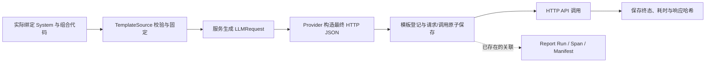

# Prompt Registry V0.1 后端交付

2026-10-29 · REQ-0051。范围为默认 FastAPI 应用三个 HTTP LLM 节点的模板版本、调用及最终请求快照；没有开发 Registry 列表、版本详情、Diff 页面，没有改 Prompt 业务内容、统计或审批规则。

## 1. 数据契约与存储

可校验的完整契约分别保存在本目录：

- `PromptTemplateSnapshot.schema.json`：不可变 System、User 组合定义、显式重试文本、能力说明、Schema 生成定义、来源代码及已加载代码指纹、内容哈希、版本和 Git 来源。
- `LLMCallRecord.schema.json`：独立 call_id、operation_id、call_sequence/retry_index/retry_reason/retry_of_call_id、模板/请求引用、已有 run_id/span_id、调用状态/错误/耗时/响应文本哈希。
- `LLMRequestSnapshot.schema.json`：当次 messages、response_format 和完整 HTTP JSON 的指纹、实际模型请求参数、客户端超时/端点哈希、受控 payload 引用、创建与可选到期时间。

最终消息/Schema 位于独立受控 payload 表。不是根据历史输入重建；保存的对象就是 Provider 传给 HTTP 的同一最终 JSON。本轮没有新增业务 Run 或 Execution 表。

默认路径：`INSIGHTFLOW_DATA_DIR/prompt_registry/registry.sqlite3`。现有业务数据库、`observability/trace.sqlite3`、上传文件及历史报告不迁移。

迁移：`backend/app/storage/migrations/prompt_registry_001.sql`。应用初始化自动登记 migration 1，创建 prompt_templates、llm_request_snapshots、llm_request_payloads、llm_calls 及索引/不可变触发器；重复启动幂等，未知迁移版本拒绝使用。SQL 已纳入 Python 包数据。请求快照与初始调用记录在同一事务提交，避免孤立调用。模板使用 `(node_id,version)` 唯一约束和 BEGIN IMMEDIATE，支持并发幂等登记。

模板版本为原标签加组合版本，如 `intent-v1.3.3+composition-v0.1`。原 IntentArtifact/Report 审计中的 Prompt 标签仍保留原值；没有伪造新的模型 Prompt 文本版本。相同版本不同内容明确报 PROMPT_VERSION_CONFLICT，不能覆盖。内容相同重复登记返回原对象及原创建时间。

当前 Git 不存在，source_commit 为 null；不使用今天的内容填补历史，也不声称当前快照证明旧版本部署关系。

## 2. 真实请求捕获与一致性



- `llm/templates.py` 对服务实际导入的 System 与版本核对；对运行中的函数/方法和经编译读取的源码比对，并保存固定字面量、组合源码及加载指纹。调用前再次检查，不用磁盘当前文件替代旧内存绑定。源码改变、单独模块热重载或实际绑定不一致时拒绝错误版本标记。
- 固定 User 原先就是 JSON 对象，不另写一套字符串模板。快照登记有序字段定义和原组合代码；三段重试文本提取为同值常量后显式登记；固定 Registry 能力规则、scope 文案及相关源码也在包内。
- `llm/compatible_provider.py` 是唯一 HTTP 出站捕获边界。实际发送只有 System+User 两条消息及原有 strict response_format，内部 CallBinding 不会进入请求体。
- Report 的 Schema 生成器仍按当前 selected Evidence ID 填 enum；每次最终 Schema 单独保存。一个静态模板可以关联很多不同 User/Schema 请求快照。
- Intent/Planner 每个 retry 都有新 call_id/request_snapshot_id，并指向前次 call_id；同一 operation_id 关联一次服务调用的尝试。没有把 operation_id 冒充 Workflow Run ID。
- 不新增模型参数：没有偷偷补 temperature、top_p 或 seed；实际省略的值仍省略。client_config 的超时/端点哈希不是模型正文，也不含 Authorization。
- 原始响应文本目前仅保留哈希。Report 原有受控 LLM 输出/候选诊断仍在 Trace；本轮未新增所有节点的原始响应正文归档。

哈希规则复用规范 JSON SHA256：UTF-8、ensure_ascii=false、sort_keys=true、separators=(',',':')、allow_nan=false。`messages_hash` 覆盖有序消息数组；`schema_hash` 覆盖整个 response_format（含 purpose/name、strict 和 schema）；`request_hash` 覆盖最终 HTTP JSON 对象。不是对网络编码后的字节流进行签名。原始请求读取时再校验 request_hash，发现内容与元数据不符拒绝返回。

模板 hash 排除创建时间、Git 定位/dirty、说明等非内容元数据，包含 System、组合定义、来源代码及运行代码指纹。不同 Python 解释器版本的字节码可能不同，因此升级解释器或改变依赖源码可能要求新组合版本；这是保守的来源版本门槛，不能把它误读为 System 文本一定改变。

## 3. 状态和故障策略

Call 状态：running → succeeded / failed / cancelled；服务重启恢复未结束项为 interrupted。终态不可再次更新，身份字段也不可修改。

**succeeded 的 outcome_scope=provider_protocol**：表示模型 HTTP/响应协议调用正常，不保证 Intent Schema、计划业务校验或洞察事实校验通过。例如第一次返回非法 JSON，Call 可以 succeeded，而第二条 Call 的 retry_reason=LLM_INVALID_JSON。后续业务失败继续由现有服务错误、Workflow 状态及 Report Span 表达，不能按 Call 成功率替代业务成功率。

- 无模板绑定：LLM_TEMPLATE_REQUIRED，不发 HTTP。
- 模板/源码不一致：PROMPT_SOURCE_MISMATCH / PROMPT_CONTENT_MISMATCH，不发 HTTP。
- 版本内容冲突：PROMPT_VERSION_CONFLICT，不发 HTTP，不覆盖旧内容。
- 调用前快照故障：LLM_SNAPSHOT_UNAVAILABLE，不发 HTTP；日志不含请求、密钥或供应商原始错误体。
- 调用后终态保存失败：LLM_CAPTURE_FINALIZE_FAILED，明确告知已发生模型调用但未能完成记录，不返回成功结果；重启后残留 running 变 interrupted，不伪造成功。
- 普通 Trace 写入依然 best effort，失败不会阻止本可成功的业务。可能存在有调用记录但 Trace Event/Span 未落盘的缺口。
- 保存 running 发生在发请求之前；若进程在此间退出，不能据一条 interrupted 断定供应商已收到请求或计费。没有自动重发恢复调用。

## 4. Trace/Manifest 关联与权限

Report 入队时将已固定模板登记，并把引用放入不可变 `RunManifest.prompt_template_snapshots.insight_generator`；实际 LLM 调用绑定当前 insight_generator Span，完成 Event 包含 call_id/request_snapshot_id/template_snapshot_id。没有事后修改旧 Manifest。

Intent/Planner 的现有业务主链没有持久 TraceRun，当前 call 的 run_id/span_id 为 null；已有会话 IntentArtifact.parse_id 与调用 operation_id 一致，Planner 通过 operation_id/尝试序号关联。未创建虚构的上游 Report Run/Span。空输入、待澄清阻断、无证据跳过不会生成假的 Call。

复用 Admin Header/HttpOnly Cookie 只读授权。新增基础查询，两个既有前缀均支持（`/admin` 和 `/api/v1/admin`）：

| 路径 | 内容 |
| --- | --- |
| GET /admin/runs/{run_id}/llm-calls | 当前 Run 已采集调用；历史缺失或跳过时 unavailable |
| GET /admin/spans/{span_id}/llm-calls | 当前 Span 已采集调用 |
| GET /admin/llm-calls/{call_id} | 调用与请求元信息，不包含消息正文 |
| GET /admin/prompt-templates/{snapshot_id} | 固定模板/源码，不含用户实际输入 |
| GET /admin/llm-calls/{call_id}/request | 完整出站 JSON，额外要求 X-Admin-Snapshot-Token |

原始内容必须同时具备原 Admin 授权及单独 `INSIGHTFLOW_ADMIN_SNAPSHOT_TOKEN`，后者空值时所有 raw 读取被拒绝。所有成功读取 no-store；没有在线修改、删除、发布入口。

数据库目录 0700、文件 0600；payload 与公共 Trace 分离。是本地权限隔离，**没有宣称已实现数据库加密、进程外防篡改或细粒度用户 RBAC**。

默认历史保留直到显式策略变更。可设置正整数 `INSIGHTFLOW_LLM_REQUEST_RETENTION_DAYS`：到期查询立即不可读；启动时删除到期 payload，保留模板、调用、请求元数据及哈希。没有运行时定时清理线程，也不删除已有磁盘备份；设置策略前需明确备份保留方式。

## 5. 实际组装与关联样例

本目录 `examples/` 是真实业务服务 + 真实 Compatible Provider + **本地脚本 HTTP 响应**得到的记录。包含 3 个节点、5 次调用、1 条 retry 关联、2 个 Report Run/Span 关联。外部 LLM 调用 0；不是模型质量评测，批准快照是构造夹具，不能当成人工业务审批验收。临时 SQLite 已在生成结束后清理，JSON 证据留存；这些测试 ID 不在用户生产数据库中。

- `examples/templates.json`：三个完整静态模板快照。
- `examples/calls-and-requests.json`：所有调用、元数据和实际截取的最终消息/Schema。
- `examples/trace-links.json`：RunManifest、Span 与 Call 关联。
- `examples/business-outputs.json`：服务输出，明确标记不是模型真实推理结果。
- `examples/checks.json`：最终 JSON 与 transport body 一致，动态 Schema 可区分，三段 retry 原话与审计前冻结值逐字相同。

其中一个实际测试关联：

```json
{
  "run_id": "run_5db744cb5c4741b7abc8677497331501",
  "span_id": "span_cdf05e462acf4ff3ba2493f3984b61b8",
  "call_id": "call_e86afa4f9242450ca0f2b0ef8d6f9424",
  "template_snapshot_id": "pt_7336ff3e2c324c8fd1e62be1da644506c95c3fefe9bbff6fc61c5c383fde4d91",
  "status": "succeeded",
  "outcome_scope": "provider_protocol"
}
```

第一个 Intent Call 为 `call_5a6964d2506f4003a15a57ae049e44bc`；第二个 `call_f1910a9ab3cc42b4ba16fb2ec693c753` 引用它，retry_index=1、retry_reason=LLM_INVALID_JSON。两个 Report Call 共享静态模板，但 schema_hash 不同。

如需重新生成样例，运行 `generate_examples.py` 并提供一个新的输出目录；不覆盖本轮冻结文件。脚本不会读取 `.env`、访问外网或使用真实上传文件。

## 6. 文件变更

新增：

- backend/app/domain/prompt_registry.py
- backend/app/storage/prompt_registry.py
- backend/app/storage/migrations/prompt_registry_001.sql
- backend/app/llm/templates.py
- backend/app/llm/capture.py
- backend/tests/test_prompt_registry.py

调整：

- backend/app/llm/base.py、compatible_provider.py：内部绑定、最终请求与生命周期捕获。
- backend/app/services/intent_parser.py、analysis_planner.py、analysis_report.py：固定模板接入、retry 元信息与 Trace 绑定；重试指令仅提为同值常量。
- backend/app/domain/tracing.py、observability/recorder.py、workflow/reporting.py：新增可选模板引用及实际调用关联；不改变报告业务结果。
- backend/app/main.py、core/config.py、api/admin.py：初始化/恢复、配置及独立授权查询。
- backend/pyproject.toml、backend/.env.example、README.md：迁移打包与使用说明。

三个 prompt.py 原文件字节保持不变。Planner 的任务生成规则、Validator、HITL、Engine、Report Fact Validator/Insight Prompt 均未修改。

## 7. 测试结果

最终：`756 passed, 1 warning`（21.87 秒），包含原 726 项和新增 30 项。日志：`tests-final.txt`。唯一 warning 为原有 Starlette/httpx TestClient 弃用提示，本轮没有升级依赖。

覆盖：三节点 HTTP 最终 JSON 落库一致、模板哈希/幂等/冲突、数据库不可变保护、首次与 retry、Evidence Schema 变化、多调用共享模板、旧 Run unavailable、并发操作与 Report Run/Span 隔离、热重载/磁盘与内存不一致、前置/后置存储故障、HTTP 错误与取消、重启恢复/读取、权限/默认 raw 拒绝、过期清理/完整性校验、迁移幂等、业务输出一致。

额外将三个节点当前 HTTP 请求体与 REQ-0050 的冻结截取逐字段比较，完全相同。样例生成另外核对三段 retry 指令文字完全相同。

早期结果原样保留：第一次专项 2 failed / 17 passed，其中一处是测试双 P0 夹具只生成一条洞察，触发既有核心覆盖拒绝；另一处是 JSON 保存 tuple→list 导致幂等返回对象不一致，已在登记前规范化。第二次 19 passed，增加覆盖后 26 passed，最终全量 756 passed。没有删除失败日志或降低业务校验。

## 8. 剩余限制

1. 旧运行的完整 User/Schema 未采集，无法恢复；历史版本标签不自动生成新快照或伪造部署证明。
2. Intent/Planner 的持久 Trace Run/Span 仍未覆盖，本轮以操作级 Call 提供基础，不扩展整体 Workflow 追踪状态机。
3. 默认应用的 Compatible Provider 已启用捕获；直接构造无 capture 的 Provider、自定义 Provider 和旧独立评测脚本/包装器不会自动接入。后续这些入口需显式传递 CallRecorder 与绑定后再宣称覆盖，不把它们的缺失解释为没有调用。
4. 来源校验是保守的模块/代码绑定，不是恶意进程防护。不同 Python 字节码或同依赖模块其他函数的修改可能要求提升组合版本；尚无自动发布流程。
5. SQLite 操作为同步、单进程部署边界与现有系统一致。重启恢复不适合多 worker 共同竞争同一库；没有跨进程租约/自动重试网络调用。
6. 未做外部真实 LLM 质量或连接评测；本轮测试只证明请求组装、保存、关联与既有业务回归。未做新的 UI 页面或浏览器验收。
7. 尚无所有节点完整响应正文/consumer validation outcome 的统一存档；Call 成功不能代替业务校验成功。元信息查询每个范围最多 500 条，当前节点尝试数远低于此限制。

本轮完成基础设施交付，Registry 的列表、版本详情与 Diff 页面保持待开发。
