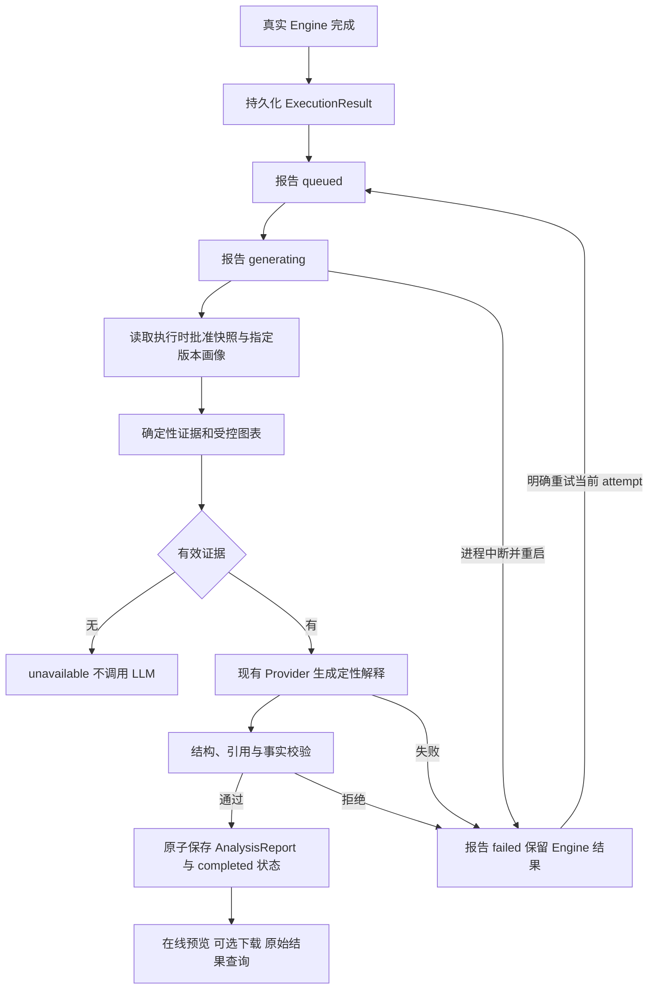

# Report Workflow V1

## 开发前审计

已有 `reporting/evidence.py`、`visualization.py`、`fact_validation.py`、`prompt.py`，`services/analysis_report.py`，`domain/analysis_report.py`、ReportRepository、导入结果报告 API 与交互报告页面。本轮复用，不创建第二套报告契约。

缺口：执行后未调度报告；报告未读取 HITL 的已确认约束；缺少明确限定为返回分组的合计指标；无真实报告生命周期、失败恢复及访问控制接线。

## 最小实施方案

1. Session 新增独立报告生成记录；ReportRepository 原子保存生成状态与报告，保留 Engine completed/failed 状态。
2. 新增 `workflow/reporting.py`：只读取 ExecutionRepository.complete 与 approved_snapshot、DatasetRepository 的指定版本；不接收客户端结果或批准标记。
3. Engine API 返回后后台生成报告；按 execution_id 幂等；提供生成状态、明确重试、启动中断恢复。
4. 在原报告服务中补充批准快照校验与返回分组合计证据；继续使用原 Provider、InsightDraft 和事实校验。
5. 主界面显示报告状态及预览链接；原始结果折叠；报告查询及可选下载携带会话访问凭证。
6. 自动测试覆盖真实文件、批准绑定、失败/重试/恢复/幂等/鉴权/部分成功，浏览器验证真实模型销售分析及 Pandas 基准。

## 契约兼容

AnalysisReport、AnalysisPlan、ValidatedAnalysisPlan、ExecutionResult、HITL 批准契约不变。Session 仅增加 report_generations，旧会话默认空数组。报告生成失败不修改 Engine 结果、审批快照或根工作流状态。导入报告 API 保持原行为，不能伪装 engine 来源。

## 实际状态与流程

根 Workflow 状态复用原 CREATED → PROFILING → PARSING_INTENT → PLANNING → VALIDATING → AWAITING_APPROVAL → APPROVED → RUNNING → COMPLETED/FAILED。没有第二套根状态机。`Session.report_generations` 单独表达报告状态；Engine 成功不会因报告失败改为 failed。

## API 与调用

所有真实执行及真实报告读取均要求原会话凭证。报告 ID 不作为访问授权；报告预览通过同源本地凭证发送 `X-Session-Keys`，不在 URL 中传令牌。

| API | 行为 |
| --- | --- |
| `POST /api/v1/executions` | 原四标识契约不变；Engine 保存后，仅 real_v1 会话自动排队报告 |
| `GET /api/v1/executions/{id}/report` | 已保存生成状态，旧执行尚未生成时为 null |
| `POST /api/v1/executions/{id}/report`，`{}` | 为旧执行生成；已有记录时幂等返回，不自动重新调用模型 |
| 同上，`{"expected_attempt": 1}` | 仅失败且当前 attempt 匹配时重试；并发/旧状态拒绝，不重新执行 Engine |
| `GET /api/v1/reports/{report_id}` | 原 AnalysisReport JSON；真实报告绑定会话凭证 |
| `GET /api/v1/reports/{report_id}/execution` | 读取原服务端完整 ExecutionResult |
| `GET /api/v1/reports/{report_id}/download` | 可选、无脚本 HTML 附件；预览不触发下载 |
| `POST /api/v1/reports` | 原 imported 独立接口不变；拒绝客户端伪称 engine 来源 |

ReportWorkflow 只以 execution_id 取结果，不接受客户端的文件路径、结果行、计划体、已批准标记。`ExecutionRepository.approved_snapshot()` 固定执行时版本，即使当前 Session 计划指针变化也不改报告依据。报告服务会再次校验批准 ID、Session、数据集版本、计划和意图。

`analysis_reports` 沿用旧表；新增 `report_generations`，以 execution_id 唯一。报告与生成记录及 Session 镜像在同一事务提交。启动时 queued/generating 转为明确的中断失败，允许用户重试，不自动重放 Engine 或 LLM。若进程恰在 Engine 保存后、排队前退出，原执行仍可通过页面手动生成报告。

## 报告与 LLM 边界

- 原 AnalysisReport / InsightDraft 不另建契约；模型请求 Schema 修正非空正则的全匹配兼容性，并把证据引用约束为本次真实 Evidence ID。仍执行原本地严格校验。
- 当前 Prompt：`report-insights-v1.1.4`，完整文本在 `backend/app/reporting/prompt.py`；真实调用快照及最终完整文本保存在验收目录。
- 模型沿用 `qwen3.8-flash`、原 OpenAI-compatible Provider，严格 JSON Schema；report 默认 enable_thinking=false，超时沿用原配置。本轮没有新增模型节点或自动修复循环。
- LLM 只写定性含义、建议和局限；fact/finding、摘要中的客观事实及数字从已校验证据组合，不能由模型补算。摘要框架与标题沿用现有确定性实现。
- 事实校验保留对任意数字、排名、因果和无依据经营断言的拒绝。有限识别“已返回的排名结果”这类已知证据指代，以及“排名不能证明利润”等否定警示；不改写模型原文，不放行正向利润/效率结论。解释性文本仍明确标注未严格事实验证。
- 返回分组合计只对完整返回表中的 sum/count 指标求和，不加总 avg/median/distinct_count，也不对截断预览求和；Top N 合计不是总体分母。
- 有效样本/上传行数是筛选覆盖口径，不能自动解释成抽样代表性不足。模型输入优先使用业务证据，覆盖信息仍在报告卡片和证据中保留。
- 沿用受控 KPI/bar/line/pie/table；不适配结果回退表格；Top N 不据部分数据生成整体饼图占比。

## 实际文件变更

新增：

- `backend/app/workflow/reporting.py`：执行结果到报告的调度、信任绑定、失败隔离。
- `backend/tests/test_report_workflow.py`：真实文件、批准、持久化、幂等、恢复、失败及语义警示测试。
- `frontend/src/components/ReportGenerationCard.tsx`：状态、重试和预览。
- `frontend/src/tests/report-workflow.test.tsx`：刷新后轮询、独立重试、按需读取/下载和凭证。

修改：

- `backend/app/domain/models.py`：追加 ReportGeneration 与 Session 默认空数组。
- `backend/app/core/config.py`、`main.py`：原 Provider 设置和依赖接线，启动恢复。
- `backend/app/storage/report_repository.py`：原报告存储扩充生命周期，原子提交和中断恢复。
- `backend/app/api/executions.py`、`reports.py`、`session_access.py`：后台调度、状态/重试/来源查询、真实报告凭证校验。
- `backend/app/services/analysis_report.py`：确认约束取批准快照、返回合计卡、批准口径展示，原报告构建保留。
- `backend/app/reporting/evidence.py`、`prompt.py`、`fact_validation.py`：确定性返回合计、结构化输出兼容、提示与否定警示校验。
- `frontend/src/api/client.ts`、`types/contracts.ts`、`types/report.ts`：新增生成状态、查询/重试、携证据下载，复用 ResultTable。
- `frontend/src/App.tsx`、`components/MessageList.tsx`：计算结束后继续轮询报告、原始结果折叠。
- `frontend/src/reporting/ReportPage.tsx`：批准范围、按需原始结果、主动携凭证下载。
- `frontend/src/components/MockNotice.tsx`、`BusinessPlanReview.tsx`：更新报告能力文案，未改审批判断。
- `frontend/src/tests/hitl-v1.test.tsx`：将测试中的旧简化表列补齐为真实共享 ResultTable 字段。
- `README.md`、`docs/report-module.md` 及本说明、验收目录。

Planner、Validator、HITL 审批服务、Engine、六类计算、主 Orchestrator 与相关共享计划/执行/批准契约未修改；9 个受保护文件 SHA 校验保存在验收目录。

## 限制

V1 使用单进程应用内后台任务，不是持久化分布式任务队列；重启中断会明确失败并等待重试。完整结果沿用每任务 5000 行/合计 100000 单元格以及报告输入 4 MiB 边界，超限明确失败，原 Engine 分页查询保留。没有通用的自然语言事实证明器；自由解释仍需业务复核。历史保守校验误拦截和真实模型违规返回均保留，不能据当前销售小样本宣称全领域语义可靠。
