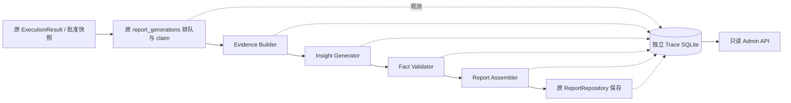

# Workflow Trace V0.1

本轮完成后端观测基础设施，优先覆盖真实 ReportWorkflow。实施前结论与冻结契约见 [审计](audits/workflow-trace-v0.1/design.md)。需求关联 REQ-0043、REQ-0044；未修改业务 Prompt 或公开报告 Schema。

## 实际数据流



现有图表逻辑仍按原代码在模型调用前运行，没有调整决策顺序。四个核心 Span 加一个 `report_persistence` Span；Run 在业务报告保存后才正常完成。失败时后续阶段不虚构为已执行。

Run 是一次报告尝试，通过原 `execution_id + attempt` 唯一关联；并非已经覆盖整条分析流程。session 是跨模块关联根。Span 支持父子关联；Event 记录阶段与候选诊断；Manifest 冻结数据/计划/审批/校验版本、Prompt、模型配置和实现哈希。

业务状态仍来自原 Repository；Trace 是观测附录。`report_generations.completed` 和 `AnalysisReport.partial` 可以同时成立，API 将两者分开返回。

## 实际文件变更

| 文件 | 作用 |
| --- | --- |
| `backend/app/domain/tracing.py`（新增） | Run、Span、Event、RunManifest 契约 |
| `backend/app/storage/trace_repository.py`（新增） | SQLite 表、幂等键、事件顺序、查询与中断恢复 |
| `backend/app/observability/__init__.py`、`recorder.py`（新增） | 显式上下文、阶段耗时、白名单、失败降级和版本指纹 |
| `backend/app/api/admin.py`（新增） | 四个只读接口、响应 Schema、独立凭证检查 |
| `backend/app/core/config.py` | Trace 开关和不进入 repr 的管理员凭证 |
| `backend/app/main.py` | 装配、路由与恢复；Trace 初始化失败不会阻止应用启动 |
| `backend/app/workflow/reporting.py` | 关联现有生成尝试，观测最终保存和失败 |
| `backend/app/services/analysis_report.py` | 四阶段埋点，原规则与计算逻辑保留 |
| `backend/app/reporting/fact_validation.py` | 只读候选诊断回调，回调异常不改变校验结果 |
| `backend/.env.example` | 新配置样例，不含真实凭证 |
| `backend/tests/test_workflow_trace.py`（新增） | 26 个追踪测试场景（含参数化） |
| `backend/scripts/verify_workflow_trace.py`（新增） | 显式 `--live` 的真实报告链路验证工具 |

新增本说明与 `docs/audits/workflow-trace-v0.1/` 证据。前端、Admin 源码、Planner、HITL、Engine 业务文件和既有测试未修改。完整源码清单、哈希及快照见验收目录。

## 存储和配置

- 业务数据仍在原 `INSIGHTFLOW_DATA_DIR/insightflow.sqlite3`。
- Trace 位于 `INSIGHTFLOW_DATA_DIR/observability/trace.sqlite3`。文件为 0600，新目录为 0700；使用 WAL、外键及 25ms busy timeout。
- 独立文件用于隔离 Trace 锁与写入异常，不存第二份 ExecutionResult、批准快照或报告。
- 默认 `INSIGHTFLOW_TRACE_ENABLED=true`；关闭后原业务继续，Admin Trace 查询返回 503。
- `INSIGHTFLOW_ADMIN_READ_TOKEN` 只配置在服务端环境，例如本地 `backend/.env`。留空时 Admin API 返回 503；凭证缺失或错误为 403。普通 session token 无法升级为管理员。
- 应用仍沿用已有环境加载方式，不会自动读取 `.env`；启动前将变量导入服务进程。不要放到 Admin 的 `VITE_` 配置中。本轮未生成或修改真实凭证文件。

例如从 backend 目录，在已加载本地环境变量的终端中启动原服务：

```sh
../.venv/bin/uvicorn app.main:app --host 127.0.0.1 --port 8000
```

这是本地单服务的只读管理员凭证，不是多用户身份认证系统。本轮不把凭证嵌入 Admin 前端，也不修改 Admin 空状态页面。

## 只读 API

统一使用 `X-Admin-Token` 请求头。两组路径使用同一个 router、权限依赖和 Repository；主路径出现在 OpenAPI，兼容路径匹配已有 Admin Base URL。

| 主路径 | 兼容路径 |
| --- | --- |
| `GET /admin/runs` | `GET /api/v1/admin/runs` |
| `GET /admin/runs/{run_id}` | `GET /api/v1/admin/runs/{run_id}` |
| `GET /admin/runs/{run_id}/spans` | `GET /api/v1/admin/runs/{run_id}/spans` |
| `GET /admin/spans/{span_id}/events` | `GET /api/v1/admin/spans/{span_id}/events` |

列表支持 `limit`（1–100）、`offset`、`status`；事件支持有界分页。先鉴权再查记录；授权后不存在为 404。没有写入、删除或原始快照下载接口。查询存储故障为 503，不伪装为空列表。

示例（请求头值取服务端配置，不在文档中写真实密钥）：

```http
GET /admin/runs?limit=20&status=failed
X-Admin-Token: <server-configured-read-token>
```

详情返回 `run`、`business_source`、`collector_degraded` 和覆盖提示。`business_source.same_attempt=false` 表示原业务最新记录已经进入其他 attempt，不能把新状态误认成旧尝试的结果。

可解析数据契约见 [JSON Schema](audits/workflow-trace-v0.1/contracts.schema.json)，真实 API 响应见 [最终接口重新查询](audits/workflow-trace-v0.1/final-api-readback.json)。

## LLM 与候选诊断

Insight Span 记录调用目的、开始/返回、输入输出字节、候选总数、模型身份与 selected evidence IDs。Manifest 保存 Prompt、Schema、生成策略、timeout、enable_thinking；temperature/top_p/usage 未提供时为 null。

Fact Validator 的每个候选事件包含 index、accepted/rejected、证据引用、error_code、role 和 rule IDs。汇总事件保存 candidate/accepted/rejected 数量，即使最终因所有候选被拒绝或核心覆盖失败而抛错，也不会丢掉已知计数。JSON 无法解析时数量未知，为 null。

不保存完整用户需求、样本、结果行、候选自由文本、HTTP headers、API Key 或异常 repr。原始计算、审批和报告使用原 ID 引用并由既有接口控制访问。默认没有原始候选快照，因此不能还原未保存的具体句子；后续若需要原文复核，应独立设计受控快照及访问审计，不能直接把整段内容塞入事件。

## 两次真实模型验证

两次使用同一份六行**合成销售 CSV**、原有确定性统计内核、实际 HITL 审批记录、ReportWorkflow 和真实 qwen3.8-flash。为限定本轮边界，上游 Intent/Planner 使用明确标注的测试传输输入；不能将这两次声称为整条真实 LLM 主流程质量评测。报告模型没有 Mock 回退。

| 验证 | 模型返回 | 模型调用耗时 | 最终报告 Run |
| --- | --- | --- | --- |
| `live-report-trace-01.json` | 3 条候选，非 Mock | 约 8.42 秒 | failed：0 合法，3 拒绝 |
| `live-report-trace-02.json` | 3 条候选，非 Mock | 约 8.12 秒 | failed：0 合法，3 拒绝 |

两次 Engine 均成功，结果为济南 21,250、南京 20,250、上海 5,760，合计 47,260。失败没有丢失执行结果；服务实例重建后 Run 可查询。第一轮原始记录保留，第二轮补充记录调用开始事件和拒绝字段定位，不覆盖前一轮。

最终验证实际节点摘要：

```json
{
  "run_id": "run_c9c69038b6b44b55b37edafbeb43c264",
  "execution_id": "exec_0bc21ddaffdc4d399a6681e03291bbca",
  "status": "failed",
  "error_code": "REPORT_UNVERIFIED_FACT",
  "evidence_builder": {"status": "complete", "evidence_count": 11},
  "insight_generator": {"status": "complete", "candidate_count": 3},
  "fact_validator": {"status": "failed", "accepted_count": 0, "rejected_count": 3}
}
```

三条候选均在 `implication` 被拒绝：候选 0 触发 CAUSAL；候选 1 触发 NUMERIC / UNSUPPORTED_ASSERTION；候选 2 触发 NUMERIC / CAUSAL / UNSUPPORTED_ASSERTION，共同规则 FREE_TEXT_GUARD。Assembler 与 Persistence 没有执行，不产生虚假完成 Span。

这些是**现有规则的拒绝记录**，并非本轮人工判定每条候选一定语义错误。本轮没有进一步评估误拦截、优化 Prompt 或放宽规则。真实模型报告成功率不是本轮 Trace 的验收指标；完整与部分成功的追踪路径已由受控传输集成测试覆盖。

## 自动化验证

- 全量 backend：696 项通过（原 670 + 新增 26），保留 1 条原有 Starlette 弃用警告。
- 原 frontend：52 项测试与构建通过。
- Admin：14 项测试、类型检查及构建通过；源码未变化。
- 新增覆盖：成功、partial、所有候选拒绝、JSON 错误、LLM 超时、无证据零调用、失败重试、幂等、并发 Run 隔离、核心覆盖失败后的合法计数、保存失败、重启恢复/查询、权限、Trace 初始化/写入故障、事件上限与父子归属。
- 早期并发测试误用了旧测试辅助函数的固定 execution_request_id，触发真实 Engine 幂等冲突；已为两次独立执行分配不同请求 ID。失败日志 `trace-tests-02/03.txt` 保留，未调整 Engine 规则。

## 保留、降级与边界

1. 默认不自动删除元信息、业务数据或旧需求/版本档案。事件每 Run 最多 256 条，每条 payload 最多 8KiB；超额标记 incomplete。存储总量仍需后续容量管理，本轮不自动 purge。
2. Trace 写入采用独立短事务，故障最多输出有限脱敏告警，不阻止原业务。恢复写入时事件标记 observation_gap；Run 可保存时标记 incomplete。整个 Run 都未写入时，只能从受控日志和 collector_degraded 发现风险，列表不保证覆盖全部业务尝试。
3. 重启将未正常结束的观测标记 interrupted；恢复发现时间单独保存，真实完成时间与跨进程耗时保持未知。
4. 支持同一服务内并发，不支持多 worker 分布式恢复。既有业务恢复本身仍假设单进程，本轮没有改变它。
5. 尚未埋点：Intent、Planner、HITL、Engine 的内部 Trace，以及独立导入报告 API、Presentation 和 HTML 导出。已有业务记录/日志继续保留；不回填不存在的历史 Span。
6. 未开发 Trace 列表前端、复杂 Dashboard、评测中心或版本比较后端。下一步可先把只读列表与阶段详情接入现有 Admin，再决定是否需要受控内容快照。
