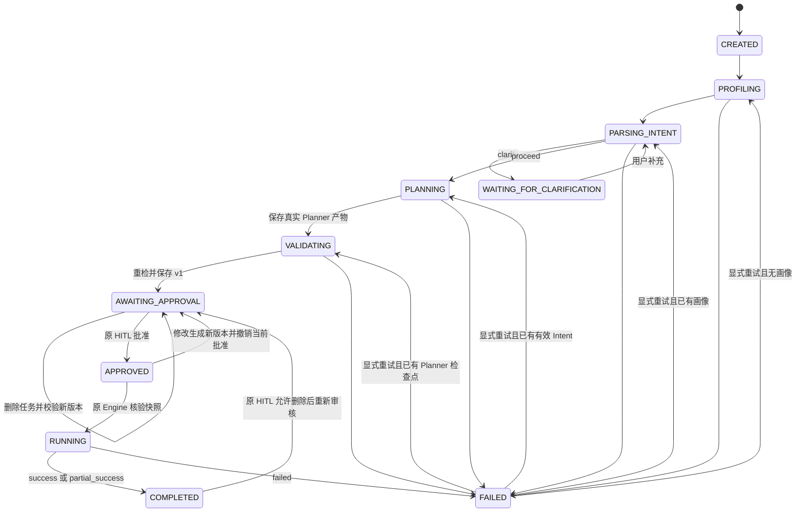

# Workflow V1：真实主链路

> 本文记录 Workflow V1 集成时的状态。后续 [HITL V2](hitl-v2.md) 已增加业务展示与有限确定性约束证明；明确映射通过的条件现可进入原审批，未证明条件与 defer 仍阻断。下文“全部非空约束阻断”是该阶段的历史限制，原验收产物保留。

本轮将现有画像、Intent、Planner、Validator、HITL、Engine 接入同一用户入口，终点为持久化 `ExecutionResultV1`。新会话由前端发送 `real_workflow=true`；历史 Mock 与人工 JSON 导入入口保持兼容并隔离。没有增加模型节点、Agent 框架或报告生成调用。

**验收结论：真实探索式请求已完成浏览器全链路验证。显式约束的自动验证仍有契约缺口：既有 HITL 拦截所有非空 Intent constraints，本轮保留此规则，因此不能宣称所有目标驱动请求均可执行。** 实际输出、截图及测试边界见 [验收记录](evaluations/workflow-v1/report.md)。

## 实际状态与恢复

扩展已有 `SessionStatus`，没有创建第二套状态系统。

| 任务书名称 | 实际持久化枚举 | 说明 |
| --- | --- | --- |
| profiling | PROFILING | 解析真实文件，保存画像及 dataset_ref |
| parsing_intent | PARSING_INTENT | 原需求、答复、轻量画像进入现有 Intent 服务 |
| clarification_required | WAITING_FOR_CLARIFICATION | 保存意图、问题并暂停；不调用 Planner |
| planning | PLANNING | 现有真实 LLM Planner；内部已有 Validator |
| validating | VALIDATING | 保存 Planner 检查点后，经现有 HITL 验证入口重检 |
| awaiting_approval | AWAITING_APPROVAL | 保存不可变计划版本与校验快照，等待原 HITL |
| 批准 | APPROVED | 原审批事务校验 dataset/plan/validation 版本 |
| executing | RUNNING | 原 Engine 声明执行并校验批准快照 |
| completed | COMPLETED | 完整结果已持久化；具体成功程度读取 execution_status |
| failed | FAILED | 可见错误；LLM 失败不替换为 Mock |



`FAILED` 的准备重试仅适用于尚无审核计划、未执行的可重试错误。执行失败不会从此入口重跑。原 HITL 也允许执行失败后删除任务生成新版本并重新审核；它遵循原来的版本与批准规则。F0/blocked 与未验证约束不是模型通信失败：保存可审阅计划与明确阻断原因，不把它们改成“计算成功”。

状态、画像引用、完整 Intent 历史、澄清答复、Planner 产物、不可变计划、批准与执行结果使用原 SQLite/本地存储。`workflow_events` 使用同一状态枚举记录变更时间，不是额外业务状态。

创建与澄清请求先返回已保存状态，再通过 FastAPI `BackgroundTasks` 运行准备阶段。前端立即保存会话 ID/访问凭证，并轮询活动阶段；刷新重新读取保存状态。单进程重启时，准备中的会话标记 `FAILED / PROCESS_INTERRUPTED`，保留检查点，由用户显式重试；不会自动再次调用模型或执行。原 Engine 的执行中断恢复规则不变。

## 数据流与复用

1. `POST /sessions` 保存上传文件与解析选项，由现有 `DataProfilerNode → DataProfilerService` 生成真实画像，绑定 dataset_id/version。
2. 现有 `IntentParserNode → IntentParserService` 从画像字段构建轻量上下文，保留原始需求及澄清历史。不发送整表。`clarify` 暂停，`proceed` 才进入 Planner。
3. 现有 `AnalysisPlannerNode → AnalysisPlannerService` 使用 Intent、画像及 Registry 摘要，生成并验证草案。真实分支拒绝 `source=mock` 或 `llm.is_mock`。
4. Workflow 保存完整 Planner 检查点，进入 VALIDATING。调用原 `PlanReviewService.validate_v1` 重检，在原审计事务中保存 `PlanVersion`。Planner 的模型来源及原产物保留，不伪装成 HITL 的批准。
5. 原 HITL 删除/重验/批准接口处理版本、并发修订号、告警与绑定检查；原 Engine 接收四个标识，从服务端不可变审批快照加载计划和指定版本文件，运行六类操作并落盘。
6. 页面读取真实任务结果、完整行数、步骤日志及错误。没有调用 Report 或 Insight Generator。

现有人工导入要求 `intent.business_goal` 逐字等于原始 user_goal，而真实 Intent 可规范化表达。仅新增服务端生成计划保存适配，保留原文及模型意图并复用原验证/版本事务。没有放宽人工导入、审批或 Engine 规则，也不允许通过人工 JSON 替换真实会话初始计划。

## API

前缀 `/api/v1`。沿用现有 `X-Session-Token` 会话访问校验，前端沿用本地凭证和每版本幂等 request_id。完整请求 Schema 见 `/docs` 与 [HITL](hitl-v1.md)、[Engine](analysis-engine.md)。

| 方法与路径 | 输入/行为 |
| --- | --- |
| POST `/sessions` | multipart：`real_workflow=true`、file、goal；可选 header_row/sheet_name/encoding/delimiter。返回 201 CREATED、会话及 review_access_token，后台准备 |
| GET `/sessions/{id}` | 当前状态、revision、节点来源、画像/意图/计划/错误/执行 ID；活动阶段轮询 |
| POST `/sessions/{id}/clarifications` | answer + expected_revision；持久化答复后重新解析 |
| POST `/sessions/{id}/retry-preparation` | expected_revision；只重试符合条件的准备失败 |
| GET `/sessions/{id}/plans` | 原不可变版本审计 |
| POST `/sessions/{id}/plan-revisions` | 原接口：plan_id、plan_version、expected_revision、remove_task_ids；删除后重验 |
| POST `/sessions/{id}/approvals` | 原接口：完整版本标识、approval_request_id、acknowledged_warnings；不能用布尔值跳过约束 |
| POST `/executions` | 原接口：session_id、plan_id、plan_version、execution_request_id；无计划正文或客户端文件路径 |
| GET `/executions/{execution_id}` | 原接口：preview（默认）或 complete；返回整体状态与任务状态 |
| GET `/executions/{execution_id}/results/{result_id}` | 原接口：完整结果分页 offset/limit |

`manual_review=true` 是保留的人工导入入口，不能与 real_workflow 同时使用。两者均未传仍为兼容的 legacy Mock API；**新前端始终发送 real_workflow=true**。真实会话不能通过旧 `/sessions/{id}/execute` 执行；无真实快照时 Engine 拒绝请求。健康检查 mode=real 只表示当前主入口能力，不代表模型连接已实测成功；连接错误由具体节点保存并显示。

## 修改文件

| 文件 | 本轮改动 |
| --- | --- |
| backend/app/domain/enums.py | 在现有枚举中新增四个准备状态 |
| backend/app/domain/models.py | 同一 SessionState 增加 workflow_kind、profile_options、planner_result、workflow_events；兼容旧 JSON |
| backend/app/workflow/transitions.py | 扩展同一转换表，恢复与原 HITL 新版本转换 |
| backend/app/workflow/orchestrator.py | 真实分支、检查点、澄清、准备重试、来源拒绝、服务端草案保存适配 |
| backend/app/main.py | 注入现有 Planner 与 HITL 服务 |
| backend/app/api/routes.py | real_workflow 模式、后台准备、重试 API、真实会话导入保护、健康能力标记 |
| backend/app/storage/session_repository.py | 会话事务记录真实状态事件 |
| backend/app/storage/plan_review_repository.py | 审计事务追加状态事件，审批规则不变 |
| backend/app/storage/execution_repository.py | 原 claim/finish 事务追加状态事件，执行规则不变 |
| frontend/src/App.tsx | 主入口自动规划、轮询、刷新/澄清恢复、新流程隐藏人工计划导入 |
| frontend/src/api/client.ts | real_workflow 参数与准备重试接口 |
| frontend/src/types/contracts.ts | 状态与 Session 新增字段 |
| frontend/src/components/WorkflowProgress.tsx | 新增状态、数据概况、失败与重试、事件展示 |
| frontend/src/components/MessageComposer.tsx | 真实流程与澄清输入提示 |
| frontend/src/components/Welcome.tsx | 自动规划引导 |
| frontend/src/components/MockNotice.tsx | 明确真实流程终点与报告边界 |
| backend/tests/test_health.py | 对应健康能力契约 |
| backend/tests/test_workflow_v1.py | 16 个参数化实例覆盖真实服务整合与故障分支 |
| backend/tests/workflow_v1_fixtures.py | 显式受控 Provider，仅用于离线测试 |
| frontend/src/tests/real-workflow.test.tsx | 6 个交互集成测试 |
| examples/workflow-sales.csv | 明确为合成验收数据的实际上传文件 |
| README.md、docs/workflow-v1.md、docs/evaluations/workflow-v1/* | 接线说明、完整验收产物与来源核验 |

Engine/HITL/Validator/Registry 内核、Intent/Planner Prompt 与服务、Report 服务等 13 个核心文件 SHA-256 与开发前一致，见 [保护清单](evaluations/workflow-v1/protected-modules.json)。无新依赖或数据库表；会话 JSON 新字段使用兼容默认值。

## 运行与测试

沿用 README 安装环境。应用不自动加载 `.env`；请将本地配置导出为环境变量后启动。qwen3.8-flash 的本次验收设置为 Intent/Planner 均 `enable_thinking=false`、30 秒超时、最多 2 次调用尝试。没有模型配置或真实调用失败时明确失败，不回退 Mock。

```bash
# 项目根目录，先在当前终端导入本地环境配置（不要输出密钥）
source .venv/bin/activate
cd backend
uvicorn app.main:app --host 127.0.0.1 --port 8000
```

另一个终端在 frontend 执行 `npm run dev`，打开 `http://127.0.0.1:5173/`。当前仅支持单后端进程；不要增加多个 workers。上传 examples/workflow-sales.csv，输入“探索这份数据的主要特征和差异。”，检查计划，删除任务可产生新版本，点击确认执行后查看真实结果。本阶段无新报告链接。

```bash
# backend 目录：避免从项目根目录收集冻结的评测归档
../.venv/bin/python -m pytest -q
# frontend 目录
npm test -- --run
npm run build
```

## 已知边界

- 原 HITL 对任何非空约束（包括明确指标）均返回 UNVERIFIED_CONSTRAINTS；defer 也不能通过勾选解除。下一阶段需设计绑定字段、版本与操作链的确定性验证证明及解决接口，再单独审核契约。不能通过清空约束打通。
- Validator 的 F2/complete 表示结构与任务覆盖，不能代表显式自然语言约束已获得验证。审批阻断与 coverage 在页面分别显示。
- 后台准备使用进程内任务，重启转失败并支持显式检查点重试；没有持久队列、跨进程调度或自动模型重放。
- 模型既有语义风险仍适用。本轮 7 次真实调用验证接线，不是语义质量的大样本重新验收。
- 执行 partial_success 由 ExecutionResult 明确披露，Session COMPLETED 不表示每个任务都成功。F0 任务与失败任务不伪造结果。
- 本轮不新增自然语言计划修订，不改变报告业务，也不自动生成报告。
